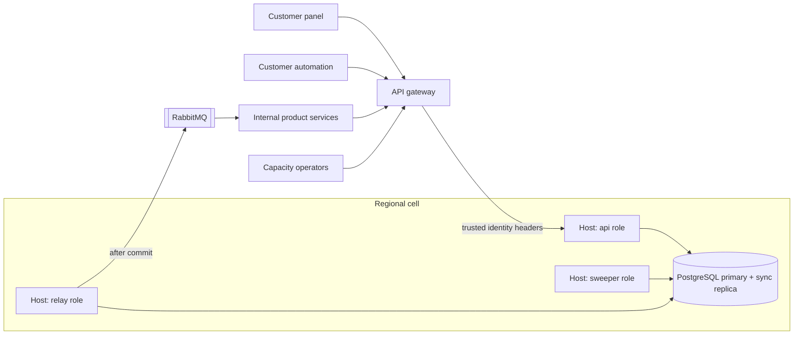
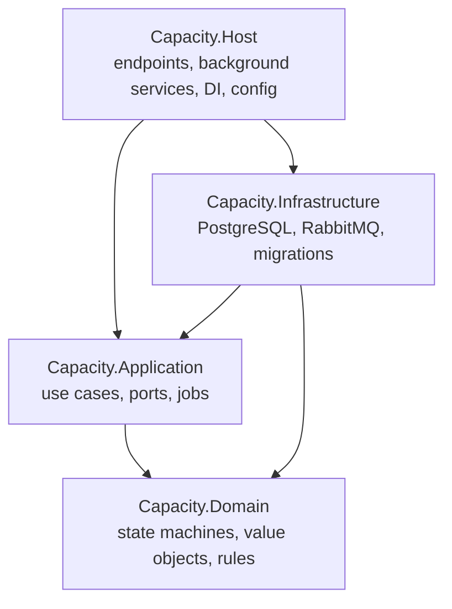

# Backend Architecture

One ASP.NET Core service (.NET 10), structured as a clean architecture, backed by one PostgreSQL database per regional cell. It runs in three roles (`api`, `sweeper`, `relay`) from the same build. RabbitMQ receives events after commit and is never on the decision path.

Related: [ADR-0010 modular monolith](../adr/0010-modular-monolith.md) · [ADR-0023 clean architecture](../adr/0023-clean-architecture.md) · [load model](load-model.md)

## 1. Context



- The gateway authenticates and passes `X-Customer-Id`, `X-Actor-Kind` and `X-Actor-Id` ([A-16](../prd/PRD.md#7-assumptions)).
- Every write path ends in one PostgreSQL transaction. A RabbitMQ outage delays events; it never blocks a reservation.

## 2. Layers and the dependency rule



| Layer | May depend on | Must not contain |
| --- | --- | --- |
| Domain | Nothing (BCL only) | I/O, time sources, frameworks, SQL |
| Application | Domain | SQL, HTTP, broker clients, `DateTime.UtcNow` |
| Infrastructure | Application, Domain | Business rules other than the SQL that enforces an invariant declared by a port |
| Host | All | Business rules |

The rule is enforced by project references and by an architecture test (NetArchTest) that fails the build on a violation.

## 3. Solution layout

```
src/
  Capacity.Domain/
    Reservations/        Reservation aggregate, RequestStateMachine, ReservationStatus, ReasonCode
    Capacity/            ResourceStateMachine, CapacityBucket, ShortageClassifier, SellableCapacity
    Catalog/             ProductPolicy, ResourceClass, Region, Zone
    Common/              Quantity, CustomerId, DomainError, Result<T>
  Capacity.Application/
    Abstractions/        IUnitOfWork, IReservationRepository, ICapacityLedger, ICatalog,
                         IIdempotencyStore, IEventRecorder, IEventPublisher
    Reservations/        Submit, Confirm, Cancel, Extend, Release, Get, List (one folder each)
    Capacity/            GetCapacityLevels, FitCheck
    Admin/               Pools, Inventories, Products, Quotas, ReconciliationReport
    Jobs/                ExpireHolds, TimeOutWaiting, PromoteWaiting, RelayEvents,
                         PurgeIdempotencyKeys, ReconcileLedger
  Capacity.Infrastructure/
    Postgres/            Dapper repositories, SQL files, NpgsqlDataSource, DbClock
    Migrations/          DbUp scripts (0001_*.sql …)
    Messaging/           RabbitMqPublisher
    Caching/             Catalog cache, sold-out negative cache
  Capacity.Host/
    Endpoints/           Minimal API groups: reservations, capacity, admin
    Http/                Identity header binding, Problem Details mapping, rate limiting
    Workers/             SweeperService, RelayService (BackgroundService)
    Program.cs           Role selection, DI, OpenTelemetry
tests/
  Capacity.Domain.Tests/         Exhaustive state-machine tables, classifier, quantity rules
  Capacity.Application.Tests/    Use cases against in-memory fakes of the ports
  Capacity.IntegrationTests/     Testcontainers: PostgreSQL and RabbitMQ; concurrency and recovery
  Capacity.ArchitectureTests/    Dependency rule
load/
  k6/                            Hot-row and scarce-burst scenarios
```

No mediator library: each use case is a plain handler class registered in DI. Handlers are few, and direct calls keep the transaction boundary visible.

## 4. Domain layer

Pure C#; every method takes `now` as an argument.

| Type | Responsibility |
| --- | --- |
| `Reservation` | Aggregate root. Holds stored status, deadlines, lines and version. Methods `Confirm(now)`, `Cancel(now)`, `Extend(now, policy)`, `Expire(now)`, `TimeOut(now)`, `Promote(now, policy)`, `Release()` return a `Transition` or a `DomainError`. `EffectiveStatus(now)` computes the status a reader sees. |
| `RequestStateMachine` | The transition table of the [request DFA](../specs/02-request-state-machine.md). `Reservation` delegates to it; tests enumerate every (state, event) pair. |
| `ResourceStateMachine` | The [resource DFA](../specs/03-resource-state-machine.md): which counter moves to which on each event, given the pool's admin state. |
| `SellableCapacity` | `floor((total − reserved) × allocation_ratio)`. The single definition the SQL mirrors. |
| `ShortageClassifier` | Given a capacity snapshot and a requested quantity, returns `EXCEEDS_REGISTERED_CAPACITY`, `CAPACITY_SOLD_OUT` or `CAPACITY_TEMPORARILY_UNAVAILABLE` ([spec](../specs/04-capacity-allocation.md#5-shortage-classification)). |
| `Quantity`, `ResourceLine` | Integer quantities in base units; `min_unit`, `step_size`, `max_unit` validation. |
| `DomainError` | Stable codes that the host maps to Problem Details. |

## 5. Application layer

Each use case opens exactly one transaction through `IUnitOfWork`, reads `now` from it, calls the domain, and persists through ports. The single exception is the shortage retry in Submit ([§8.4](#84-the-one-two-transaction-path)).

### Ports

| Port | Contract |
| --- | --- |
| `IUnitOfWork` | Begins a READ COMMITTED transaction; exposes `Now` (the database transaction timestamp); commit or rollback. |
| `IReservationRepository` | Insert; `GetForUpdate(id, customerId)` locks one reservation row; `Update(reservation, expectedVersion)`; `ListByCustomer`; `LockExpiredHolds(limit)` and `LockTimedOutWaiting(limit)` with SKIP LOCKED; `LockWaiting(region, product, limit)`. |
| `ICapacityLedger` | The only component allowed to change `held` and `used`. `TryHold(plan)` applies all lines and quota rows or none, never exceeding sellable capacity or quota; returns `Held` or `Shortage(lines)`. `Commit`, `Return`, `Release` move counters and write ledger rows. Locks in the [global order](#83-global-lock-order). |
| `ICatalog` | Products, policies, pools and inventory snapshots; cached for 2 s. |
| `IIdempotencyStore` | `Begin(customer, key, operation, hash)` → `New`, `Replay(response)` or `Mismatch`; `Complete(response)`. Same transaction as the use case. |
| `IEventRecorder` | Appends a row to `reservation_events` in the current transaction (history and outbox). |
| `IEventPublisher` | Used only by the relay job; publishes to RabbitMQ with publisher confirms. |

### Use cases

| Use case | Actor | Transaction |
| --- | --- | --- |
| SubmitReservation | Customer, service | New row; quotas; inventories |
| ConfirmReservation | Customer, service | Reservation row; quotas; inventories |
| CancelReservation | Customer, service | Reservation row; quotas; inventories (if held) |
| ExtendReservation | Customer, service | Reservation row only |
| ReleaseAllocation | Service, admin | Reservation row; quotas; inventories |
| GetReservation, ListReservations | Customer, service | Read-only, via `reservation_effective` |
| GetCapacityLevels, FitCheck | Customer, service, admin | Read-only, cached snapshot |
| Admin use cases | Admin | Pool or inventory row |
| ExpireHolds, TimeOutWaiting, PromoteWaiting | Sweeper | Batch of reservations; quotas; inventories |
| RelayEvents | Relay | Batch of unpublished events |
| ReconcileLedger | Sweeper (hourly) | Read-only report |

## 6. Infrastructure layer

| Adapter | Implementation |
| --- | --- |
| Database access | `NpgsqlDataSource`; Dapper for mapping; SQL in embedded `.sql` files reviewed like code ([ADR-0013](../adr/0013-data-access-npgsql-dapper.md)) |
| Hold path | One `NpgsqlBatch`: quota updates and inventory updates, sorted, in one round trip |
| Clock | `DbClock` returns the transaction's `now()`; application code never reads the host clock |
| Migrations | DbUp, run by `Capacity.Host migrate` before roles start |
| Broker | RabbitMQ.Client with publisher confirms, topic exchange `capacity.events` |
| Caching | `IMemoryCache`: catalog 2 s, sold-out negative cache 1 s per (pool, class) |

## 7. Host and runtime roles

| Role | What runs | Instances |
| --- | --- | --- |
| `api` | Minimal API endpoints, Problem Details, rate limiter, OpenAPI | 3+, stateless |
| `sweeper` | `SweeperService`: expire, time out, promote, purge keys, hourly reconciliation | 2 (SKIP LOCKED makes duplicates safe) |
| `relay` | `RelayService`: outbox to RabbitMQ | 2 (SKIP LOCKED) |

The role is chosen by `Capacity__Roles` (for example `api` or `api,sweeper,relay` locally). One image, one build.

Health: `/health/live` (process) and `/health/ready` (database reachable, migrations at the expected version).

## 8. Where correctness lives

Clean architecture puts rules in the domain. Capacity counters under concurrency cannot be checked in application memory: two requests would both see "1 left". The design splits the rules by what they touch.

### 8.1 Rules on one aggregate: domain, on a locked row

Request transitions depend on one reservation. The use case locks that row (`SELECT … FOR UPDATE`), the domain decides with the transaction's `now`, and the repository writes with a version check. The lock makes "decide in C#, write in SQL" race-free, and the row is not contended (one reservation, one caller).

### 8.2 Rules across aggregates: a port contract, enforced in SQL

Counters on inventory and quota rows are shared by every request. `ICapacityLedger` declares the invariant (`held + used ≤ sellable`, `held + used + q ≤ quota_limit`). The adapter enforces it with one conditional `UPDATE … WHERE held + used + @q <= …` per row, backed by a `CHECK` constraint. The domain owns the formula (`SellableCapacity`); an integration test runs random operations and asserts SQL and domain agree.

### 8.3 Global lock order

Every writer takes locks in this order: **reservation rows → quota rows (customer, class, region) → inventory rows (pool, class)**. The hold path, confirm, cancel, release and the sweeper all follow it. No deadlock cycle is possible ([C-2](../edge-cases/edge-cases.md#1-concurrency-on-capacity)).

### 8.4 The one two-transaction path

When a hold finds a shortage, expired-but-unsettled holds on the same pools may be the cause. Finalizing them inside the hold transaction would lock reservation rows after inventory rows and break the lock order. So Submit rolls back, runs one short finalization transaction for those pools (normal order), and retries the hold once.

### 8.5 Submit flow

```mermaid
sequenceDiagram
    participant C as Client
    participant A as api role
    participant D as PostgreSQL
    C->>A: POST /v1/reservations (Idempotency-Key)
    A->>D: BEGIN; now()
    A->>D: INSERT idempotency key (blocks on concurrent duplicate)
    alt key already completed
        D-->>A: stored response
        A-->>C: same response
    else new key
        A->>A: validate lines, policy, cooldown, hold limit
        A->>D: SAVEPOINT; conditional UPDATEs: quotas, then inventories (one batch)
        alt all rows updated
            A->>D: INSERT reservation HELD, lines, ledger HOLD, event
        else shortage
            A->>D: ROLLBACK TO SAVEPOINT; read snapshot; classify
            A->>D: INSERT reservation REJECTED or WAITING, event
        end
        A->>D: complete idempotency key; COMMIT
        A-->>C: 201 HELD / 202 WAITING / 409 or 422 Problem Details
    end
```

### 8.6 Expiry flow

```mermaid
sequenceDiagram
    participant S as sweeper role
    participant D as PostgreSQL
    loop every 1 s
        S->>D: BEGIN; SELECT HELD WHERE expires_at <= now() LIMIT 200 FOR UPDATE SKIP LOCKED
        S->>D: decrement quotas (sorted), then inventories (sorted)
        S->>D: UPDATE reservations SET EXPIRED; INSERT ledger RETURN rows; INSERT events
        S->>D: COMMIT
        S->>D: PromoteWaiting for affected (region, product)
    end
```

## 9. Growth path

Nothing here changes the API contract or the state machines.

| Need | Change | Trigger |
| --- | --- | --- |
| High availability | CloudNativePG cluster: primary, one synchronous standby out of two, PgBouncer | First production day |
| More holds on one hot row | Split pools per cluster; data change only | Sustained > 150 holds / s on one row |
| Even more | Escrow: split one pool's capacity into independent slices | > 300 holds / s on a pool that cannot be split further |
| More reads | Read replica and Redis for the shared sold-out cache and rate limits | > 5,000 reads / s or > 10 api instances |
| Region isolation | One cell (database and roles) per region; gateway routes by region | SLO per region, or a fourth region |
| History volume | Monthly partitions on ledger and events; archive after 13 months | Ledger > 50M rows |
| Event volume | Relay replaced by CDC on `reservation_events` | Several thousand events / s |
| Global quotas | Control plane that escrows each region's share | Contract that spans regions |

## 10. Cross-cutting concerns

| Concern | Approach |
| --- | --- |
| Errors | `DomainError` and port outcomes map to RFC 9457 Problem Details with a stable `code` ([API spec](../specs/01-api.md#6-errors)) |
| Validation | Request shape at the endpoint; quantities and policy in the domain |
| Time | Only the database clock is used in decisions |
| Configuration | `appsettings.json` plus environment variables; region and resource-class definitions are configuration ([deployment spec](../specs/12-configuration-and-deployment.md)) |
| Observability | OpenTelemetry traces, Prometheus metrics, structured JSON logs ([spec](../specs/10-observability.md)) |
| Security | Identity from trusted headers; customer id in every query; admin endpoints require `X-Actor-Kind: ADMIN` |
