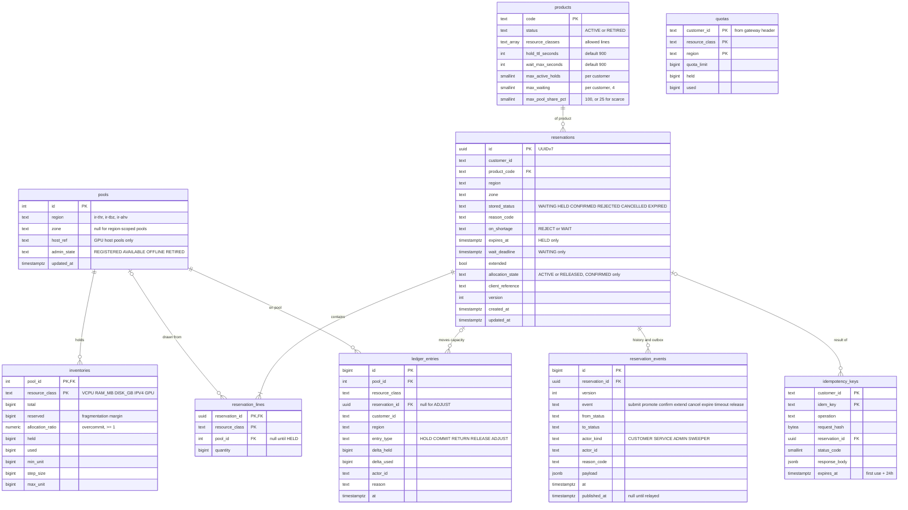

# Database

Nine tables and one view on PostgreSQL 17. Everything that exists only for the real multi-region environment is in the [growth path](#8-growth-path-to-the-real-environment), not in the schema. Related: [ADR-0024](../adr/0024-lean-data-model.md), [ADR-0012](../adr/0012-database-postgresql.md), [ADR-0003](../adr/0003-ledger-and-counters.md).

Three things are kept despite the small size, because correctness depends on them:

- **Append-only ledger:** without it, behaviour after recovery cannot be explained.
- **Idempotency keys:** without them, client retries create duplicate reservations.
- **Counters with `CHECK` constraints:** without them, "no oversell" depends only on code being right.

All quantities are integers in the resource class's base unit (millicores, megabytes, units).

## 1. ERD

## 2. Tables

| Table | Role | Rows at the estimated load |
| --- | --- | --- |
| `pools` | Unit of capacity; region and zone are text, validated against configuration | < 50 |
| `inventories` | Counters of the [resource DFA](../specs/03-resource-state-machine.md) per (pool, class) | < 100 |
| `products` | Catalog and policy in one row | ~30 |
| `quotas` | Contract limit per (customer, class, region) | ~30k customers × classes used |
| `reservations` | [Request DFA](../specs/02-request-state-machine.md): stored status and deadlines | ~18M per year |
| `reservation_lines` | Resource lines; `pool_id` set when the request is held | ~4 per reservation |
| `reservation_events` | Transition history and transactional outbox ([spec 08](../specs/08-events.md)) | ~3 per reservation |
| `ledger_entries` | Every change of `held` or `used`; source of truth | ~200M per year |
| `idempotency_keys` | Stored responses for retries ([spec 06](../specs/06-idempotency.md)) | ~150k (24 h window) |

## 3. View

`reservation_effective` adds `effective_status`, `effective_reason_code` and `settled`, computed from `stored_status`, the deadlines and the database `now()`. All API reads go through it. Definition in [spec 05 §2](../specs/05-expiry-and-effective-state.md#2-effective-status).

## 4. Constraints

| Table | Constraint | Edge case |
| --- | --- | --- |
| `inventories` | `CHECK (held >= 0 AND used >= 0 AND held + used <= floor((total - reserved) * allocation_ratio))` | C-1, C-11 |
| `inventories` | `CHECK (allocation_ratio >= 1 AND reserved >= 0 AND reserved <= total)`; `min_unit > 0`; `step_size > 0`; `max_unit >= min_unit` | C-11, D-1 |
| `quotas` | `CHECK (held >= 0 AND used >= 0)`. The limit is deliberately not a `CHECK`; it is a condition of the hold `UPDATE`, so contracts can shrink below usage | Q-1, Q-2 |
| `reservations` | `CHECK` tying status to columns: `HELD` ⇒ `expires_at` not null; `WAITING` ⇒ `wait_deadline` not null; `allocation_state` not null ⇔ `CONFIRMED` | T-7 |
| `reservations` | Partial unique `(customer_id, client_reference) WHERE stored_status IN ('WAITING','HELD','CONFIRMED')` | R-4 |
| `reservation_lines` | `CHECK (quantity > 0)`; primary key `(reservation_id, resource_class)` prevents duplicate classes | D-1, D-2 |
| `idempotency_keys` | Primary key `(customer_id, idem_key)` | R-1, R-2 |
| `ledger_entries` | Application role has `INSERT` only; no `UPDATE` or `DELETE` grants | F-11 |
| All reservation queries | `customer_id` in every `WHERE` | D-4 |

## 5. Indexes

| Index | Used by |
| --- | --- |
| `reservations (expires_at) WHERE stored_status = 'HELD'` | Sweeper, inline finalizer, effective free capacity |
| `reservations (region, product_code, created_at) WHERE stored_status = 'WAITING'` | FIFO promotion |
| `reservations (wait_deadline) WHERE stored_status = 'WAITING'` | Wait timeout |
| `reservations (customer_id, created_at DESC, id)` | History with cursor |
| `reservations (customer_id, product_code, updated_at) WHERE stored_status = 'EXPIRED'` | Cooldown |
| `reservation_lines (pool_id, resource_class)` | Pool share cap; finalizing expired holds on a pool |
| `reservation_events (id) WHERE published_at IS NULL` | Relay |
| `reservation_events (reservation_id, version)` | History of one reservation |
| `ledger_entries (pool_id, resource_class)` | Reconciliation |
| `idempotency_keys (expires_at)` | Purge |

## 6. Storage settings

- `inventories`: `fillfactor = 50` so updates stay HOT; `autovacuum_vacuum_scale_factor = 0`, `autovacuum_vacuum_threshold = 1000`. It has under 100 rows but is the most updated table.
- Reservation ids are UUIDv7 (`Guid.CreateVersion7()`): time-ordered, so inserts do not scatter the index, and not guessable across customers.

## 7. Two rules enforced without extra tables

- **Pool share cap.** The customer's quota row is locked first by a conditional `UPDATE`; the share query on `reservation_lines` runs after. All of one customer's requests for that class and region serialize on that row, so two parallel requests cannot both pass the cap ([spec 07 §4](../specs/07-quotas-and-fairness.md#4-pool-share-cap)).
- **Cooldown.** A count of the customer's `EXPIRED` reservations for the product in the last hour, served by a partial index. A race at the window edge lets at most one extra hold through, which cannot oversell.

## 8. Growth path to the real environment

No step changes the API or the state machines.

| Real-environment need | Data change | Trigger |
| --- | --- | --- |
| High availability | Synchronous standby (one of two), no schema change ([ADR-0018](../adr/0018-postgresql-high-availability.md)) | First production day |
| History volume | Monthly partitions on `ledger_entries` and `reservation_events`, created three months ahead plus a default partition; archive after 13 months | Ledger > 50M rows |
| One cell per region | One database per region; `region` is already the split key | SLO per region, or a fourth region |
| Region, zone and class managed through an admin panel | Text columns become reference tables with foreign keys | When their definition leaves configuration |
| Hierarchical or global quotas | `customers` and `organizations` tables; quota scope column; escrow per region for global limits | Organisation-wide or cross-region contracts |
| Hot row | Pools split per cluster or host; data only | > 150 holds / s on one row |
| Event volume | Relay replaced by CDC on `reservation_events` | Several thousand events / s |
| Capacity planning analytics | `unmet_demand` table fed from `CAPACITY_SOLD_OUT` events | When planning needs history beyond metrics |
