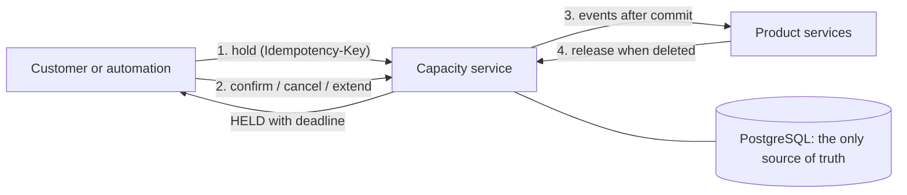

# Start here

> **This is a code and architecture challenge, not a live product.**
> Nothing here runs in production and no real traffic exists. The goal of this guide is to show reviewers **how I designed it, why I chose each trade-off, and what limits I worked under.**

## The one-minute version

A cloud provider sells VMs, GPUs, IPs and managed services in several regions. Before building a service it must be sure the capacity exists, and often keep that capacity aside for a few minutes.

I built the **backend core of a capacity reservation service**:

- A customer **holds** several resources at once. All of them are held, or none are.
- The hold is a **lease** with a deadline. The customer confirms it, cancels it, or lets it expire.
- Capacity is **never sold twice**, even under heavy concurrency. The database enforces this, not just the code.
- Retries are safe: the same request sent twice gives the same answer.
- After any crash, every number can be **explained from an append-only ledger**.

## My position in seven sentences

1. The real problem is a **ledger of reservations**, not a "VM service". I drew the system boundary there.
2. I **never oversell**. When something is unclear, the system refuses instead of guessing.
3. The decision to hold is **synchronous and local**: one database transaction, about 5 ms of lock time.
4. Correctness lives **in the database** (conditional updates, `CHECK` constraints, a fixed lock order), because two requests in application memory both see "1 left".
5. Every waiting state **has a deadline**, so abandoned work always returns its capacity.
6. I **kept the first version small**: one PostgreSQL, one binary, no Redis, no workflow engine. Each omission has a measurable trigger for adding it back.
7. I **tested the hard parts on a real PostgreSQL**, and I report load-test results even where they miss my own target.

## My constraints

| Constraint | Effect on the design |
| --- | --- |
| The challenge text is intentionally incomplete and the team does not answer questions | Every ambiguity became an **explicit written assumption** (20 of them) |
| No real traffic numbers | I built a **hypothetical load model** and measure real limits with k6 |
| Challenge scope, not a platform | I delivered the **correctness path completely** and documented scale and HA as design only |
| One developer, one laptop | Load results come from **one laptop VM**; they show shape, not production capacity |
| Evaluators run it themselves | **One command** (`make up`), tests on real PostgreSQL through Testcontainers |

## How to read this guide

| If you have | Read |
| --- | --- |
| **5 minutes** | This page, then [Solution overview](#03-solution-overview) |
| **20 minutes** | Add [Core logic](#07-core-logic), [Idempotency](#08-idempotency) and [Rate limits](#09-rate-limits-fairness) |
| **An hour** | Everything in order. The *Decisions* chapter links every choice to its rejected alternatives |

## Map of this guide

| Group | Chapters |
| --- | --- |
| **Why** | Problem · Assumptions and constraints |
| **What** | Solution overview · Decisions (ADRs) |
| **How it is built** | Data model · State machines · Core logic · Idempotency · Rate limits and fairness · Code structure |
| **Proof** | Edge cases · Testing and coverage · Load test |
| **Honesty** | Trade-offs and growth path |

> The full source documents (PRD, 24 ADRs, 12 specs, database, edge cases) stay in the sibling folders under `docs/`. This guide is the readable summary of them.
