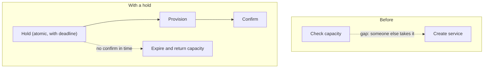

# The problem

## What the brief describes

A cloud provider sells several products (VMs, managed services, GPUs, public IPs) in several regions. Before some services are created, the provider must check that the request can be served, and sometimes keep that capacity aside for a short time while the service is built.

Today this is split across tools and manual steps. As customers and products grow, three failures appear.

## Three symptoms, three root causes, three guarantees

| What goes wrong | Root cause | What this service guarantees |
| --- | --- | --- |
| The customer **sees capacity, but it is gone** when the service is created | Checking and taking are two separate steps | An atomic, time-limited **hold**, taken in one transaction |
| The outcome is unclear, so the customer **sends the request again** | No durable request state, no deduplication | A durable **state machine** and **idempotency** on every mutation |
| A process **starts and never finishes** | Nobody owns abandoned work | Every intermediate state has a **deadline**; capacity always comes back |

## What the brief asks the customer to be able to do

| # | Capability | Where it lives |
| --- | --- | --- |
| 1 | View product capacity status | `GET /v1/capacity` (levels) and `POST /v1/capacity/fit-check` |
| 2 | Submit a capacity request | `POST /v1/reservations` |
| 3 | Track the request status | `GET /v1/reservations/{id}` |
| 4 | Complete or cancel the allocation | `confirm`, `cancel`, `extend`, and `release` for product services |
| 5 | View previous requests | `GET /v1/reservations` (newest first, filtered, paged) |

## Goals

| ID | Goal | How it is measured |
| --- | --- | --- |
| G-1 | Never sell the same capacity twice | Oversell incidents = 0; ledger vs counter drift = 0 |
| G-2 | Every request has one deterministic, queryable outcome | A retry with the same key returns the same result |
| G-3 | Abandoned requests never hold capacity | Expired-hold release lag p99 < 5 s |
| G-4 | Behaviour after any outage is explainable | Every counter is rebuildable from the append-only ledger |
| G-5 | Fast enough to sit in the service-creation path | Hold p99 < 150 ms; availability 99.95% |
| G-6 | New products and resources need no code change | Adding a product or resource class is a data change |

## Non-goals

These were excluded by the brief or by my scope:

- Graphical UI, authentication and user management, billing, real VM or infrastructure creation, real multi-region deployment.
- **Placement** on physical hosts (bin-packing). The service counts capacity; a scheduler places it.
- **Orchestrating** service creation. Product services provision and call confirm, cancel and release.
- Customer-facing webhooks. Events are internal.

## Who uses it

| User | Needs |
| --- | --- |
| Customer in the panel | Clear messages; never told "available" for something that cannot be had |
| Customer automation (Terraform, scripts) | Idempotency, machine-readable error codes, `Retry-After` |
| Internal product services (VM, DBaaS, IP) | Safe, fast confirm and release; events on state change |
| Capacity operators | Admin API to register pools, set overcommit, set quotas; a drift report |

## The hard part in one sentence

> Many callers want the **last unit** at the same moment, across **several resources at once**, while clients retry, processes crash and timers fire, and the answer must still be exactly right.
