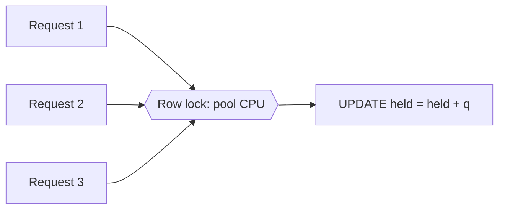

# Assumptions and constraints

## Why this chapter matters

The challenge text is deliberately incomplete, and the team does not answer questions. So the reviewer is really judging **which gaps I noticed, what I would have asked, and how I justified each answer.**

Every ambiguity became a written assumption (`A-1` … `A-20` in the PRD). Each one also says **what would change if the reviewer assumed something else.**

## The decision framework: three levels

For every ambiguity I wrote three options, then chose one.

| Level | Meaning |
| --- | --- |
| **1 – Weak** | Works while load and concurrency are low. Wrong under contention or failure. |
| **2 – Middle** | Correct. Works on one regional cell for tens of times the estimated load. Does not block level 3. |
| **3 – Mature enterprise** | Needed for large scale, many regions or complex organisations. High operational cost. |

> **My rule.** Where *correctness* is at risk (oversell, idempotency, audit) I take level 2 in full, or higher. Where only *scale* is at risk I take level 2 and write the **numeric trigger** for moving to level 3.

## The six assumptions that shape the architecture

| # | Question | If the answer differs | My decision |
| --- | --- | --- | --- |
| 1 | Who owns physical capacity truth? | If external, this is a facade, not a ledger | This service owns **sellable** capacity. Physical capacity enters through the admin API |
| 2 | Do we orchestrate service creation? | Changes the boundary and needs a workflow engine | **Reservation only.** Provisioning belongs to other services |
| 3 | Who reports deletion and capacity return? | Without it accounting never closes | A **release** API plus periodic reconciliation |
| 4 | At what level does capacity make sense? | Simple counter vs real bin-packing | CPU, RAM, disk per **zone**; IP per **region**; GPU per **host** |
| 5 | In a partial outage, refuse or accept with oversell risk? | CAP position | **Never oversell.** The service itself fails closed |
| 6 | What are the real numbers? | Every threshold | A **hypothetical scenario**, measured later with k6 |

## The smaller assumptions

| ID | Assumption |
| --- | --- |
| A-7 | Hold TTL is per product: default **15 minutes**, range 2–60, **one** extension |
| A-8 | Overcommit is an `allocation_ratio` per inventory, set by operators |
| A-9 | The service **counts units**; it does not pick which IP or GPU |
| A-10 | Requests are **all-or-nothing**; a rejection says which line was short |
| A-11 | Quotas are **hard**, per (customer, resource class, region) |
| A-12 | **Open holds count against quota**, so parallel requests cannot dodge a contract |
| A-13 | No dedicated enterprise pools in v1; the pool model leaves room for them |
| A-14 | Customers see a **level** (`AVAILABLE`, `LIMITED`, `UNAVAILABLE`) plus a fit-check; exact numbers are for internal callers |
| A-15 | Availability 99.95%, hold p99 below 150 ms |
| A-16 | The gateway authenticates and passes trusted identity headers |
| A-17 | Events are internal, published through an outbox; no webhooks |
| A-18 | History stays online for 13 months, then is archived |
| A-19 | A request targets **exactly one region** |
| A-20 | Waiting is **opt-in**, only for temporary shortages, at most 15 minutes |

## The load model (hypothetical, on purpose)

There are no real figures, so I built an internally consistent scenario. **Every threshold in the ADRs derives from it**, and the k6 results replace it where they disagree.

| Quantity | Estimate | Basis |
| --- | --- | --- |
| Active IaaS customers | ~30k (range 15k–60k) | Growth from ~25k total customers in a public incident report |
| Live VMs | ~100k | ~3 VMs per customer |
| Reservation requests per day | ~50k | 5% daily VM churn ×2 other products ×4 automation |
| Average rate | 0.6 / s | 50k ÷ 86,400 |
| **Hourly peak** | **~6 / s** | 10× average |
| Burst on one scarce product | 200–300 / s for 1–2 min | GPU launch or a retry storm |
| Lines per request | avg 4, max 16 | CPU, RAM, disk, IP |
| Concurrent active holds | ~5,400 at peak | rate × 15-minute TTL |
| Capacity reads | ~100 / s peak | 10–20× writes, cacheable |
| Data growth | ~18M requests, ~200M ledger rows, 60–100 GB per year | ~3 ledger rows per line |

### Design targets

| Target | Value | Compared to estimate |
| --- | --- | --- |
| Sustained holds per regional cell | **500 / s** | ~80× the hourly peak |
| Availability (hold and confirm) | 99.95% | ~22 min downtime a month |
| Hold latency | p99 < 150 ms | |
| RPO for confirmed reservations | **0** | synchronous replication |
| RTO | < 60 s | automatic failover |
| Expired-hold release lag | < 5 s | |

## The real bottleneck: one hot row

The ceiling is **not** PostgreSQL's total throughput. It is the **lock on one inventory row**: every VM created in Tehran locks the same CPU row of that pool.

- Lock time with one round trip and a synchronous commit: about **3–5 ms**.
- Theoretical ceiling for one row: **200–300 holds/s**. Safe working limit: **~150/s**.
- The estimated peak is 6/s, so a single pool has about **25× headroom**.
- To reach 500/s per cell, load must spread over **at least 4 pools** (split by zone or cluster). That is a data change, not a code change.

> The numbers above are my **estimates**. The [load test](#13-load-test) is where they meet reality. On one laptop Docker VM, a hold first took 28 round trips, not one, and a single row broke well below 150/s. After batching the writes and locking the row last (9 round trips), granted holds on one row stayed under 150 ms p99 up to 200/s in those runs and broke between 200 and 300/s. These are laptop measurements, not production figures.

## Rejected as out of scope on purpose

| Not built | Why |
| --- | --- |
| Hierarchical or global quotas | No requirement in the brief; written as growth step 7 |
| Bin-packing placement | The service counts; schedulers place (fragmentation is a known open risk) |
| Webhooks, CDC | Internal outbox events are enough for v1 |
| Real HA / multi-region | Described in ADRs; the schema already carries `region` so it needs no migration |
