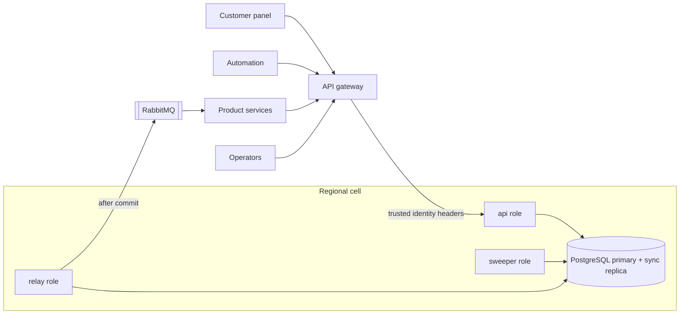
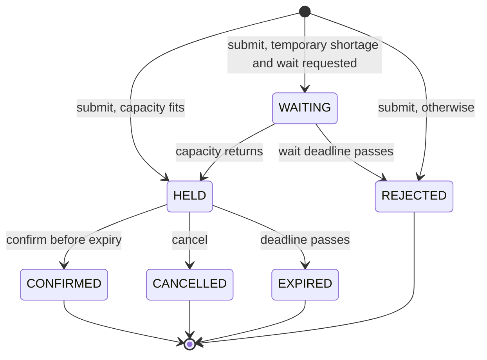

# Solution overview

## The design in six lines

1. A **modular monolith** on ASP.NET Core (.NET 10). The only stateful dependency on the correctness path is **PostgreSQL 17**.
2. An **append-only ledger** is the source of truth. Counters are derived from it **inside the same transaction**.
3. The hold decision is **synchronous** and made in **one local transaction**. A request is a durable state machine with a lease and lazy expiry.
4. The unit of deployment is a **regional cell**. Every transaction touches exactly one region, so splitting regions later needs no schema change.
5. Design target: **500 holds/s per cell**, against an estimated peak of ~6/s (about 80× margin).
6. Events leave through a **transactional outbox**. RabbitMQ is never on the decision path.

## System context



- The gateway authenticates and passes `X-Customer-Id`, `X-Actor-Kind`, `X-Actor-Id`.
- Every write path ends in **one PostgreSQL transaction**. A RabbitMQ outage delays events; it never blocks a reservation.

## Three runtime roles, one image

| Role | Job | Instances |
| --- | --- | --- |
| `api` | HTTP endpoints, rate limiter, OpenAPI | 3+, stateless |
| `sweeper` | Expire holds, time out waits, promote waiters, purge idempotency keys, hourly reconciliation | 2 (safe because of `SKIP LOCKED`) |
| `relay` | Move outbox rows to RabbitMQ | 2 (`SKIP LOCKED`) |

No state lives outside the database, so **any instance can be killed at any time**.

## A reservation's life, at a glance



Worst case with defaults: 15 min waiting + 15 min held + one 15 min extension = **45 minutes**. After that every request is in a final state and its capacity is back.

## The three shortage answers

A shortage is not one error. The caller needs to know whether retrying can ever help.

| Code | Meaning | Retry helps? |
| --- | --- | --- |
| `EXCEEDS_REGISTERED_CAPACITY` (422) | Bigger than any pool could ever provide | **Never** |
| `CAPACITY_SOLD_OUT` (409) | Fits in theory, but live allocations fill it | Not on a known timescale |
| `CAPACITY_TEMPORARILY_UNAVAILABLE` (409 + `Retry-After`) | Short only because of open holds or an offline pool | **Yes, within one TTL** |

Only the third can become `WAITING`, and only when the client sends `on_shortage = WAIT`.

## What was built vs only designed

| Topic | In the delivered code | Design document only |
| --- | --- | --- |
| Five customer capabilities | All five, plus `release` and `fit-check` | |
| Ledger, counters, quotas | Complete, with `CHECK` constraints | Hierarchical and global quotas |
| Idempotency | Complete | |
| Expiry | Sweeper, lazy (effective) expiry, lease extension | Time-bucketed expiry |
| Events | Outbox and relay; RabbitMQ in an optional profile | CDC, webhooks |
| Recovery | `reconcile` command and a kill test | Reconcile against real inventory |
| Demo data | 3 regions, ~10 products, customers with quotas | |
| HA and multi-region | `region` in schema and every transaction | Patroni/CloudNativePG, cells, global control plane |
| Authentication | Trusted headers for identity | Gateway and RBAC |
| Load testing | k6 scripts and a committed run on a laptop | Benchmark on production hardware |

> The brief asked for correctness on the core path. I put the depth there and documented the rest.

## Run it

```bash
make up      # PostgreSQL, RabbitMQ, migrations, api, sweeper, relay, demo data
make demo    # walks through every outcome with curl
make test    # unit, integration (Testcontainers) and architecture tests
make load    # k6 scenarios
make down
```
