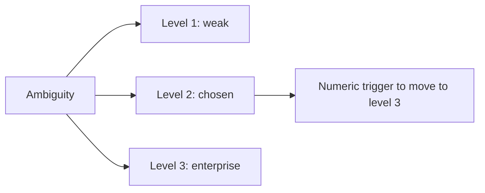

# Decisions (ADRs)

There are **24 Architecture Decision Records**. Each one states the context, the decision, the options at three maturity levels, why the others were rejected, and **the measurable condition for revisiting it**.

## How to read an ADR

## Design decisions

| ADR | Decision | The short reason |
| --- | --- | --- |
| 0001 | **Reserve only**, do not orchestrate service creation | The problem is a ledger. Orchestration would need a workflow engine and distributed transactions |
| 0002 | Resources are **pools, classes and counter-based inventories** | Counters are cheap and exact; placement is a scheduler's job |
| 0003 | **Append-only ledger** is truth; counters update in the same transaction | After an incident you must be able to explain every number |
| 0004 | **Conditional atomic `UPDATE`** in a fixed lock order | Avoids races without extra round trips or distributed locks |
| 0005 | **Synchronous hold** with a time-limited lease | A 5 ms decision does not need a queue; a queue adds "unknown" states |
| 0006 | **Idempotency key** stored in the same transaction | A retry must never create a second reservation |
| 0007 | **Quotas are counters** in the same transaction; holds count | Two parallel requests cannot both pass a contract check |
| 0008 | **Consistency over availability**, fail closed, one cell per region | Overselling is worse than refusing |
| 0009 | **Transactional outbox** merged with the event history | An event exists if and only if the state change committed |
| 0010 | **Modular monolith** with three runtime roles | One build, one image, no network between modules |
| 0021 | **Three shortage answers**; wait is opt-in and bounded | Callers need to know if retrying can help |
| 0022 | **Two state machines**; effective state computed on read | Readers always see the truth *now* |
| 0023 | **Clean architecture**; cross-aggregate rules behind a port, enforced in SQL | Keeps rules testable without losing atomicity |
| 0024 | **Lean data model**: nine tables and one view | Everything else is a documented growth step |

## Technology decisions

| ADR | Decision | The short reason |
| --- | --- | --- |
| 0011 | **C# on .NET 10** (ASP.NET Core) | Current LTS, supported until Nov 2028; strong typing for state machines |
| 0012 | **PostgreSQL 17**, the only source of truth | ACID, row locks, `CHECK`, `SKIP LOCKED`, synchronous replication |
| 0013 | **Npgsql + Dapper**, hand-written SQL, DbUp migrations | The hold path is SQL; an ORM would hide the part that matters |
| 0014 | **REST + OpenAPI** | Standard for panels and automation; gRPC stays in design only |
| 0015 | **No Redis** in v1 | One fewer dependency is one fewer failure mode |
| 0016 | **RabbitMQ** for events | Durable topic exchange; replaceable behind an interface |
| 0017 | **No workflow engine** | Seven states and two timers fit in a table and a sweeper |
| 0018 | **CloudNativePG** with synchronous replication (design) | RPO 0 for confirmed reservations |
| 0019 | **OpenTelemetry + Prometheus** | Every ADR threshold has a named metric and an alert |
| 0020 | **Docker Compose** and tests on **real PostgreSQL** | Evaluators run it in one command; mocks cannot prove locking |

## The decisions that carry the most weight

### ADR-0003 and ADR-0004: ledger plus conditional update

| Option | Verdict |
| --- | --- |
| Read free capacity, then write it in app code | Rejected. Race between two requests |
| **Conditional `UPDATE` in a local ACID transaction, fixed lock order** | **Chosen** |
| Optimistic locking with a version column | Rejected. On a hot row most attempts fail and retry storms follow |
| `SELECT … FOR UPDATE` then `UPDATE` | Rejected. The extra round trip doubles lock time |
| `SERIALIZABLE` isolation | Rejected. Serialisation failures on the hot row |
| Distributed lock in Redis | Rejected. No fencing; correctness would depend on clocks |
| Escrow, single-writer batching, distributed SQL | Deferred. Not needed at the estimated load |

**Revisit when:** sustained > 150 holds/s on one row, or lock-wait p99 > 20 ms → split pools. Over 300 holds/s on a pool that cannot be split → escrow.

### ADR-0005: synchronous hold with a lease

| Option | Verdict |
| --- | --- |
| Yes/no check with no durable state | Rejected. Nothing to track, no history |
| **Synchronous decision + durable state machine + lease** | **Chosen** |
| Asynchronous queue with priorities and webhooks | Rejected. Adds "unknown" states to a 5 ms decision, the exact problem in the brief |
| Two-phase commit with provisioning services | Rejected. A blocking coordinator |
| No hold, check only | Rejected. That *is* today's "seen but gone" |

**Revisit when:** a decision needs a human or another system (quota approval, capacity procurement).

### ADR-0006: idempotency in the same transaction

| Option | Verdict |
| --- | --- |
| No dedup, or dedupe by body hash | Rejected. Retries duplicate; two real identical requests become one |
| **Client key in the same transaction, plus `client_reference`** | **Chosen** |
| Keys stored in Redis | Rejected. A crash between Redis and the database leaves a window |

### ADR-0007: quotas in the same transaction

| Option | Verdict |
| --- | --- |
| Check in app code before the hold | Rejected. Two parallel requests both pass |
| **Quota counters in the same transaction** | **Chosen** |
| Count only confirmed allocations | Rejected. Parallel holds exceed the contract |
| Separate quota service | Rejected. Turns the hottest path into a distributed transaction |

**Revisit when:** a contract spans regions or organisations.

### ADR-0015 and ADR-0017: what I chose *not* to add

| Not added | Rejected because | Add when |
| --- | --- | --- |
| Redis | An in-process 2-second snapshot cache covers reads. It is never allowed on the correctness path | More than 10 API instances, or exact global rate limits |
| Workflow engine (Temporal, Camunda) | A multi-service cluster on the critical path for seven states | Service creation orchestration enters scope |

## Read the full records

Every complete ADR, with all options and consequences, is in the **Decisions (ADRs)** menu on the left, grouped into *Boundary and model*, *Correctness*, *Request lifecycle*, *Architecture and resilience* and *Technology*. The source files are in `docs/adr/`.
