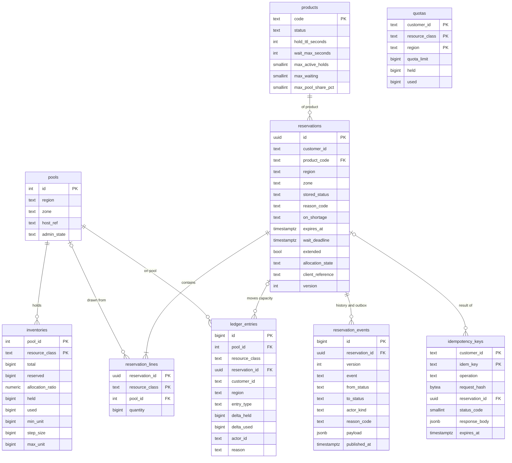
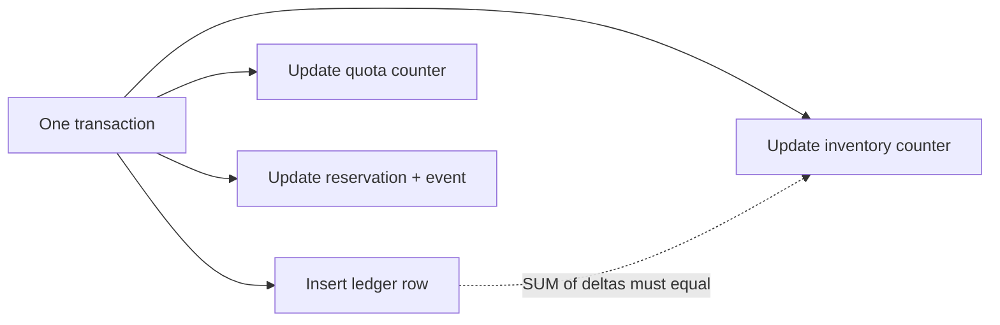

# Data model

**Nine tables and one view** on PostgreSQL 17. All quantities are integers in the resource class's base unit (millicores, megabytes, units).

Three things stay despite the small size, because correctness depends on them:

| Kept | Without it |
| --- | --- |
| **Append-only ledger** | Behaviour after recovery cannot be explained |
| **Idempotency keys** | Client retries create duplicate reservations |
| **Counters with `CHECK` constraints** | "No oversell" depends only on code being right |

## ERD



## The tables in plain words

| Table | Role | Rows at the estimated load |
| --- | --- | --- |
| `pools` | A unit of capacity. Region and zone are text | < 50 |
| `inventories` | The two counters, `held` and `used`, per (pool, class) | < 100 |
| `products` | Catalog and policy in one row (TTL, limits) | ~30 |
| `quotas` | Contract limit per (customer, class, region) | ~30k customers × classes |
| `reservations` | The request state machine | ~18M per year |
| `reservation_lines` | The resource lines of a reservation | ~4 per reservation |
| `reservation_events` | **History and outbox in one table** | ~3 per reservation |
| `ledger_entries` | Every change of `held` or `used`. **Source of truth** | ~200M per year |
| `idempotency_keys` | Stored responses for retries (24 h window) | ~150k |

> `inventories` has under 100 rows but is the **most updated** table. It uses `fillfactor = 50` so updates stay HOT, and aggressive autovacuum settings.

## The sellable-capacity formula

```text
sellable = floor( (total − reserved) × allocation_ratio )
free     = sellable − held − used          (only if the pool is AVAILABLE)
```

- `reserved` is the fragmentation margin (10% of each zone).
- `allocation_ratio` is overcommit, set by operators.

## The ledger: why it is the truth

Every change to `held` or `used` writes **one ledger row** and updates the counters **in the same transaction**.

| `entry_type` | Meaning | `delta_held` | `delta_used` |
| --- | --- | --- | --- |
| `HOLD` | Capacity put on hold | +q | |
| `COMMIT` | Hold becomes allocation | −q | +q |
| `RETURN` | Cancel or expiry gives it back | −q | |
| `RELEASE` | Allocated capacity freed | | −q |
| `ADJUST` | Operator correction (admin) | ± | ± |

An hourly **reconciliation** recomputes counters from the ledger and reports drift. The target is `driftRows: 0`.



## Constraints that protect the invariant

| Table | Constraint | Why |
| --- | --- | --- |
| `inventories` | `CHECK (held >= 0 AND used >= 0 AND held + used <= floor((total − reserved) × allocation_ratio))` | **The last line of defence against oversell** |
| `quotas` | `CHECK (held >= 0 AND used >= 0)`. The *limit* is **not** a CHECK | So a contract can shrink below current usage |
| `reservations` | `HELD` ⇒ `expires_at` not null; `WAITING` ⇒ `wait_deadline` not null; `allocation_state` not null ⇔ `CONFIRMED` | A row cannot lie about its own state |
| `reservations` | Partial unique `(customer_id, client_reference)` among open and confirmed | Second line of idempotency |
| `reservation_lines` | `quantity > 0`; PK `(reservation_id, resource_class)` | No duplicate classes |
| `idempotency_keys` | PK `(customer_id, idem_key)` | The deduplication itself |
| `ledger_entries` | The app role has **INSERT only**, no UPDATE or DELETE | The ledger really is append-only |
| every reservation query | `customer_id` in the `WHERE` | One customer cannot read another's data |

## Indexes that matter

| Index | Used by |
| --- | --- |
| `reservations (expires_at) WHERE stored_status = 'HELD'` | Sweeper, inline finalizer, effective free capacity |
| `reservations (region, product_code, created_at) WHERE WAITING` | FIFO promotion of waiters |
| `reservations (wait_deadline) WHERE WAITING` | Wait timeout |
| `reservations (customer_id, created_at DESC, id)` | History with cursor |
| `reservations (customer_id, product_code, updated_at) WHERE EXPIRED` | Cooldown |
| `reservation_events (id) WHERE published_at IS NULL` | The outbox relay |
| `ledger_entries (pool_id, resource_class)` | Reconciliation |

Partial indexes keep each one tiny: they only contain the rows the job cares about.

## The read view

`reservation_effective` adds `effective_status`, `effective_reason_code` and `settled`, computed from the stored status, deadlines and the **database** `now()`. Every API read goes through it. See [State machines](#06-state-machines).

## Reservation ids

IDs are **UUIDv7**: time-ordered, so inserts do not scatter the index, and not guessable across customers.

## Growth path (no API or state-machine change)

| Need | Data change | Trigger |
| --- | --- | --- |
| High availability | Synchronous standby | First production day |
| History volume | Monthly partitions on ledger and events; archive after 13 months | Ledger > 50M rows |
| One cell per region | One database per region (`region` is already the split key) | SLO per region, or a fourth region |
| Admin-managed catalog | Text columns become reference tables | When definitions leave configuration |
| Hierarchical or global quotas | `customers`, `organizations`; escrow per region | Org-wide or cross-region contracts |
| Hot row | Split pools per cluster or host | > 150 holds/s on one row |
| Event volume | Replace the relay with CDC | Several thousand events/s |
