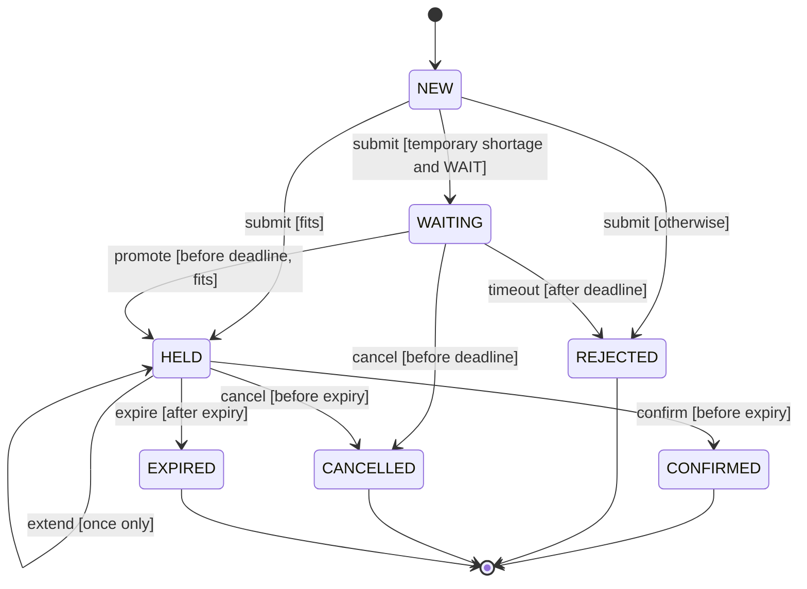
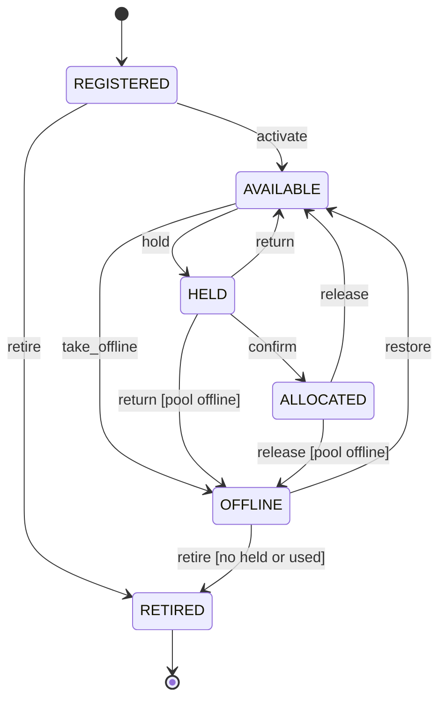
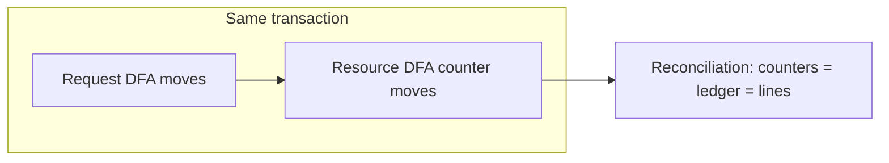
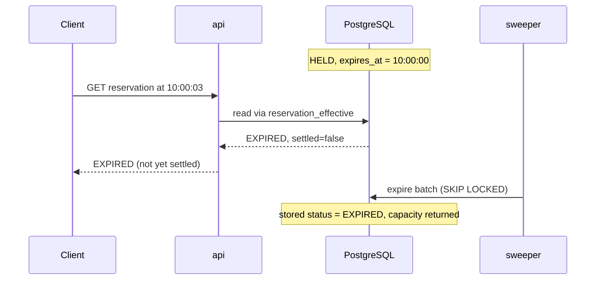

# State machines

I model the system as **two deterministic finite automata (DFAs)** that move together in one transaction.

| Machine | What it describes |
| --- | --- |
| **Request DFA** | The life of one *reservation* (the customer's request) |
| **Resource DFA** | The life of one *unit of capacity* (one core, one GPU, one IP) |

> **Try it.** Click the transitions below to walk a reservation through its life. Illegal moves are refused, exactly like the real API (409).

## 1. Request state machine

### States

| State | Kind | Stored | Deadline | Holds capacity |
| --- | --- | --- | --- | --- |
| `NEW` | Start | No (only inside the submit transaction) | | No |
| `WAITING` | Intermediate | Yes | `wait_deadline` | No |
| `HELD` | Intermediate | Yes | `expires_at` | Yes (`held`) |
| `CONFIRMED` | Final | Yes | | Yes (`used`, until release) |
| `REJECTED` | Final | Yes | | No |
| `CANCELLED` | Final | Yes | | No |
| `EXPIRED` | Final | Yes | | No |

### Diagram

### Transition table

`now` is always the **database transaction timestamp**. Any pair not listed is illegal.

| From | Event | Guard | To | Actor | Capacity effect |
| --- | --- | --- | --- | --- | --- |
| NEW | submit | All lines and quotas fit | HELD | API | AVAILABLE → HELD |
| NEW | submit | Only a temporary shortage, `on_shortage = WAIT`, wait limit not reached | WAITING | API | none |
| NEW | submit | otherwise | REJECTED | API | none |
| WAITING | promote | `now < wait_deadline` and fits | HELD | Sweeper | AVAILABLE → HELD |
| WAITING | cancel | `now < wait_deadline` | CANCELLED | Customer, service | none |
| WAITING | timeout | `now ≥ wait_deadline` | REJECTED | Sweeper | none |
| HELD | extend | `now < expires_at` and not yet extended | HELD | Customer, service | none |
| HELD | confirm | `now < expires_at` | CONFIRMED | Customer, service | HELD → ALLOCATED |
| HELD | cancel | `now < expires_at` | CANCELLED | Customer, service | HELD → AVAILABLE |
| HELD | expire | `now ≥ expires_at` | EXPIRED | Sweeper, inline finalizer | HELD → AVAILABLE |

### Why it is deterministic

- **Disjoint guards.** For each (state, event) pair, the guards split the input space. Exactly one row applies.
- **The deadline splits time in two.** Before it, only client events are legal. After it, only the timer event. A client event and the timer are **never both legal** at the same instant.
- **Termination.** Both intermediate states have a deadline, so every request reaches a final state. Default worst case: 15 + 15 + 15 = **45 minutes**.

### What every transition does (one transaction)

1. Update the reservation row with a **version check**.
2. Apply the capacity effect and write **one ledger row per line**.
3. Append one `reservation_events` row (history *and* outbox).
4. Complete the idempotency key, if the call carried one.

### Repeated or illegal events

| Situation | Response |
| --- | --- |
| Same event, same idempotency key | The stored response is replayed |
| Event already produced the current final state (confirm on CONFIRMED), new key | `200` with the current resource |
| Confirm or extend on an effectively expired hold | `409 RESERVATION_EXPIRED` |
| Anything else illegal | `409 INVALID_STATE_TRANSITION`, body includes the effective status |

## 2. Resource state machine

One *sellable capacity unit* has no row of its own. **Each state is a counter**, and a transition moves a quantity between two counters.

| State | Stored as |
| --- | --- |
| `REGISTERED` | Idle units of a pool whose `admin_state = REGISTERED` |
| `AVAILABLE` | Idle units of an available pool |
| `HELD` | `inventories.held` |
| `ALLOCATED` | `inventories.used` |
| `OFFLINE` | Idle units of an offline pool |
| `RETIRED` | Idle units of a retired pool |

### Counter moves

| Event | Trigger | Counter change |
| --- | --- | --- |
| `hold` | Request reached HELD | `held += q` |
| `confirm` | Request reached CONFIRMED | `held −= q; used += q` |
| `return` | Request CANCELLED or EXPIRED | `held −= q` |
| `release` | Service deleted, provisioning failed, or reconciler found an orphan | `used −= q` |
| `activate`, `take_offline`, `restore`, `retire` | Admin or health check | pool `admin_state` only |

### Rules

- **Only idle units change admin state.** Taking a pool offline does not touch held or allocated units; they finish their cycle and land in OFFLINE when returned.
- **No hold on a non-AVAILABLE pool.** The hold `UPDATE` requires `admin_state = 'AVAILABLE'`.
- **Shrinking capacity** below `held + used` is rejected by the `CHECK`. With `force = true` the pool goes OFFLINE first and drains.
- **Release is per reservation**, acts on `allocation_state`, and repeating it has no effect.

## 3. How the two machines stay in sync

- Every request transition and its resource transition are written **in the same transaction**. Stored states never disagree.
- `hold`, `confirm` and `return` have **no independent entry point**. They are outputs of the request DFA.
- The resource DFA's own events are `activate`, `take_offline`, `restore`, `retire` and `release`.
- The reconciliation job checks that `inventories.held` equals the sum of HELD lines, and `used` equals the sum of CONFIRMED lines with an ACTIVE allocation.

## 4. Effective state: readers always see the truth *now*

A hold whose deadline has passed is **already expired**, even if no process has stored that yet. So reads compute the status instead of trusting the stored one.

| Stored status | Condition at read | Effective status | `settled` |
| --- | --- | --- | --- |
| `HELD` | `expires_at <= now()` | `EXPIRED` (`HOLD_EXPIRED`) | **false** |
| `WAITING` | `wait_deadline <= now()` | `REJECTED` (`WAIT_TIMEOUT`) | **false** |
| anything else | | stored status | true |

Four rules make this safe:

1. **Reads never write.**
2. The **only clock is the database's `now()`**. Host clocks never enter a decision.
3. **Every write guard is the effective-status condition**, so a write can never contradict what a reader was told.
4. If the sweeper is stopped, nothing breaks. Reads still show EXPIRED, and a new hold that falls short first finalizes expired holds, then retries. **A stopped sweeper cannot cause oversell or undersell**; it only delays the stored final state.

| Writer | Guard |
| --- | --- |
| confirm, cancel, extend on HELD | `stored_status = 'HELD' AND expires_at > now()` |
| expire | `stored_status = 'HELD' AND expires_at <= now()` |
| cancel, promote on WAITING | `stored_status = 'WAITING' AND wait_deadline > now()` |
| timeout | `stored_status = 'WAITING' AND wait_deadline <= now()` |

If confirm and expiry arrive at the same instant, the **row lock serialises them**, and the second finds zero rows.
