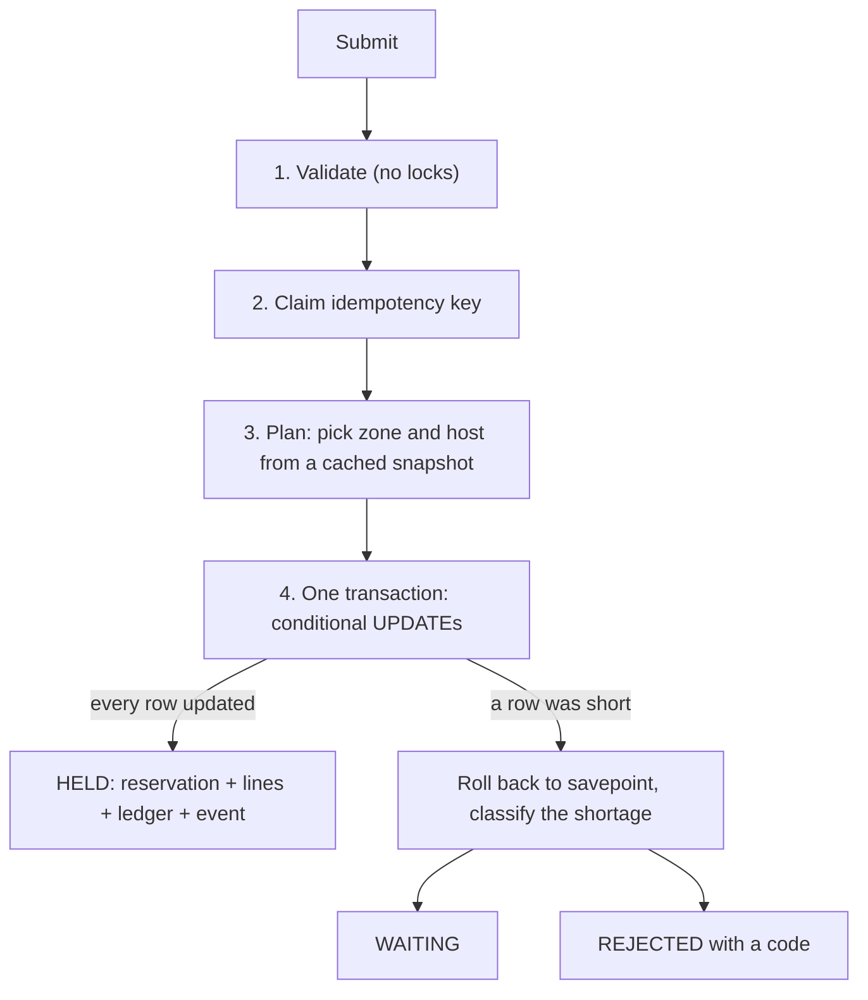
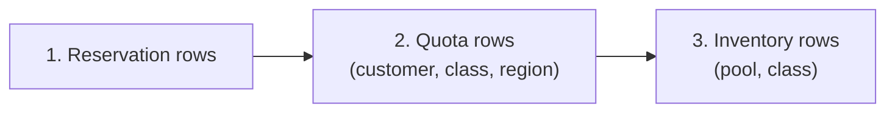
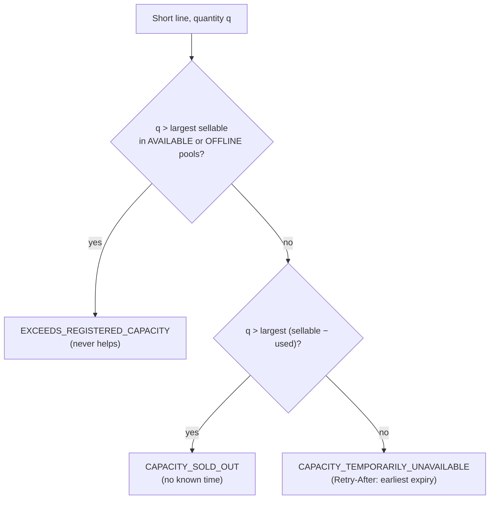
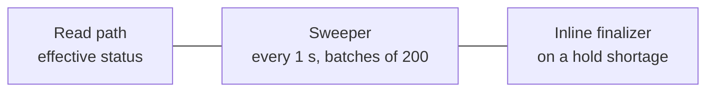
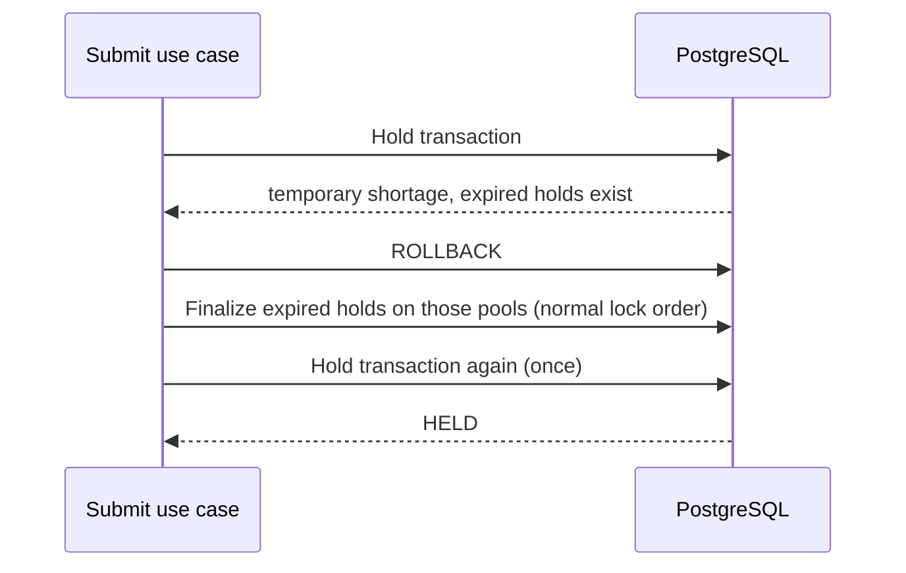
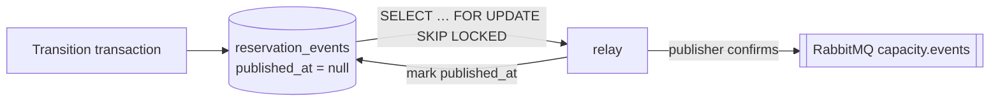

# Core logic

This is the heart of the system: how one request becomes a hold, without ever overselling.

## The idea in one picture



The cached snapshot is **only a ranking hint**. Correctness comes from the conditional updates in step 4.

## 1. Why correctness lives in SQL

Two requests in application memory both read "1 unit left" and both proceed. So the rule is written as the statement itself:

```sql
UPDATE inventories AS i
SET    held = i.held + @q
FROM   pools AS p
WHERE  i.pool_id = @pool
  AND  i.resource_class = @class
  AND  p.id = i.pool_id
  AND  p.admin_state = 'AVAILABLE'
  AND  i.held + i.used + @q <= floor((i.total - i.reserved) * i.allocation_ratio)
RETURNING i.held;
```

- **One row updated** → the line fits and is already held.
- **Zero rows** → a shortage. Nothing else is needed, and no read-then-write gap exists.
- The same bound exists as a table `CHECK`, so even a bug in this statement cannot oversell.

## 2. Rules split by what they touch

| Rule touches | Lives in | Enforced by |
| --- | --- | --- |
| **One reservation** (state transitions, deadlines, extension) | Domain (`Reservation`, state machine) | Decided in C# on a row locked `FOR UPDATE`, written with a version check |
| **Shared counters** (capacity, quota) | Formula in Domain (`SellableCapacity`); invariant stated by a port | Conditional `UPDATE` and `CHECK` in Infrastructure |

An integration test runs random operations and asserts that **SQL and the domain model agree** (see [Testing](#12-testing)).

## 3. The hold transaction

One `READ COMMITTED` transaction. Writes are **queued and sent as batches**, and the contended inventory `UPDATE` goes **alone and last**, right before `COMMIT`. A hold takes **9 round trips**, the same for 1 line or 4 (it took 28 before this change; see [Load test](#13-load-test)).

```text
BEGIN
  claim idempotency key                       → replay / mismatch / continue
  read now(), cooldown, open holds, snapshot   (if every plan is hopeless: store the rejection, skip the attempt)
  SAVEPOINT attempt
    one batch:
        INSERT reservation (HELD, expires_at = now + ttl), lines, event
        UPDATE quotas (…held + used + q <= quota_limit), sorted by class
        pool-share check (scarce products only)
        INSERT ledger_entries (HOLD, +q) per line
        complete the idempotency key with the response
    alone and last:
        UPDATE inventories (…held + used + q <= sellable), sorted by (pool, class)
    if any statement updated zero rows:
        ROLLBACK TO SAVEPOINT   → try next candidate, or classify the shortage
COMMIT
```

**Why the order matters.** The hot inventory row stays locked from its `UPDATE` until `COMMIT`. Putting it last keeps that window to the `UPDATE` and the commit, instead of 7 round trips. Everything written before it is rolled back with the savepoint if it fails, so the global lock order (reservation → quota → inventory) is unchanged.

**All-or-nothing:** if the third line of four is short, the savepoint rolls everything in the attempt back. Nothing stays held.

## 4. One global lock order: no deadlocks

Every writer takes locks in the same order:



Within each level rows are **sorted by key**. Hold, confirm, cancel, release and the sweeper all follow it, so a wait cycle cannot form.

## 5. Picking the pool

| Scope | Classes | Chosen |
| --- | --- | --- |
| `ZONE` | VCPU, RAM_MB, DISK_GB | One zone pool. All zone lines of a request use the same zone |
| `REGION` | IPV4 | The region pool |
| `HOST` | GPU | One host in the chosen zone, by **best fit** |

1. If the request names a zone, use it. Otherwise rank zones by the smallest `effective_free / requested` ratio, highest first.
2. For host lines, take up to 3 hosts by best fit.
3. Try the first candidate. On a shortage, roll back to the savepoint and try the next. **At most 4 attempts.**

## 6. Naming the shortage

After a failed attempt the system reads the candidate pools (no locks) and classifies each short line. The reservation takes the **most severe** line code.



`Retry-After` for the temporary case is the seconds until the earliest `expires_at` among HELD reservations on the short pools, clamped to 1–60 s.

## 7. The wait queue

| Final classification | `on_shortage` | Result |
| --- | --- | --- |
| Temporary shortage | `WAIT` | `WAITING` with `wait_deadline = now + 15 min`; **holds no capacity and no quota** |
| anything else | any | `REJECTED` with the code |

- At most **4 waiting requests per customer and product**.
- The sweeper **promotes in FIFO order** when capacity returns.
- No capacity is reserved for waiters: whoever's transaction comes first wins. This is an **accepted risk** (C-9).

## 8. Later transitions

All run on a reservation row locked `FOR UPDATE`, then quota rows, then inventory rows, sorted.

| Transition | Quota and inventory change | Ledger |
| --- | --- | --- |
| confirm | `held −= q; used += q` | `COMMIT` |
| cancel, expire | `held −= q` | `RETURN` |
| release | `used −= q` | `RELEASE` |
| promote | as a normal hold | `HOLD` |

Confirm only moves units between two counters of the **same row**, so it needs no capacity check. `CHECK (held >= 0 AND used >= 0)` would catch a double application.

## 9. Expiry: three layers



| Layer | What it does |
| --- | --- |
| **Effective status** | Readers see EXPIRED the instant the deadline passes |
| **Sweeper** | Stores EXPIRED and returns capacity. `LIMIT 200 FOR UPDATE SKIP LOCKED`, so several instances are safe. Counter changes are summed per (pool, class) per batch |
| **Inline finalizer** | If a hold finds a *temporary* shortage and expired-but-unsettled holds sit on those pools, finalize them, then retry **once** |

### The one two-transaction path

Finalizing expired holds *inside* the hold transaction would lock reservation rows **after** inventory rows and break the lock order. So Submit rolls back, runs one short finalization transaction in the normal order, then retries the hold from the start.



## 10. Protecting the hot row

| Protection | What it does |
| --- | --- |
| **Sold-out negative cache** | When a line is `SOLD_OUT` or `EXCEEDS_REGISTERED`, cache `(pool, class) → max(sellable − used)` in process for **1 second**. Requests larger than that skip the inventory `UPDATE` and are classified directly. Never caches *temporary* shortage, because holds expire |
| **Hopeless plan check** | If every candidate already shows too little free in the snapshot, no locks are taken at all |
| **Per-customer rate limit** | See [Rate limits](#09-rate-limits-fairness) |
| **Timeouts** | `statement_timeout = 2 s`, `lock_timeout = 500 ms`, set as connection **startup options** (checked by `ConnectionSettingsTests`). A lock timeout returns `503` with `Retry-After: 1`; the client retries with the same key |
| **Connection settings** | Auto-prepared statements, no reset on close, a pool cap of 80 connections per replica |

## 11. Events: the transactional outbox

Each transition inserts a row into `reservation_events` **in the same transaction**. That one table is both the audit history and the outbox.



- Delivery is **at least once**. Consumers de-duplicate by `event_id` and order by the reservation `version`.
- If RabbitMQ is down, events wait in the table. **A reservation is never blocked by the broker.**

## 12. Recovery and explainability

- No in-memory state: kill any instance at any time.
- A retry after a lost response replays the stored result.
- `reconcile` recomputes every counter from the ledger and reports drift. After the load test it reported `driftRows: 0`.
