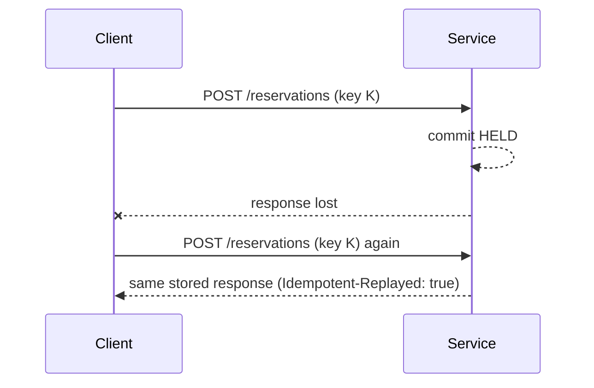
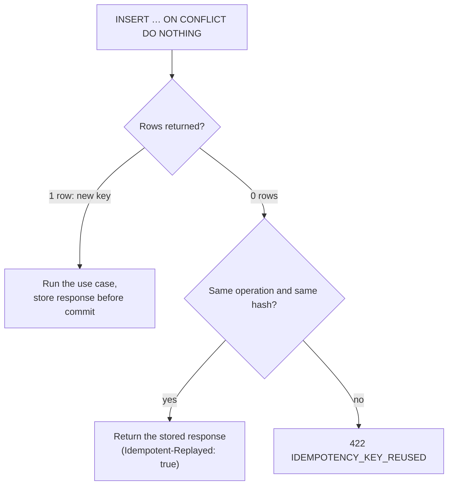
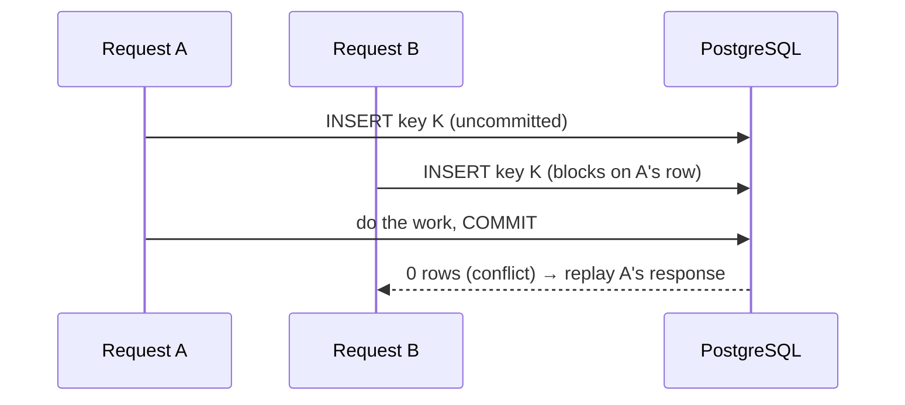

# Idempotency

> **The promise:** every state-changing call can be retried safely. The same key returns the same result, and **never creates a second reservation.**

## Why it matters

Machine clients retry on every timeout. If a response is lost *after* the commit, a naive service creates a second reservation for the same intent and holds capacity twice.



## The key

| Property | Rule |
| --- | --- |
| Header | `Idempotency-Key`, **required** on submit, confirm, cancel, extend, release and every admin write. Missing → `400 IDEMPOTENCY_KEY_REQUIRED` |
| Format | 1–64 characters, `[A-Za-z0-9_-]` |
| Namespace | **Per customer** (admin calls use the actor id) |
| Bound to | The **operation** and a **fingerprint** of the request |
| Fingerprint | SHA-256 over the operation name and the canonical JSON body |
| Retention | 24 hours from first use (longer than any reservation's 45-minute lifetime) |

## The algorithm

It runs **inside the use case's transaction, before any other write**.

```sql
INSERT INTO idempotency_keys (customer_id, idem_key, operation, request_hash, expires_at)
VALUES (@customer, @key, @operation, @hash, now() + interval '24 hours')
ON CONFLICT (customer_id, idem_key) DO NOTHING
RETURNING 1;
```



| Insert result | Meaning | Action |
| --- | --- | --- |
| 1 row | New key | Run the use case; before commit, store status code and response body |
| 0 rows, same operation and hash | Retry of a completed call | Return the **stored** status and body |
| 0 rows, different operation or hash | Key reused for something else | `422 IDEMPOTENCY_KEY_REUSED` |

## Concurrent duplicates: no "in progress" state

Two identical requests at the same instant:



- The second `INSERT` **waits on the first transaction's uncommitted row**.
- If A commits, B gets 0 rows and replays A's stored response.
- If A rolls back, B inserts and runs.
- No "in progress" status is ever visible, and no extra lock table exists.

## What is stored, and what is not

| Stored and replayed | Not stored |
| --- | --- |
| Successful results | `401`, `403`, `429` |
| **Deterministic refusals** (`409`, `422`), because they are the true outcome of that request | `503`, and anything thrown and rolled back |

Because unstored failures roll the transaction back, **the key stays free** and the retry runs normally.

## Why "same transaction" is the key design choice

| Alternative | Problem |
| --- | --- |
| Keys in Redis | A crash between Redis and the database leaves a window |
| Dedupe by body hash | Two legitimate identical requests become one |
| No dedup | Every retry duplicates |

Here the key and the reservation **commit or roll back together**. There is no window.

## Second line of defence: `client_reference`

`client_reference` is unique per customer among `WAITING`, `HELD` and `CONFIRMED` reservations. A client that retries with a **new key** after 24 hours (the old key purged) but the **same reference** gets `409 INVALID_STATE_TRANSITION` pointing at the existing reservation, not a duplicate.

## Transitions are also naturally idempotent

| Repeated call | Result |
| --- | --- |
| Confirm on a CONFIRMED reservation (new key) | `200` with the current resource |
| Cancel on a CANCELLED reservation | `200` with the current resource |
| Release twice | Capacity returns **once** |
| Two parallel confirms | The second sees `stored_status != 'HELD'`, updates zero rows, returns the current resource |

## In the code

`IdempotencyOperations.ClaimAsync` builds the SHA-256 hash from the operation and the serialised request, claims the key through the repository, and:

- returns *new* when the insert succeeded,
- returns the stored response when operation and hash match (compared with a **constant-time** equality),
- throws `IdempotencyKeyReusedException` when they differ.

`SubmitReservationUseCase` calls it first, and if the claim is a replay it returns the stored output flagged `Replayed = true` (surfaced as the `Idempotent-Replayed: true` header).

## Purge

The sweeper deletes keys with `expires_at < now()`, 1,000 per batch. At ~50k mutating calls a day the table stays near **150k rows**.

## Tests that prove it

| Test | Proves |
| --- | --- |
| `Same_key_in_parallel_creates_one_reservation` | One reservation, identical responses under concurrency |
| `Confirm_cancel_and_extend_repeated_with_one_key_apply_once` | Every operation is idempotent |
| `Calls_aborted_mid_flight_and_retried_with_their_keys_leave_no_duplicate_or_partial_reservation` | A killed call plus a retry never duplicates or leaves half a reservation |
| `Submit_answers_201_with_location_and_replays_with_the_header` | The replay header and status |
