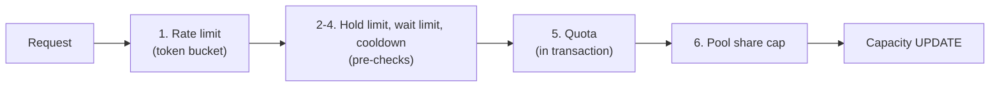

# Rate limits and fairness

> **A hold is free.** Without limits it is the cheapest way to take a scarce product off the market. So the service layers several controls, from cheap and early to exact and late.

## The seven controls

| # | Control | Scope | Enforced where | Error |
| --- | --- | --- | --- | --- |
| 1 | **Rate limit** | customer × endpoint group | ASP.NET Core rate limiter, **before** any database work | `429 RATE_LIMITED` |
| 2 | Active hold limit | customer × product | Pre-check | `429 HOLD_LIMIT_REACHED` |
| 3 | Waiting limit | customer × product | Pre-check | `429 HOLD_LIMIT_REACHED` |
| 4 | Cooldown | customer × product | Pre-check | `429 COOLDOWN_ACTIVE` |
| 5 | **Quota** | customer × class × region | Conditional `UPDATE` in the hold transaction | `409 QUOTA_EXCEEDED` |
| 6 | **Pool share cap** | customer × pool × class (scarce products) | Query under the quota row lock | `409 POOL_SHARE_EXCEEDED` |
| 7 | Extension limit | reservation | Request state machine guard | `409 INVALID_STATE_TRANSITION` |



Cheap checks come first. A request that will be refused costs as few locks as possible.

## How the rate limiter works

It is a **token bucket per customer and endpoint group**, using the built-in ASP.NET Core `RateLimiter`. No library, no Redis.

| Group | Refill | Burst (bucket size) | Used by |
| --- | --- | --- | --- |
| `submit` | 10 / s | 20 | `POST /v1/reservations` |
| `fitcheck` | 5 / s | 10 | `POST /v1/capacity/fit-check` |
| `reads` | 50 / s | 100 | capacity levels, get, list |
| `transitions` | 20 / s | 40 | confirm, cancel, extend, release |

**How a bucket behaves:**

- Each customer has a separate bucket per group, keyed `group:customer`. The key is `X-Customer-Id`, then `X-Actor-Id`, then the remote IP, then `anonymous`.
- Every request takes **one token**. The bucket refills at the group's rate each second, up to the burst size.
- When the bucket is empty the request is **refused immediately** (queue limit 0). It never waits.
- The refusal is `429` with a `Retry-After` header and the standard error body.

> **Try it.** Fire requests at a `submit` bucket (burst 20, refill 10/s) and watch it drain and refill.

<div data-widget="token-bucket"></div>

### Why a token bucket

| Property | Benefit |
| --- | --- |
| Allows a **burst** up to the bucket size | A Terraform apply sending 15 calls at once still works |
| Enforces the **average** rate over time | A retry storm is flattened |
| Constant memory, no I/O | Rejected before the database is touched |

### The honest limit

The limiter is **per instance**. With N API instances a customer can get up to N× the configured rate. At 3 instances that is acceptable. A shared limiter (Redis) is the growth step **when exact global limits are required** (ADR-0015). Redis stays off the correctness path in any version.

## Quota: the contract limit

One row per (customer, class, region) with `quota_limit`, `held`, `used`.

```sql
UPDATE quotas
SET    held = held + @q
WHERE  customer_id = @customer AND resource_class = @class AND region = @region
  AND  held + used + @q <= quota_limit
RETURNING held;
```

- **Open holds count** (`held + used + q <= limit`), so parallel requests cannot dodge a contract.
- A **missing row is created** with the class's default quota. It never means unlimited.
- **Lowering a limit below usage is allowed.** Existing holds stay and new ones fail until usage drops. This is why the limit is a condition in the `UPDATE`, **not** a `CHECK`.
- A quota refusal **never becomes WAITING**. Waiting cannot fix a contract.

## Fairness policy per product

| Setting | Default product | Scarce product (e.g. GPU) |
| --- | --- | --- |
| Hold TTL | 15 min | **2 min** |
| Max wait | 15 min | 5 min |
| Max active holds per customer | 20 | **4** |
| Max waiting per customer | 4 | 4 |
| Pool share cap | off (100%) | **25%** |
| Cooldown | 5 expiries in 1 h → 10 min | same |

## Pool share cap

For scarce products, one customer may not hold more than `max_pool_share_pct` of a pool.

```sql
SELECT coalesce(sum(l.quantity), 0)
FROM   reservation_lines l
JOIN   reservations r ON r.id = l.reservation_id
WHERE  r.customer_id = @customer AND l.pool_id = @pool AND l.resource_class = @class
  AND  (r.stored_status = 'HELD'
        OR (r.stored_status = 'CONFIRMED' AND r.allocation_state = 'ACTIVE'));
```

Reject if `existing + q > sellable × share%`.

**Why it is race-free:** the customer's **quota row is locked first**. All of that customer's requests for the class and region serialise on that row, so two parallel requests cannot both pass the cap.

**Worked example.** 200 GPUs, 2,000 customers in the first minute, 2-minute TTL, 4 holds max, 25% cap. In the worst case, hoarding spreads over at least 50 customers instead of one.

## Cooldown

A customer who keeps taking holds and letting them expire is hoarding.

```sql
SELECT count(*) FROM reservations
WHERE customer_id = @customer AND product_code = @product
  AND stored_status = 'EXPIRED' AND updated_at > now() - interval '1 hour';
```

Five or more, with the latest in the last 10 minutes → `429 COOLDOWN_ACTIVE`, with `Retry-After` until 10 minutes after the latest expiry. It runs without a lock: a race at the edge lets **at most one** extra hold through, which cannot oversell.

## Layers against a hot pool

| Layer | Stops |
| --- | --- |
| Rate limit | One client hammering the API |
| Negative sold-out cache (1 s) | Hammering a pool that is already empty |
| Hold, wait limits, cooldown | Hoarding by one customer |
| Share cap | One customer taking a scarce pool |
| `lock_timeout` 500 ms → `503` + retry | Unbounded queueing on the row |

## Other abuse notes

- **Internal services** act on behalf of a customer and count against that customer's quota. A service holding for itself (e.g. capacity tests) has its own customer id and quota.
- **Suspended customers** are the account system's concern. The gateway stops issuing identity. This service only cleans up with `cancel-open` (HELD and WAITING, in batches of 200). Confirmed allocations are untouched.

## Tests

| Test | Proves |
| --- | --- |
| `Request_rate_is_limited_per_customer_with_a_retry_hint` | The bucket refuses with 429 and `Retry-After` |
| `Quota_counts_open_holds_and_never_means_unlimited` | Quota rules |
| `Lowering_a_quota_below_usage_keeps_existing_holds_and_blocks_new_ones` | Shrinking contracts |
| `Hold_limit_share_cap_and_cooldown_apply_to_a_customer_hoarding_a_scarce_product` | The three hoarding controls |
| `The_hold_limit_and_the_waiting_limit_apply_per_customer_and_product` | Per-customer limits |
