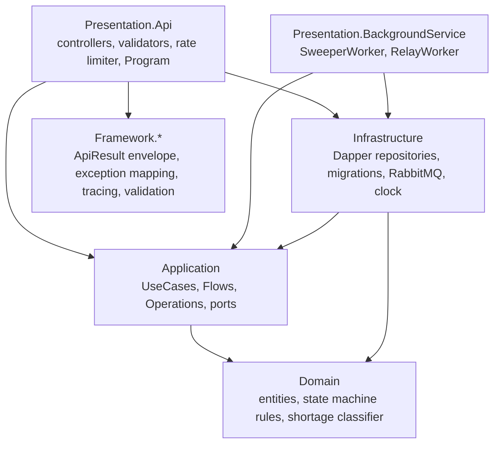
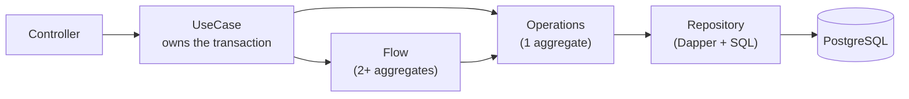

# Code structure

## The shape

A **clean architecture** modular monolith. The solution is `src/Arvan.Capacity.slnx`, with the **dependency rule enforced by an architecture test**, not by good intentions.



## Folder map

```text
src/
  Domain/Arvan.Capacity.Domain/                 (43 files, ~1.8k lines)
    Entities/Reservations   Reservation, ReservationLine, ReservationEvent
    Entities/Capacity       Pool, HoldPlanner, ShortageClassifier, InventorySnapshot, CapacityLevels
    Entities/Products       Product, ProductDefinition
    Enums, Exceptions       ReservationStatus, ReasonCode, PoolAdminState, ...
  Application/Arvan.Capacity.Application/       (130 files, ~4.1k lines)
    UseCases/               one folder per business operation (Input, Output, UseCase)
    Flows/                  sequences across two or more aggregates
    Operations/             per-aggregate operations (interface + implementation)
    Repositories/           ports (and Readonly/ for queries)
    Abstractions/           IUseCase, IFlow, ITransactionManager, IClock
  Infrastructure/Arvan.Capacity.Infrastructure/ (24 files, ~2.3k lines)
    Repositories/           Dapper + hand-written SQL (CapacityLedgerRepository, ...)
    Persistence/            TransactionManager, DbClock, migrator, options
    Messaging/              RabbitMqEventPublisher, LoggingEventPublisher
    Migrations/             0001_initial_schema.sql, 0002_...sql (DbUp)
    Seeds/                  0001_demo_catalog.sql
  Presentation/
    Arvan.Capacity.Presentation.Api/            (controllers, validators, mappers, view models)
    Arvan.Capacity.Presentation.BackgroundService/ (sweeper and relay workers)
  Framework/                shared plumbing: ApiResult, error handling, tracing, JSON, validation
tests/
  Arvan.Capacity.Invariants.Tests/              correctness tests on real PostgreSQL
  Arvan.Capacity.ArchitectureTests/             the dependency rules
load/k6/                                        four load scenarios
deploy/                                         observability stack, postgres init
docs/                                           PRD, ADRs, specs, this guide
```

About **10.7k lines of C#** in `src/`.

## The three-tier Application layer

The Application layer has three tiers, each with one clear job.

| Tier | Owns | Rule |
| --- | --- | --- |
| **UseCase** | One business operation **and its transaction** | The *only* place that may begin, retry or commit a transaction |
| **Flow** | A sequence across **two or more aggregates** | Runs inside its caller's transaction; reaches persistence only through Operations |
| **Operation** | Work on **one aggregate** | Calls repositories; unaware it is inside a transaction |



> **Example.** `SubmitReservationUseCase` opens the transaction, claims the idempotency key, asks `CapacityOperations` for a plan, asks `ReservationOperations` to hold, and, on a temporary shortage, calls `ExpireHeldFlow` in a *separate* short transaction. The `ExpireHeldFlow` is shared with the sweeper, which is exactly why it is a Flow.

## Use cases (one per operation)

| Group | Use cases |
| --- | --- |
| Reservations | Submit, Confirm, Cancel, Extend, Release, Get, List |
| Background | ExpireHolds, TimeOutWaiting, PromoteWaiting, PurgeIdempotencyKeys |
| Capacity | GetCapacityLevels, FitCheck |
| Events | RelayEvents |
| Admin | PutPool, ChangePoolState, PutInventory, PutProduct, PutQuota, AdjustLedger, CancelOpenReservations, GetReconciliation, ReconcileLedger |

## Where each design rule lives

| Rule | Where |
| --- | --- |
| State transitions and deadlines | `Domain/Entities/Reservations/Reservation` |
| Sellable capacity formula, pool planning, shortage classification | `Domain/Entities/Capacity` |
| Idempotency claim and replay | `Application/Operations/.../IdempotencyOperations` |
| Sold-out negative cache | `Application/Operations/.../SoldOutCache` |
| The conditional `UPDATE`s | `Infrastructure/Repositories/CapacityLedgerRepository` (SQL) |
| Rate limiter | `Presentation.Api/Program.cs` (token bucket per customer and group) |
| Time | `Infrastructure/Persistence/DbClock` (database `now()` only) |
| Outbox relay | `RelayEventsUseCase` called by `RelayWorker` |
| Expiry | `ExpireHoldsUseCase` and `ExpireHeldFlow` called by `SweeperWorker` |

## What the architecture tests enforce

13 tests in `ArchitectureTests` fail the build if someone breaks a rule:

| Rule | Why |
| --- | --- |
| Domain depends on nothing but the framework base | Pure, testable rules |
| Application depends on Domain only: no Infrastructure, Presentation, or driver | No SQL or HTTP leaks upward |
| **Application never reads the host clock** | Only the database clock decides |
| Only UseCases may use `ITransactionManager` | One owner of every transaction |
| Operations and Flows never depend on a UseCase | No upward calls |
| Flows reach persistence only through Operations | Layering inside Application |
| UseCases are named `*UseCase`, implement `IUseCase`, each has exactly one Input | Uniform shape |
| Repository implementations stay internal to Infrastructure | Nothing bypasses the Operations |

## Runtime roles from one image

The `Dockerfile` publishes the API and the worker. Roles are chosen by command and `Capacity__Roles`.

| Role | Process | What runs |
| --- | --- | --- |
| `api` | `Presentation.Api` | Controllers, rate limiter, `/health/live`, `/health/ready`, `/metrics`, OpenAPI |
| `sweeper` | `Presentation.BackgroundService` | `SweeperWorker` |
| `relay` | `Presentation.BackgroundService` | `RelayWorker` |
| `migrate` | `Presentation.Api migrate` | Applies DbUp migrations and exits |

Docker Compose services: `postgres` (17, with `pg_stat_statements`), `migrator`, `api`, `sweeper`, `relay`; optional profiles `events` (RabbitMQ) and `observability` (OpenTelemetry Collector, Prometheus, Grafana).

## Data access

- **Npgsql + Dapper**, SQL hand-written and reviewed like code. The hold path sends its statements as **one `NpgsqlBatch`**.
- **DbUp** versioned SQL migrations, run by a separate `migrate` command **before** roles start.
- No ORM: the part that matters most (locking and conditional updates) must stay visible.

## API surface

| Method | Path | Actor |
| --- | --- | --- |
| GET | `/v1/capacity` | any |
| POST | `/v1/capacity/fit-check` | customer, service |
| POST | `/v1/reservations` | customer, service |
| GET | `/v1/reservations/{id}` · `/v1/reservations` | customer, service |
| POST | `/v1/reservations/{id}/confirm` · `cancel` · `extend` | customer, service |
| POST | `/v1/reservations/{id}/release` | service, admin |
| `/v1/admin/...` | pools, inventories, products, quotas, reconciliation, adjust, cancel-open | admin |

The OpenAPI document is committed at `docs/openapi/capacity.v1.json` and **checked by a test**, so the contract cannot drift silently.

## Where the code differs from the written specs

The specs were written first; the implementation then followed a house framework (Operation / Flow / UseCase) with **Npgsql and Dapper**. Where they differ, the framework won:

| Specs say | Code does |
| --- | --- |
| RFC 9457 Problem Details, `UPPER_SNAKE` codes | An **`ApiResult` envelope** with dotted codes such as `reservation.expired` |
| Enums as `VCPU`, `RAM_MB` | Enum member names (`Vcpu`, `RamMb`) |
| Cursor pagination | Page-numbered lists |
| Test projects `Domain.Tests`, `Application.Tests`, `IntegrationTests` | `Invariants.Tests` (domain tables, concurrency, recovery, API contract) and `ArchitectureTests` |
| Stored refusals | A stored `409` or `422` carries the reservation in `data` and the reason in `error.code`; other failures are thrown, roll back, and are **not** stored |

> I am listing this on purpose. A reviewer comparing the specs with the code should find these differences here first, not by surprise.
