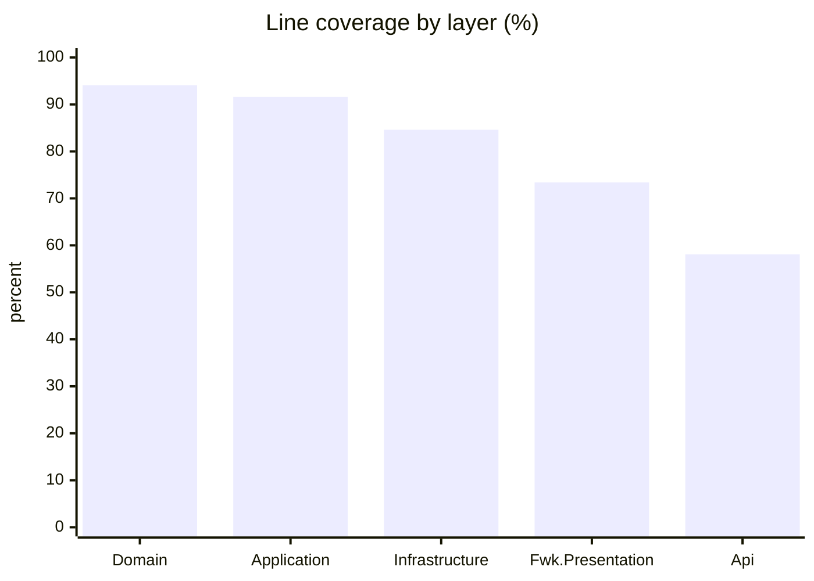
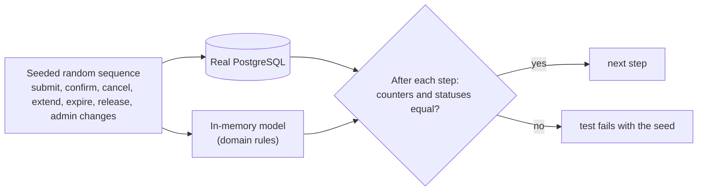

# Testing and coverage

> **Principle.** Correctness lives in SQL and transactions, so the important tests run against a **real PostgreSQL 17** (Testcontainers). Not mocks, not SQLite.

## The numbers (measured on 2026-11-16)

I ran `dotnet test` with coverlet on the whole solution on my laptop. That run came **before** `ConnectionSettingsTests` was added, so it has one test case fewer than the project has now, and its coverage figures predate the round-trip changes.

| Measure | Result |
| --- | --- |
| Test projects | 2 |
| Test cases | **149** (136 correctness + 13 architecture) |
| Passed | **148** |
| Failed | **1**, a timing-dependent test (explained below) |
| Wall time of the full run | ~5 min 50 s (it starts real PostgreSQL containers) |
| **Line coverage** | **81.0%** (3,209 of 3,962 lines) |
| **Branch coverage** | **66.7%** (750 of 1,124 branches) |

> Coverage is collected from the correctness test project. The architecture tests inspect assemblies and do not execute application code, so they add none.

### Coverage by layer

| Layer | Line | Branch | Comment |
| --- | --- | --- | --- |
| **Domain** (rules, state machines, classifier) | **94.1%** | 84.3% | Where the business rules are |
| **Application** (use cases, flows, operations) | **91.6%** | 77.1% | |
| **Infrastructure** (SQL repositories, clock, outbox) | 84.6% | 75.8% | RabbitMQ publisher is untested (below) |
| Framework.Presentation (envelope, errors) | 73.4% | 47.8% | |
| Presentation.Api (controllers, Program) | 58.1% | 43.4% | Includes generated OpenAPI code that is never executed |
| Framework.Domain | 100% | 50.0% | Tiny base types |



**Reading it honestly.** The coverage is highest where the rules are (Domain, Application). It is lowest in the API shell. Some of that is generated OpenAPI code that no test can meaningfully hit. The two gaps that are *real*:

| Gap | Why | Risk |
| --- | --- | --- |
| `RabbitMqEventPublisher` is at **0%** | Tests use the logging publisher. RabbitMQ runs only in the optional Compose profile | Low (the outbox, not the broker, carries correctness), but it is untested code |
| `PutPool` use case and `PoolOperations.PutAsync` are barely covered | Pools are seeded by migrations in tests; the create path is admin-only | Low |

## What I wrote tests for

### Layers

| Project | Runs against | Proves |
| --- | --- | --- |
| `Arvan.Capacity.Invariants.Tests` (136 cases) | **Real PostgreSQL** in Testcontainers, the API through `WebApplicationFactory` | Concurrency, invariants, recovery, SQL ↔ domain agreement, the HTTP contract |
| `Arvan.Capacity.ArchitectureTests` (13 cases) | Assemblies | The dependency rule and the layering rules |
| `load/k6` (4 scripts) | The full stack in Docker Compose | The hot-row ceiling, scarce burst, sweeper drain |

### Correctness tests, by theme

| File | Cases | What it proves |
| --- | --- | --- |
| `ConcurrencyTests` | 5 | **1,000 parallel submits on a pool of 100 hold exactly 100.** Multi-line requests in random line order **never deadlock**. Confirm, cancel and expiry racing on one hold apply **exactly one** outcome. The same key in parallel creates **one** reservation. Confirm, cancel, extend repeated with one key apply **once** |
| `DomainTests` | 12 + 7 theories | Sellable-capacity formula, shortage classification, quantity rules, zone ranking, host best-fit, capacity levels, **every (state, event) pair** of both state machines, wait promotion, event routing keys |
| `ReservationStateMachineTests` | 6 + 1 theory | Confirm before the deadline allocates and is idempotent; at or after the deadline is refused; **a client event and the timer are never both legal**; extend once only; held-past-deadline reads as expired; every transition leaves one event with the next version |
| `ModelAgreementTests` | seeded theory | **A random sequence of operations runs against the database and an in-memory domain model. After every step, the database must match the model.** This is the check that SQL and C# agree |
| `RecoveryAndReadTests` | 4 | Calls aborted mid-flight and retried leave **no duplicate or partial reservation**. With the sweeper stopped, reads still show EXPIRED and new holds reuse expired capacity. Another customer gets 404 for every operation. Release is once-only and a late confirm is refused |
| `FairnessWaitingAndAdminTests` | 11 | Quota counts open holds and never means unlimited. Lowering a quota keeps holds. Hold limit, share cap and cooldown apply. A wait is opt-in, promoted in order, rejected at its deadline. Capacity levels count expired holds as free and hide numbers. Fit-check is advisory. Pool states follow the resource state machine. Reconciliation reports drift. `cancel-open` spares confirmed allocations |
| `RoundTripTests` | 3 | A hold takes **the same number of round trips for 1 line and 4 lines** (9 in the load runs, down from 28), within a fixed budget. A refusal on a full pool is cheap and never attempts the hold. Confirm, cancel and the sweeper write in one batch |
| `ConnectionSettingsTests` | 1 | Pooled connections really carry the statement and lock timeouts. Added after the first version of the settings silently never applied |
| `ApiContractTests` | 11 | Status codes (201, 202, 409, 422, 429), the replay header, the envelope, a 16 KB body limit, identity and key errors, actor-kind rules, health and metrics, **the OpenAPI document matches the committed one** |
| `ArchitectureTests` | 13 | See [Code structure](#10-code-structure) |

## The ten critical scenarios

These come from the PRD's testing spec. Each is tied to edge cases from the [previous chapter](#11-edge-cases).

| # | Scenario | Edge cases | Pass condition | Test |
| --- | --- | --- | --- | --- |
| 1 | 1,000 parallel submits, capacity 100 | C-1, C-3, Q-1 | Exactly 100 HELD | `Thousand_parallel_submits_on_a_pool_of_hundred_hold_exactly_hundred` |
| 2 | Multi-line requests, random line order | C-2 | No deadlocks | `Multi_line_requests_in_random_line_order_never_deadlock` |
| 3 | Confirm, cancel, expiry racing | C-4, C-6, C-7, T-2, T-4 | One final state per hold | `Confirm_cancel_and_expiry_racing_on_one_hold_apply_exactly_one_outcome` |
| 4 | Same key, serial and parallel | R-1, R-2, R-3, F-2 | One reservation, same responses | `Same_key_in_parallel_creates_one_reservation` and sibling |
| 5 | API killed under load, clients retry | F-1, F-2 | No duplicate or partial reservations | `Calls_aborted_mid_flight_and_retried_with_their_keys_...` |
| 6 | Sweeper stopped while load continues | T-1, T-7, Q-6 | Reads show EXPIRED, new holds succeed | `With_the_sweeper_stopped_reads_show_expired_...` |
| 7 | Customer A uses customer B's ids | D-4 | Every response 404 | `Another_customer_gets_not_found_for_every_operation` |
| 8 | Repeated release, late confirm | D-5, R-7 | Capacity returns once; late confirm gets 409 | `Release_is_once_only_and_a_late_confirm_is_refused` |
| 9 | One customer looping hold and abandon | A-1, A-2, A-3 | Share cap, hold limit, cooldown apply | `Hold_limit_share_cap_and_cooldown_apply_...` |
| 10 | Invariant check plus k6 on one pool | F-11, C-10 | Drift 0 | Reconciliation test plus the [load test](#13-load-test) |

## Invariants checked after every integration test

- `held + used <= sellable` for every inventory row.
- Counters equal the ledger sums.
- `held` equals the lines of HELD reservations; `used` equals the lines of CONFIRMED reservations with an ACTIVE allocation.
- Every reservation's stored status is consistent with its columns (the `CHECK` would fail otherwise).

## The model-agreement test



It runs on four seeds (1 to 4). A failure prints its seed, so any counter-example can be **replayed**.

## The failing test, explained

| | |
| --- | --- |
| Test | `Request_rate_is_limited_per_customer_with_a_retry_hint` |
| Result in the full run | **Failed** (`Assert.NotNull() Failure: Value is null`), after 34 s |
| Result when run alone | **Passed** in 3 s |

**Cause.** The test sends 60 `fit-check` calls one after another and expects the token bucket (burst 10, refill 5 per second) to run dry. On a loaded machine each call took about half a second, so the bucket **refilled as fast as it drained** and was never empty. The rate limiter itself is correct; the **test depends on wall-clock speed.**

**Fix I would make.** Drive the limiter with a fake clock, or send the 60 calls in parallel, so the test does not depend on how fast the machine is. I did not change it here, because this guide documents the project as it is.

## Where coverage is thin, and what that means

| Area | State |
| --- | --- |
| Domain and Application rules | Well covered, with exhaustive state-machine tables and a model-agreement test |
| SQL and concurrency | Proven on real PostgreSQL |
| HTTP shell | Moderately covered; contract tests cover each endpoint group |
| RabbitMQ publishing | **Not covered by any automated test.** It only runs in the Compose `events` profile, as in the load run |
| High availability (F-3, F-5) | **Not testable** here; needs HA infrastructure |
| Load behaviour | One k6 scenario has run so far |

## How to run

```bash
make test                                   # everything (Docker required for integration tests)
dotnet test src/Arvan.Capacity.slnx \
  --collect:"XPlat Code Coverage"           # with coverage (the Invariants project carries coverlet)
UPDATE_OPENAPI=1 dotnet test                # regenerate the committed OpenAPI document
```

## Differences from the written test spec

| Spec says | Reality |
| --- | --- |
| Separate `Domain.Tests`, `Application.Tests` (with fakes), `IntegrationTests` | One `Invariants.Tests` project mixing pure domain tables and real-PostgreSQL tests. **No use-case tests with in-memory fakes.** Use cases are exercised only through the real database |
| Property test with FsCheck | A **seeded** random model test (`ModelAgreementTests`), same idea, replayable by seed |
| CI runs everything plus an OpenAPI diff | The OpenAPI diff is a test; there is no CI pipeline in the repository |
