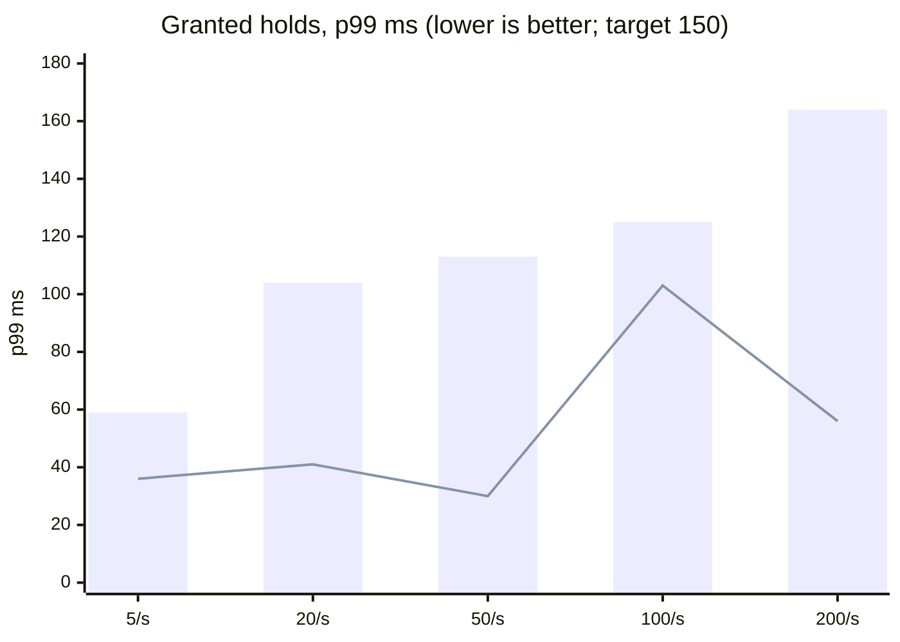
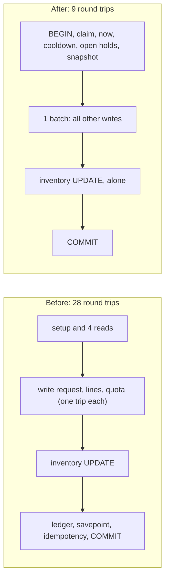

# Load test

> **The short version.** On one hot inventory row, **granted holds stayed under the 150 ms p99 target up to 200 requests/s** in these runs, and broke between 200 and 300/s. The **rejection path no longer collapses at 200/s**, but its tail at 100/s and 300/s is still above 150 ms and noisy. It is **not fixed**. Correctness held in every run: no oversell, zero ledger drift.
>
> **All numbers come from one laptop Docker VM with one API replica, not Linux hardware.** Read them as measured here, not as production capacity.

## Two rounds of measurement

| Round | What it was | Source |
| --- | --- | --- |
| 1. Scarce burst | 300/s for 2 min on a 200-unit pool, **before** any latency work | `load/results/2026-11-16-scarce-burst.md` |
| 2. Hold latency, steps 1–3 | Rate steps on one hot row, **before and after** the latency changes | `load/results/2026-11-16-hold-latency-steps-1-3.md` |

The full analysis, with the round-trip trace and the plan, is in the [hold latency report](../../reports/hold-latency.html) (`docs/reports/hold-latency.html`; section 6 has the results after steps 1–3).

## Setup (round 2)

| | |
| --- | --- |
| Load shape | **One hot inventory row**, a **fresh customer per request** (so only the inventory row is shared), **15 s per rate step** |
| Hardware | Laptop, Docker Desktop VM (8 cores). PostgreSQL, k6, the workers and **one API replica** all on the same VM |
| PostgreSQL | Tuned for local runs only (`max_connections=300`, `checkpoint_timeout=30min`) |
| Method | Each series ran after a discarded warm-up run. "After" has two runs for granted holds and one for rejections |
| Measure | p99 of HTTP duration, in ms |

## Results: p99 in ms

| Offered rate | Granted, before | Granted, after (2 runs) | Stored rejection, before | Stored rejection, after (1 run) |
| --- | --- | --- | --- | --- |
| 5/s | 59 | 32 · 36 | 44 | 40 |
| 20/s | 104 | 34 · 41 | 39 | 28 |
| 50/s | 113 | 30 · 30 | 32 | 38 |
| 100/s | 125 | 20 · 103 | 188 | **278** |
| 200/s | 164 | **53 · 56** | **4,633** | **126** |
| 300/s | not measured | **1,002** (one run; at 400/s: 3.7 s) | not measured | **245** |

Target: **p99 < 150 ms**.



The bars are **before**; the line is the **worse of the two "after" runs**. The 300/s point (1,002 ms) is left off so the scale stays readable.

## How to read it

| Finding | Status |
| --- | --- |
| Granted holds on one row, up to 200/s | **Under 150 ms p99** in these runs (worst: 103 ms at 100/s) |
| Granted holds at 300/s | **Over target**: 1,002 ms. The break is between 200 and 300/s |
| Rejections at 200/s | No longer collapse: 4,633 → 126 ms |
| Rejections at 100/s and 300/s | **Still above 150 ms** (278 and 245 ms), and noisy. One run is not enough to say more |
| Correctness | No oversell, zero drift, in every run |

> The two "after" runs at 100/s for granted holds (20 ms and 103 ms) show how noisy one laptop VM is. I report both rather than pick one.

## What changed between "before" and "after"

A hold went from **28 database round trips to 9**, the **same for 1 line or 4 lines**. A refusal on a full pool takes 10. This is measured by the service's own `capacity_transaction_round_trips` metric and asserted in `RoundTripTests`.

| Step | Change |
| --- | --- |
| 1. Instrument | Per-phase timing (`capacity_hold_phase_duration_seconds`), round trips per transaction, `pg_stat_statements` |
| 2. Batch, lock late | Writes are queued and sent as batches: the request, lines, event, quota, ledger and idempotency response go **in one batch**. The contended inventory `UPDATE` goes **alone and last**, then `COMMIT` |
| 3. Cheap rejections | A request whose snapshot already shows no capacity in any plan **skips the hold attempt** and is stored as rejected |
| 4. Connection settings | Auto-prepare, no reset on close, a pool cap, and the statement and lock timeouts as **startup options** |



**Why it matters.** The hot row stays locked from its `UPDATE` until `COMMIT`. Before, that window was 7 round trips plus the commit; now it is the `UPDATE` and the commit. Per-row throughput is roughly the inverse of that window.

### Two mistakes found on the way

| Mistake | Effect | Now |
| --- | --- | --- |
| The first version of the connection settings **never applied** (`ContainsKey` is true for every Npgsql keyword) | No timeouts, so overload queued for tens of seconds instead of failing fast | `ConnectionSettingsTests` checks the timeouts on a pooled connection |
| A rewritten `Retry-After` query **scanned every held reservation** | Extra cost on the rejection path | Bounded to leases ending within 60 s; equivalent, because the answer is clamped to 1–60 s |

## The earlier scarce burst (round 1, before the changes)

| Measure | Value |
| --- | --- |
| Scenario | 300 iterations/s for 2 min on one 200-unit IPv4 pool. **Each iteration did a quota `PUT` plus a submit**, which doubled the request count |
| Holds granted | **200**, exactly the pool's capacity |
| Oversell / drift | **0 / 0** (`driftRows: 0`, unsettled 0, outbox backlog 0) |
| Rejections stored | 6,625 `CapacityTemporarilyUnavailable` |
| Throughput | ~58 iterations/s (~115 requests/s); k6 dropped 28,294 iterations |
| Latency | p50 6.3 s, **p99 15.3 s** |
| 5xx | 882 of 7,707 submits (11%), `503` from lock timeouts |

This run **has not been repeated after the changes**. Because of the quota `PUT` in every iteration it overstates the problem, and the round-2 step series isolates the hold better.

## What has not been run

| Not run | Why it matters |
| --- | --- |
| Linux hardware | Docker Desktop adds network and fsync cost a Linux host would not |
| Several API replicas | Only one replica was measured; rate limits and connection pools are per replica |
| Synchronous replication | Adds a round trip to every commit (ADR-0018); must be measured, not assumed |
| The 2-minute scarce burst, after the changes | The burst target is p99 < 150 ms and 5xx < 0.05% |
| `expiry-storm.js`, `mixed.js` | Sweeper drain rate and the combined SLOs |

## An unexplained event

During an overloaded rejection run, **one PostgreSQL server process exited with code 2** and the server recovered by itself. It has not reproduced, and it is not explained. I list it so nobody finds it by surprise.

## Plan steps not started

| Step | Change |
| --- | --- |
| P5 | One read for the whole decision (idempotency claim, `now()`, cooldown, open holds, snapshot) |
| P6 | The hold as one server-side function |
| P7 | Admission control: a per-pool in-flight limit and a shorter `lock_timeout`, so a saturated pool answers `503` immediately |
| P8 | Pool slicing: split the hot row (a data change; the ADR-0004 growth step) |
| P9 | Infrastructure: PgBouncer, fast WAL, several API replicas |

Whether they are needed depends on a baseline on target hardware.

## What this does and does not prove

| It shows, on this setup | It does not show |
| --- | --- |
| Granted holds on one row under 150 ms p99 up to 200/s | Production throughput or latency |
| Round trips per hold cut from 28 to 9, independent of line count | That 500 holds/s per cell is reachable |
| Rejections no longer collapse at 200/s | That the rejection tail is under control (it is not, at 100/s and 300/s) |
| No oversell and zero drift under every load tried | Behaviour with replicas, synchronous replication, or the full burst |

## Run it yourself

```bash
make up
make load          # hot-row, scarce-burst, expiry-storm, mixed
```

Observability: `make observability` adds Prometheus (`:9090`) and Grafana (`:3000`). Useful metrics: `capacity_hold_phase_duration_seconds`, `capacity_transaction_round_trips`, `capacity_expiry_lag_seconds`.
