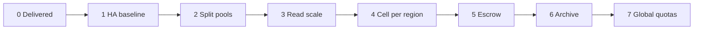

# Trade-offs, limits and growth

## What I optimised for

| I optimised for | Over |
| --- | --- |
| **Depth of correctness** on the core path | Number of features |
| **Explainability** (ledger, history, reconciliation) | Raw speed |
| **Refusing** when unsure | Staying available at any cost |
| **A small first version** with named upgrade triggers | A full enterprise platform on day one |

## Trade-offs I made knowingly

| Choice | What I gain | What it costs |
| --- | --- | --- |
| One PostgreSQL, conditional `UPDATE` | Exact, simple, auditable | One hot row per pool limits throughput |
| Synchronous decision | No "unknown" states; one answer per call | The caller waits for the row lock under heavy contention |
| Fail closed | Never oversell | A short outage during failover returns 503 |
| Counters, not unit identities | Cheap and exact | Fragmentation is invisible |
| No Redis | One fewer failure mode | Rate limits are per instance; reads cached in-process only |
| No workflow engine | Seven states fit in a table | Orchestration would need a rethink |
| Opt-in, bounded wait | Honest and simple | No queue priority or fairness among waiters |
| Quota counters in the same transaction | No parallel bypass | Quotas are per region, not global |
| Lean schema (9 tables) | Easy to review | Regions and zones are text, not tables |

## Known limits and open risks

| Risk | Impact | Mitigation or plan |
| --- | --- | --- |
| **Load numbers are guesses** | If peak is 10× the estimate (60/s) nothing changes. If 100×, pool splitting is needed from day one | Pool split is a data change; measured by k6 |
| **One hot row breaks between 200 and 300 req/s** (laptop VM) | Granted holds: p99 1,002 ms at 300/s. Rejections: p99 278 ms at 100/s and 245 ms at 300/s, noisy | Plan steps P5–P9 (one decision read, server-side hold, admission control, pool slicing, infrastructure), not started; measure on target hardware first |
| **Unexplained PostgreSQL process exit** | One server process exited with code 2 during an overloaded rejection run; the server recovered by itself | Not reproduced, not investigated. Watch for it in the next runs |
| **Fragmentation** | Counters say 100 cores are free; maybe no host has 16 contiguous | 10% margin, release on failure; host-level pools when needed |
| **Capacity return depends on product services calling `release`** | A forgotten release looks like capacity used forever | Reconciler interface and a drift metric |
| **No global quotas** | A contract spanning regions is not enforced | Revisit ADR-0007 before building it |
| **Rate limits are per instance** | N instances allow N× the rate | Shared limiter when exact limits matter |
| **Load coverage is partial** | Not run: Linux hardware, several API replicas, synchronous replication, the 2-minute scarce burst after the changes, `expiry-storm.js`, `mixed.js` | Run them and commit the results |

## Growth path

**No step rewrites anything.** The API contract and the schema are stable from step 0.

| Step | Numeric trigger | Change | Where |
| --- | --- | --- | --- |
| 0. Delivered | none | One PostgreSQL, one binary, Docker Compose | |
| 1. Production baseline | First production day | A synchronous and an asynchronous replica, automatic failover, 3+ API instances, PgBouncer | Deployment only |
| 2. Split pools | > 150 holds/s sustained on one row, or lock-wait p99 > 20 ms | Break a pool into zones or clusters | Data and the pool-selection function |
| 3. Scale reads | > 5,000 reads/s or > 10 API instances | Read replica; Redis for shared cache and rate limits | Read layer |
| 4. Cell per region | SLO per region, or a fourth region | Each region gets its own database and deployment; routing at the gateway | Deployment and routing |
| 5. Escrow or batching | > 300 holds/s on a pool that cannot split further | Split a pool's capacity into independent slices | Reservation repository |
| 6. Archive | Ledger > 500 GB | Move old partitions to cold storage | Maintenance job |
| 7. Global quotas | A contract that spans regions | A global control plane escrows each cell's share | New service beside the cells |

## What I would build next

1. Take a baseline on Linux hardware with several API replicas and synchronous replication, then re-run the 2-minute scarce burst, `expiry-storm.js` and `mixed.js`, and update the load model with measured numbers.
2. Decide on plan steps P5–P9 from that baseline. Start with admission control (P7) to bound the rejection tail, and pool slicing (P8) when the hot-row alert fires.
3. Add a `coverage` target to the Makefile and publish the number with every run.
4. Make the rate-limit test independent of machine speed (see [Testing](#12-testing)).
5. Reconcile allocations against a simulated inventory to address the "forgotten release" risk.

## What I would ask the product owners

If the team could answer, these would change the design the most:

1. Is physical capacity truth inside or outside this service? *(boundary)*
2. Are contracts per region, or global? *(quota model)*
3. Do enterprise customers get reserved capacity or priority? *(pool model, queueing)*
4. What are the real peak and burst numbers? *(every threshold)*
5. Is a customer-facing view of exact capacity acceptable? *(information leakage)*

## Closing note

The design goal was never the highest throughput. It was a service whose answer is **always correct, always explainable, and always safe to retry**, with a clear, measured path for when the scale arrives.
