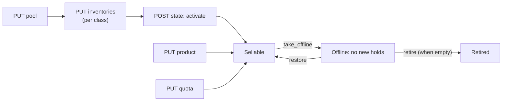

# Admin API

Endpoints for **capacity operators** (the admin panel). They manage the catalog (pools, inventories, products), customer quotas, ledger corrections and the reconciliation report. Source: `AdminController` in `src/Presentation/Arvan.Capacity.Presentation.Api/Controllers/Admin`.

## At a glance

All routes are under `/v1/admin`.

| Method | Path | Who | Purpose |
| --- | --- | --- | --- |
| `PUT` | `/pools/{id}` | admin | Create or update a pool (region, zone, host) |
| `POST` | `/pools/{id}/state` | admin; **service** for `take_offline` / `restore` | Move a pool through its state machine |
| `PUT` | `/pools/{poolId}/inventories/{resourceClass}` | admin | Set a pool's capacity for one resource class |
| `PUT` | `/products/{code}` | admin | Create or update a product and its policy |
| `PUT` | `/quotas/{customerId}/{resourceClass}/{region}` | admin | Set a customer's contract limit |
| `POST` | `/customers/{customerId}/cancel-open` | admin | Cancel a suspended customer's holds and waits |
| `POST` | `/ledger/adjustments` | admin | Correct a counter with an `ADJUST` ledger row |
| `GET` | `/reconciliation` | admin | Drift report: counters vs ledger vs reservations |
| `GET` | `/v1/capacity?detail=true` | admin, service | Per-pool numbers (see [Customer API](#api-customer)) |



## Common rules

| Rule | |
| --- | --- |
| Identity | `X-Actor-Kind: Admin` and `X-Actor-Id` on every call. No `X-Customer-Id` needed |
| Idempotency | `Idempotency-Key` required on **every write**; the key namespace is the actor id |
| Envelope | The same `ApiResult` envelope as the [Customer API](#api-customer) |
| Wrong actor | `403 actor.not_allowed` |
| Audit | Every change is logged with the actor; counter changes also write ledger rows |
| Rate limits | None on admin routes (operators are trusted and few) |

```http
PUT /v1/admin/pools/12/inventories/Vcpu
X-Actor-Kind: Admin
X-Actor-Id: ops-sara
Idempotency-Key: inv-12-vcpu-2026-11-16
Content-Type: application/json
```

---

## Pools

### `PUT /v1/admin/pools/{id}` — create or update a pool

```csharp
[HttpPut("pools/{id:int}")]
Task<ActionResult<PoolResponse>> PutPool(int id, PutPoolRequest request, CancellationToken ct);

public sealed record PutPoolRequest(string Region, string? Zone, string? HostRef);
public sealed record PoolResponse(int Id, string Region, string? Zone, string? HostRef, PoolAdminState AdminState);
```

```json
{ "region": "ir-thr", "zone": "ir-thr-1", "hostRef": null }
```

A new pool starts as `Registered`: it exists but **sells nothing** until it is activated. A blank region, or a host without a zone, is refused with `400 pool.invalid`. Use `zone` for zone pools (CPU, RAM, disk), no zone for region pools (IPv4), and `hostRef` for host pools (GPU).

### `POST /v1/admin/pools/{id}/state` — change the pool's state

```csharp
[HttpPost("pools/{id:int}/state")]
Task<ActionResult<PoolStateResponse>> ChangePoolState(int id, ChangePoolStateRequest request, CancellationToken ct);

public sealed record ChangePoolStateRequest(string Event);   // activate | take_offline | restore | retire
public sealed record PoolStateResponse(int Id, PoolAdminState AdminState);
```

```json
{ "event": "take_offline" }
```

| Event | Allowed from | Effect | Who |
| --- | --- | --- | --- |
| `activate` | `Registered` | Pool becomes sellable | admin |
| `take_offline` | `Available` | No new holds; existing holds and allocations finish normally | admin, **service** (health checker) |
| `restore` | `Offline` | Sellable again | admin, **service** |
| `retire` | `Registered`; or `Offline` with `held = 0` and `used = 0` | Final | admin |

Any other combination → `409 pool.invalid_state_transition`. Unknown pool → `404 pool.not_found`.

---

## Inventories

### `PUT /v1/admin/pools/{poolId}/inventories/{resourceClass}` — set capacity

```csharp
[HttpPut("pools/{poolId:int}/inventories/{resourceClass}")]
Task<ActionResult<InventoryChangeResponse>> PutInventory(
    int poolId, ResourceClass resourceClass, PutInventoryRequest request, CancellationToken ct);

public sealed record PutInventoryRequest(
    long Total,               // physical units, in the class's base unit
    long Reserved,            // fragmentation margin, 0..Total
    decimal AllocationRatio,  // overcommit, >= 1
    long MinUnit, long StepSize, long MaxUnit,   // allowed request sizes
    bool Force);              // see below

public sealed record InventoryChangeResponse(bool Applied, bool PoolTakenOffline, long Held, long Used);
```

```json
{ "total": 512000, "reserved": 51200, "allocationRatio": 4.0,
  "minUnit": 500, "stepSize": 500, "maxUnit": 64000, "force": false }
```

**Sellable** becomes `floor((total − reserved) × allocationRatio)`. If that is **below** `held + used`:

| `force` | Result |
| --- | --- |
| `false` | `409 inventory.below_usage`, with the current `held` and `used` |
| `true` | Change **not** applied. The pool is taken **offline** so no new holds land, and the response says `applied: false, poolTakenOffline: true`. Repeat the update once usage has drained |

Invalid shape (ratio below 1, reserved above total, bad units) → `400 inventory.configuration_invalid`.

---

## Products

### `PUT /v1/admin/products/{code}` — catalog and policy

```csharp
[HttpPut("products/{code}")]
Task<ActionResult<ProductResponse>> PutProduct(string code, PutProductRequest request, CancellationToken ct);

public sealed record PutProductRequest(
    ProductStatus Status,                         // Active | Retired
    IReadOnlyList<ResourceClass> ResourceClasses, // lines this product may request
    int HoldTtlSeconds,                           // 120..3600, default 900
    int WaitMaxSeconds,                           // 0..900, default 900
    int MaxActiveHolds,                           // per customer, > 0
    int MaxWaiting,                               // per customer, >= 0
    int MaxPoolSharePct);                         // 1..100; 100 = off, 25 for scarce products
```

```json
{
  "status": "Active",
  "resourceClasses": ["Vcpu", "RamMb", "DiskGb", "Gpu"],
  "holdTtlSeconds": 120,
  "waitMaxSeconds": 300,
  "maxActiveHolds": 4,
  "maxWaiting": 4,
  "maxPoolSharePct": 25
}
```

- `Retired` blocks **new** submits (`product.not_available`). Existing holds can still be confirmed, cancelled or expire.
- Policy changes (TTL, limits) apply to **new** reservations only. Existing `expiresAt` values never move.
- Out-of-range values → `400 product.definition_invalid`.

---

## Quotas

### `PUT /v1/admin/quotas/{customerId}/{resourceClass}/{region}` — contract limit

```csharp
[HttpPut("quotas/{customerId}/{resourceClass}/{region}")]
Task<ActionResult<QuotaResponse>> PutQuota(
    string customerId, ResourceClass resourceClass, string region, PutQuotaRequest request, CancellationToken ct);

public sealed record PutQuotaRequest(long Limit);
public sealed record QuotaResponse(string CustomerId, ResourceClass ResourceClass, string Region, long Limit);
```

```json
{ "limit": 64000 }
```

Lowering a limit **below** current usage is allowed: existing holds and allocations stay, new holds fail with `quota.exceeded` until usage drops. A customer with no row gets the class's default quota, never unlimited.

---

## Customers

### `POST /v1/admin/customers/{customerId}/cancel-open` — clean up a suspended customer

```csharp
[HttpPost("customers/{customerId}/cancel-open")]
Task<ActionResult<CancelOpenResponse>> CancelOpen(string customerId, CancellationToken ct);

public sealed record CancelOpenResponse(int Cancelled);
```

Cancels the customer's `Held` and `Waiting` reservations in batches of 200, returning held capacity. **Confirmed allocations are untouched**: their fate belongs to billing. Stopping new requests is the gateway's job.

---

## Ledger and reconciliation

### `POST /v1/admin/ledger/adjustments` — correct a counter

```csharp
[HttpPost("ledger/adjustments")]
Task<IActionResult> AdjustLedger(AdjustLedgerRequest request, CancellationToken ct);

public sealed record AdjustLedgerRequest(
    int? PoolId,              // set for an inventory counter …
    string? CustomerId,       // … or CustomerId + Region for a quota counter
    string? Region,
    ResourceClass ResourceClass,
    long DeltaHeld, long DeltaUsed,
    string Reason);           // required, kept in the ledger
```

```json
{ "poolId": 12, "customerId": null, "region": null, "resourceClass": "Vcpu",
  "deltaHeld": -2000, "deltaUsed": 0, "reason": "INC-481: hold lost by a manual edit" }
```

The **only** way to change a counter outside a reservation transition. It writes one `ADJUST` ledger row and applies the delta under the same `CHECK` constraints, so it cannot push a counter negative or over capacity. The application's database role cannot `UPDATE` counters or the ledger directly.

### `GET /v1/admin/reconciliation` — drift report

```csharp
[HttpGet("reconciliation")]
Task<ActionResult<ReconciliationResponse>> GetReconciliation([FromQuery] bool refresh, CancellationToken ct);

public sealed record ReconciliationResponse(
    DateTimeOffset GeneratedAt,
    int DriftRows,                          // must be 0
    IReadOnlyList<DriftRowResponse> Drift,  // (Check, Key, Counter, Expected, Actual)
    long UnsettledHolds, long UnsettledWaiting,
    long OutboxBacklog, long OutboxOldestAgeSeconds);
```

```json
{
  "generatedAt": "2026-11-16T11:00:00Z",
  "driftRows": 0,
  "drift": [],
  "unsettledHolds": 0,
  "unsettledWaiting": 0,
  "outboxBacklog": 0,
  "outboxOldestAgeSeconds": 0
}
```

| Check | Compares |
| --- | --- |
| Ledger vs counters | `inventories.held/used` and `quotas.held/used` vs the sums of ledger deltas |
| Reservations vs counters | `held` vs lines of Held reservations; `used` vs lines of Confirmed + Active ones |
| Unsettled backlog | Held past `expiresAt`, Waiting past `waitDeadline` |
| Outbox backlog | Unpublished events and the age of the oldest |

The sweeper computes it **hourly**; `refresh=true` computes it now. Drift is never corrected automatically: an operator decides, then uses a ledger adjustment.

---

## Error codes (admin side)

| HTTP | `error.code` | Meaning |
| --- | --- | --- |
| 400 | `idempotency.key_required`, `validation_failed` | Missing key, bad body |
| 400 | `pool.invalid`, `inventory.configuration_invalid`, `product.definition_invalid` | Values out of range |
| 401 | `identity.missing` | Missing actor headers |
| 403 | `actor.not_allowed` | Not an admin (or a service outside `take_offline` / `restore`) |
| 404 | `pool.not_found` | Unknown pool |
| 409 | `pool.invalid_state_transition` | Event not legal for the pool's state |
| 409 | `inventory.below_usage` | New sellable below `held + used`, without `force` |
| 422 | `idempotency.key_reused` | Same key, different request |
