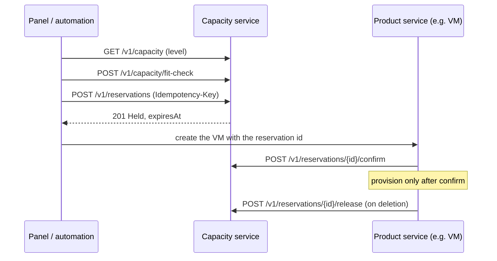

# Customer API

These are the endpoints the **customer panel**, customer automation (Terraform, scripts) and **internal product services** call. Everything here comes from the controllers in `src/Presentation/Arvan.Capacity.Presentation.Api`. The machine-readable contract is `docs/openapi/capacity.v1.json`, and a test checks that it matches the code.

## At a glance

| Method | Path | Who | Purpose | Rate group |
| --- | --- | --- | --- | --- |
| `GET` | `/v1/capacity` | any actor | Capacity **level** per product and region | `reads` |
| `POST` | `/v1/capacity/fit-check` | customer, service | Would this request fit **now**? (advisory) | `fitcheck` |
| `POST` | `/v1/reservations` | customer, service | **Submit** a reservation (hold) | `submit` |
| `GET` | `/v1/reservations/{id}` | customer, service | Read one reservation (effective status) | `reads` |
| `GET` | `/v1/reservations` | customer, service | History, newest first, filtered and paged | `reads` |
| `POST` | `/v1/reservations/{id}/confirm` | customer, service | Confirm a hold before it expires | `transitions` |
| `POST` | `/v1/reservations/{id}/cancel` | customer, service | Cancel a hold or a wait | `transitions` |
| `POST` | `/v1/reservations/{id}/extend` | customer, service | Extend a hold once | `transitions` |
| `POST` | `/v1/reservations/{id}/release` | **service, admin** | Free allocated capacity after deletion or failed provisioning | `transitions` |



## Common rules

### Headers

| Header | Required on | Values |
| --- | --- | --- |
| `X-Customer-Id` | every reservation and fit-check call | The customer id the gateway authenticated |
| `X-Actor-Kind` | every call | `Customer`, `Service`, `Admin` (case-insensitive) |
| `X-Actor-Id` | every call | The user, service or operator id |
| `Idempotency-Key` | every `POST` that changes state | 1–64 characters, `[A-Za-z0-9_-]` |

- Missing or malformed identity → `401 identity.missing`. Missing or malformed key → `400 idempotency.key_required`.
- A `Service` actor acts **on behalf of** `X-Customer-Id`, and its holds count against that customer's quota.
- A replayed response carries the header `Idempotent-Replayed: true` (see [Idempotency](#08-idempotency)).

### Response envelope

Every response, success or failure, uses the same `ApiResult` envelope.

```json
{
  "isSuccess": true,
  "data": { },
  "error": null,
  "traceId": "4bf92f3577b34da6a3ce929d0e0e4736"
}
```

```json
{
  "isSuccess": false,
  "data": null,
  "error": {
    "code": "validation_failed",
    "message": "…",
    "details": [ { "field": "lines[0].quantity", "code": "GreaterThanValidator", "message": "…" } ]
  },
  "traceId": "4bf92f3577b34da6a3ce929d0e0e4736"
}
```

- Property names are **camelCase**. Enums travel as their **member names**: `Held`, `Vcpu`, `RamMb`, `Wait`.
- `details` appears only for validation errors.
- A **stored refusal** (capacity or quota shortage) is special: the status is `409`/`422`, `error.code` gives the reason, **and `data` still carries the stored reservation**, so the client has its id.

### Enumerations

| Type | Values |
| --- | --- |
| `ResourceClass` | `Vcpu` (millicores), `RamMb` (MB), `DiskGb` (GB), `Ipv4` (units), `Gpu` (units) |
| `ReservationStatus` | `Waiting`, `Held`, `Confirmed`, `Rejected`, `Cancelled`, `Expired` |
| `ShortagePolicy` | `Reject` (default), `Wait` |
| `ReasonCode` | `HoldExpired`, `CancelledByClient`, `WaitTimeout`, `QuotaExceeded`, `PoolShareExceeded`, `CapacityTemporarilyUnavailable`, `CapacitySoldOut`, `ExceedsRegisteredCapacity` |
| `CapacityLevel` | `Available`, `Limited`, `Unavailable` |
| `AllocationState` | `Active`, `Released` (only on `Confirmed`) |
| `ReleaseReason` | `ServiceDeleted`, `ProvisioningFailed`, `Reconciled` |

Demo data: regions `ir-thr`, `ir-tbz`, `ir-ahv`, each with zones `-1` and `-2`; products include `vm-standard`, `vm-gpu`, `public-ip`.

### The reservation object

Returned by submit, get, list and every transition.

```csharp
public sealed record ReservationResponse(
    Guid Id,
    ReservationStatus Status,          // the EFFECTIVE status at the moment of reading
    bool Settled,                      // false: past its deadline, final state not yet stored
    ReasonCode? ReasonCode,
    string Product,
    string Region,
    string? Zone,
    IReadOnlyList<ReservationLineResponse> Lines,   // (ResourceClass, Quantity)
    DateTimeOffset? ExpiresAt,         // set while Held
    DateTimeOffset? WaitDeadline,      // set while Waiting
    bool Extended,
    AllocationState? AllocationState,  // set only when Confirmed
    string? ClientReference,
    int Version,                       // +1 on every transition
    DateTimeOffset CreatedAt,
    DateTimeOffset UpdatedAt);
```

---

## Capacity

### `GET /v1/capacity` — capacity levels

```csharp
[HttpGet] [EnableRateLimiting("reads")]
Task<ActionResult<CapacityLevelsResponse>> GetLevels(
    [FromQuery] string? region, [FromQuery] string? product, [FromQuery] bool detail, CancellationToken ct);
```

```http
GET /v1/capacity?region=ir-thr&product=vm-standard
X-Actor-Kind: Customer
X-Actor-Id: user-42
```

```json
{
  "isSuccess": true,
  "data": {
    "items": [ { "product": "vm-standard", "region": "ir-thr", "level": "Available" } ],
    "asOf": "2026-11-16T10:00:00Z",
    "stale": false,
    "pools": null
  },
  "error": null,
  "traceId": "…"
}
```

| Rule | |
| --- | --- |
| Level | Worst level across the product's resource classes. `Unavailable` when effective free is 0 everywhere; `Limited` below 10% of sellable; otherwise `Available` |
| Expired holds | Counted as **free** (effective free capacity) |
| `detail=true` | Adds per-pool `sellable`, `held`, `used`, `free`. **`Service` and `Admin` only**; a customer gets `403` |
| `stale` | `true` when served from cache because the database is unreachable |

### `POST /v1/capacity/fit-check` — would it fit now?

```csharp
[HttpPost("fit-check")] [EnableRateLimiting("fitcheck")]
Task<ActionResult<FitCheckResponse>> FitCheck(FitCheckRequest request, CancellationToken ct);

public sealed record FitCheckRequest(string Product, string Region, string? Zone, IReadOnlyList<FitCheckLineRequest> Lines);
public sealed record FitCheckResponse(bool Fits, ReasonCode? Code, IReadOnlyList<FitCheckLineResponse> Lines);
```

```json
{ "product": "vm-standard", "region": "ir-thr", "zone": null,
  "lines": [ { "resourceClass": "Vcpu", "quantity": 4000 } ] }
```

```json
{ "fits": false, "code": "QuotaExceeded",
  "lines": [ { "resourceClass": "Vcpu", "code": "QuotaExceeded" } ] }
```

> **Advisory only.** It includes the caller's quota but never says how much is free, and only a hold guarantees capacity. It is rate-limited (5/s) so it cannot be used to probe exact inventory.

---

## Reservations

### `POST /v1/reservations` — submit

```csharp
[HttpPost] [EnableRateLimiting("submit")]
Task<ActionResult<ReservationResponse>> Submit(SubmitReservationRequest request, CancellationToken ct);

public sealed record SubmitReservationRequest(
    string Product, string Region, string? Zone,
    IReadOnlyList<SubmitReservationLineRequest> Lines,   // 1–16 lines, each class once
    ShortagePolicy? OnShortage,                          // Reject (default) or Wait
    string? ClientReference);                            // unique among open + confirmed
```

```http
POST /v1/reservations
X-Customer-Id: cust-001
X-Actor-Kind: Customer
X-Actor-Id: user-42
Idempotency-Key: order-123-submit
Content-Type: application/json
```

```json
{
  "product": "vm-standard",
  "region": "ir-thr",
  "zone": "ir-thr-1",
  "lines": [
    { "resourceClass": "Vcpu",   "quantity": 4000 },
    { "resourceClass": "RamMb",  "quantity": 8192 },
    { "resourceClass": "DiskGb", "quantity": 80 },
    { "resourceClass": "Ipv4",   "quantity": 1 }
  ],
  "onShortage": "Reject",
  "clientReference": "order-123"
}
```

```json
{
  "isSuccess": true,
  "data": {
    "id": "01936c4e-8f0a-7b3e-9a51-2c4d5e6f7a80",
    "status": "Held",
    "settled": true,
    "reasonCode": null,
    "product": "vm-standard",
    "region": "ir-thr",
    "zone": "ir-thr-1",
    "lines": [ { "resourceClass": "Vcpu", "quantity": 4000 }, "…" ],
    "expiresAt": "2026-11-16T10:15:00Z",
    "waitDeadline": null,
    "extended": false,
    "allocationState": null,
    "clientReference": "order-123",
    "version": 1,
    "createdAt": "2026-11-16T10:00:00Z",
    "updatedAt": "2026-11-16T10:00:00Z"
  },
  "error": null,
  "traceId": "…"
}
```

**Outcomes**

| Status | When | `error.code` | Stored? |
| --- | --- | --- | --- |
| `201 Created` + `Location` | All lines held | | yes |
| `202 Accepted` + `Location` | Temporary shortage and `onShortage: Wait` → `Waiting` | | yes |
| `409` | Short only because of open holds or an offline pool (+ `Retry-After`) | `capacity.temporarily_unavailable` | yes, `data` = rejected reservation |
| `409` | Live allocations fill it | `capacity.sold_out` | yes |
| `409` | Contract limit, counting open holds | `quota.exceeded` | yes |
| `409` | Over the customer's share of a scarce pool | `capacity.pool_share_exceeded` | yes |
| `422` | Bigger than any pool could ever provide | `capacity.exceeds_registered` | yes |
| `400` | Body shape (with field `details`), bad zone, bad quantity, bad lines | `validation_failed`, `reservation.zone_invalid`, `capacity.quantity_not_allowed`, `reservation.lines_invalid` | no |
| `422` | Unknown or retired product, or a class the product does not allow | `product.not_available` | no |
| `409` | `clientReference` already used by an open or confirmed reservation | `reservation.client_reference_taken` | no |
| `429` | Hold or waiting limit, cooldown, or rate limit (+ `Retry-After`) | `reservation.hold_limit_reached`, `reservation.cooldown_active`, `rate.limited` | no |
| `503` | Lock timeout on a hot row (+ `Retry-After: 1`) | `service.unavailable` | no, retry with the **same key** |

### `GET /v1/reservations/{id}` — read one

```csharp
[HttpGet("{id:guid}")] [EnableRateLimiting("reads")]
Task<ActionResult<ReservationResponse>> Get(Guid id, CancellationToken ct);
```

- Returns the **effective** status: a `Held` reservation past `expiresAt` reads as `Expired` with `settled: false` until the sweeper stores it.
- Another customer's id → `404` (existence is never revealed).

### `GET /v1/reservations` — history

```csharp
[HttpGet] [EnableRateLimiting("reads")]
Task<ActionResult<PagedData<ReservationResponse>>> List([FromQuery] ListReservationsRequest request, CancellationToken ct);

public sealed record ListReservationsRequest {
    ReservationStatus[]? Status;   // filter on the effective status
    string? Product; string? Region;
    int PageNumber = 1; int PageSize = 20;
}
```

```http
GET /v1/reservations?status=Held&status=Waiting&region=ir-thr&pageNumber=1&pageSize=20
```

```json
{
  "isSuccess": true,
  "data": {
    "items": [ { "id": "…", "status": "Held", "…": "…" } ],
    "pagination": { "pageNumber": 1, "pageSize": 20, "totalCount": 3,
                    "totalPages": 1, "hasNextPage": false, "hasPreviousPage": false }
  },
  "error": null,
  "traceId": "…"
}
```

Newest first. Only the caller's own reservations.

### `POST /v1/reservations/{id}/confirm`

```csharp
[HttpPost("{id:guid}/confirm")] [EnableRateLimiting("transitions")]
Task<ActionResult<ReservationResponse>> Confirm(Guid id, CancellationToken ct);
```

| Status | When |
| --- | --- |
| `200` | `Held` → `Confirmed`, `allocationState: Active`. Also `200` with the current resource if it is **already** `Confirmed` |
| `409 reservation.expired` | `now >= expiresAt`. The product service **must not provision** |
| `409 reservation.invalid_state_transition` | Any other state |
| `404` | Not the caller's reservation |

### `POST /v1/reservations/{id}/cancel`

```csharp
[HttpPost("{id:guid}/cancel")] [EnableRateLimiting("transitions")]
Task<ActionResult<ReservationResponse>> Cancel(Guid id, CancellationToken ct);
```

`Held` or `Waiting` → `Cancelled`; held capacity returns **immediately**. Cancel on `Cancelled` returns `200` with the current resource; cancel on `Confirmed` is `409 reservation.invalid_state_transition` (use release instead).

### `POST /v1/reservations/{id}/extend`

```csharp
[HttpPost("{id:guid}/extend")] [EnableRateLimiting("transitions")]
Task<ActionResult<ReservationResponse>> Extend(Guid id, CancellationToken ct);
```

Adds the product's TTL to `expiresAt` **once**, capped at `created + 2 × ttl + wait_max`. A second extend → `409`. Extending an expired hold → `409 reservation.expired`.

### `POST /v1/reservations/{id}/release` — product services only

```csharp
[HttpPost("{id:guid}/release")] [EnableRateLimiting("transitions")]
Task<ActionResult<ReservationResponse>> Release(Guid id, ReleaseReservationRequest request, CancellationToken ct);

public sealed record ReleaseReservationRequest(ReleaseReason Reason);  // ServiceDeleted | ProvisioningFailed | Reconciled
```

```json
{ "reason": "ServiceDeleted" }
```

| Status | When |
| --- | --- |
| `200` | `Confirmed` + `Active` → `allocationState: Released`; `used` drops. Repeating it returns the same result; capacity returns **once** |
| `403 actor.not_allowed` | Called with `X-Actor-Kind: Customer` |
| `409` | The reservation is not `Confirmed` |

---

## Error codes (customer side)

| HTTP | `error.code` | Meaning |
| --- | --- | --- |
| 400 | `idempotency.key_required` | Missing or malformed `Idempotency-Key` |
| 400 | `validation_failed` | Body shape; `details` lists each field |
| 400 | `reservation.lines_invalid`, `reservation.zone_invalid`, `capacity.quantity_not_allowed`, `reservation.client_reference_invalid` | Domain validation |
| 401 | `identity.missing` | Missing or malformed identity headers |
| 403 | `actor.not_allowed` | This actor kind may not do this |
| 404 | `reservation.not_found` | Unknown id, or another customer's |
| 409 | `reservation.invalid_state_transition` | Event not legal in the current effective state |
| 409 | `reservation.expired` | Confirm or extend after `expiresAt` |
| 409 | `reservation.already_extended` | Second extension |
| 409 | `reservation.client_reference_taken` | Reference already in use |
| 409 | `capacity.temporarily_unavailable`, `capacity.sold_out`, `capacity.pool_share_exceeded`, `quota.exceeded` | Stored refusals |
| 422 | `capacity.exceeds_registered` | Stored refusal: can never fit |
| 422 | `idempotency.key_reused` | Same key, different request |
| 422 | `product.not_available` | Unknown or retired product, or a class it does not allow |
| 429 | `rate.limited`, `reservation.hold_limit_reached`, `reservation.cooldown_active` | Slow down (`Retry-After`) |
| 503 | `service.unavailable` | Lock timeout or failover; retry with the same key (`Retry-After`) |

## Rate limits

| Group | Refill | Burst | Endpoints |
| --- | --- | --- | --- |
| `submit` | 10 / s | 20 | submit |
| `fitcheck` | 5 / s | 10 | fit-check |
| `reads` | 50 / s | 100 | capacity, get, list |
| `transitions` | 20 / s | 40 | confirm, cancel, extend, release |

Per customer, per API instance. Details in [Rate limits and fairness](#09-rate-limits-fairness).
