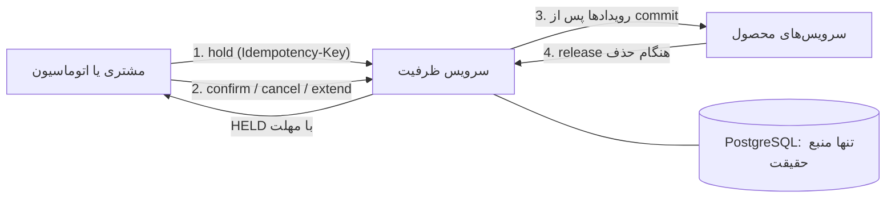

# از اینجا شروع کنید

> **این یک چالش کد و معماری است، نه یک محصول زنده.**
> هیچ‌چیز از این پروژه در محیط production اجرا نمی‌شود و ترافیک واقعی هم وجود ندارد. هدف این راهنما این است که به بازبین‌ها نشان دهد **من چطور آن را طراحی کردم، چرا هر مصالحه (trade-off) را انتخاب کردم و زیر چه محدودیت‌هایی کار کردم.**

## نسخهٔ یک‌دقیقه‌ای

یک ارائه‌دهندهٔ ابری VM، GPU، IP و سرویس‌های مدیریت‌شده را در چند منطقه می‌فروشد. پیش از ساختن یک سرویس باید مطمئن شود که ظرفیت وجود دارد و اغلب باید آن ظرفیت را برای چند دقیقه کنار بگذارد.

من **هستهٔ backend یک سرویس رزرو ظرفیت** را ساختم:

- مشتری چند منبع را هم‌زمان **hold** می‌کند. یا همهٔ آن‌ها hold می‌شوند، یا هیچ‌کدام.
- hold یک **lease** با مهلت مشخص است. مشتری آن را تأیید یا لغو می‌کند، یا می‌گذارد منقضی شود.
- ظرفیت **هرگز دو بار فروخته نمی‌شود**، حتی زیر هم‌زمانی سنگین. این را پایگاه داده تضمین می‌کند، نه فقط کد.
- retry امن است: همان درخواست اگر دو بار فرستاده شود، همان پاسخ را می‌گیرد.
- پس از هر crash، هر عددی را می‌توان **از روی یک ledger فقط‌افزودنی (append-only) توضیح داد**.

## موضع من در هفت جمله

1. مسئلهٔ واقعی یک **ledger رزروها** است، نه یک «سرویس VM». مرز سیستم را همان‌جا کشیدم.
2. من **هرگز بیش‌فروشی (oversell) نمی‌کنم**. هر جا چیزی مبهم باشد، سیستم به‌جای حدس زدن رد می‌کند.
3. تصمیم hold **هم‌گام (synchronous) و محلی** است: یک تراکنش پایگاه داده با حدود 5 ms زمان قفل.
4. درستی **در پایگاه داده** قرار دارد (به‌روزرسانی‌های شرطی، قیدهای `CHECK`، ترتیب ثابت قفل‌گذاری)، چون دو درخواست در حافظهٔ برنامه هر دو «1 عدد باقی مانده» را می‌بینند.
5. هر حالت انتظار **یک مهلت دارد**، پس کار رهاشده همیشه ظرفیتش را برمی‌گرداند.
6. **نسخهٔ اول را کوچک نگه داشتم**: یک PostgreSQL، یک باینری، بدون Redis، بدون workflow engine. برای هر چیزی که کنار گذاشته شده، یک شرط قابل‌اندازه‌گیری برای اضافه کردن دوباره‌اش وجود دارد.
7. **بخش‌های سخت را روی یک PostgreSQL واقعی آزمودم** و نتایج آزمون بار را حتی جایی که به هدف خودم نرسیده‌اند گزارش می‌کنم.

## محدودیت‌های من

| محدودیت | اثر روی طراحی |
| --- | --- |
| متن چالش عمداً ناقص است و تیم به سؤال‌ها پاسخ نمی‌دهد | هر ابهام به یک **فرض صریح و مکتوب** تبدیل شد (20 فرض) |
| عدد واقعی از ترافیک در دست نیست | یک **مدل بار فرضی** ساختم و محدودیت‌های واقعی را با k6 اندازه می‌گیرم |
| دامنهٔ یک چالش، نه یک پلتفرم | **مسیر درستی را کامل** تحویل دادم و مقیاس و HA را فقط در حد طراحی مستند کردم |
| یک توسعه‌دهنده، یک لپ‌تاپ | نتایج بار از **یک VM روی لپ‌تاپ** می‌آیند؛ شکل رفتار را نشان می‌دهند، نه ظرفیت production را |
| ارزیاب‌ها خودشان آن را اجرا می‌کنند | **یک فرمان** (`make up`)، آزمون‌ها روی PostgreSQL واقعی از طریق Testcontainers |

## این راهنما را چطور بخوانید

| اگر این‌قدر وقت دارید | بخوانید |
| --- | --- |
| **5 دقیقه** | همین صفحه، سپس [نمای کلی راه‌حل](#03-solution-overview) |
| **20 دقیقه** | به‌علاوهٔ [منطق اصلی](#07-core-logic)، [Idempotency](#08-idempotency) و [محدودیت نرخ](#09-rate-limits-fairness) |
| **یک ساعت** | همه‌چیز به ترتیب. فصل *تصمیم‌ها* هر انتخاب را به گزینه‌های ردشده‌اش پیوند می‌دهد |

## نقشهٔ این راهنما

| گروه | فصل‌ها |
| --- | --- |
| **چرا** | مسئله · فرض‌ها و محدودیت‌ها |
| **چه** | نمای کلی راه‌حل · تصمیم‌ها (ADRها) |
| **چطور ساخته شده** | مدل داده · ماشین‌های حالت · منطق اصلی · Idempotency · محدودیت نرخ و انصاف · ساختار کد |
| **اثبات** | حالت‌های لبه · آزمون و پوشش · آزمون بار |
| **صداقت** | مصالحه‌ها و مسیر رشد |

> اسناد کامل منبع (PRD، 24 ADR، 12 spec، پایگاه داده، حالت‌های لبه) در پوشه‌های هم‌سطح زیر `docs/` باقی می‌مانند. این راهنما خلاصهٔ خوانای آن‌هاست.
