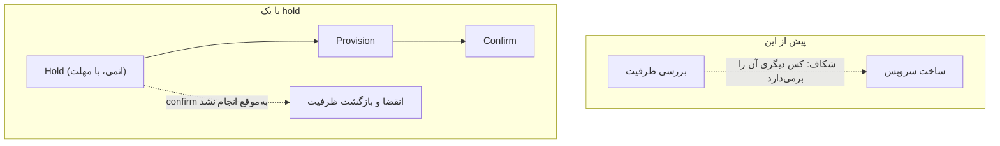

# مسئله

## صورت مسئله چه می‌گوید

یک ارائه‌دهندهٔ ابری چند محصول (VM، سرویس‌های مدیریت‌شده، GPU، IP عمومی) را در چند منطقه می‌فروشد. پیش از ساخته شدن برخی سرویس‌ها، ارائه‌دهنده باید بررسی کند که درخواست قابل پاسخ‌گویی است و گاهی آن ظرفیت را برای مدت کوتاهی، تا زمانی که سرویس ساخته می‌شود، کنار بگذارد.

امروز این کار بین ابزارها و مراحل دستی پخش شده است. با رشد مشتری‌ها و محصولات، سه خرابی ظاهر می‌شود.

## سه نشانه، سه علت ریشه‌ای، سه تضمین

| چه چیزی خراب می‌شود | علت ریشه‌ای | این سرویس چه چیزی را تضمین می‌کند |
| --- | --- | --- |
| مشتری **ظرفیت را می‌بیند، اما** هنگام ساخت سرویس **دیگر وجود ندارد** | بررسی و برداشتن دو مرحلهٔ جدا هستند | یک **hold** اتمی و زمان‌دار که در یک تراکنش گرفته می‌شود |
| نتیجه روشن نیست، پس مشتری **درخواست را دوباره می‌فرستد** | وضعیت درخواست ماندگار نیست و حذف تکرار (deduplication) وجود ندارد | یک **ماشین حالت** ماندگار و **idempotency** روی هر عملیات تغییردهنده |
| یک فرایند **شروع می‌شود و هرگز تمام نمی‌شود** | هیچ‌کس مالک کار رهاشده نیست | هر حالت میانی یک **مهلت** دارد؛ ظرفیت همیشه برمی‌گردد |

## صورت مسئله می‌خواهد مشتری چه کارهایی بتواند بکند

| # | قابلیت | کجا پیاده شده |
| --- | --- | --- |
| 1 | دیدن وضعیت ظرفیت محصول | `GET /v1/capacity` (سطح‌ها) و `POST /v1/capacity/fit-check` |
| 2 | ثبت درخواست ظرفیت | `POST /v1/reservations` |
| 3 | پیگیری وضعیت درخواست | `GET /v1/reservations/{id}` |
| 4 | تکمیل یا لغو تخصیص | `confirm`، `cancel`، `extend` و `release` برای سرویس‌های محصول |
| 5 | دیدن درخواست‌های قبلی | `GET /v1/reservations` (جدیدترین اول، با فیلتر و صفحه‌بندی) |

## اهداف

| شناسه | هدف | چطور اندازه‌گیری می‌شود |
| --- | --- | --- |
| G-1 | هرگز یک ظرفیت دو بار فروخته نشود | تعداد رخدادهای بیش‌فروشی = 0؛ اختلاف ledger با شمارنده‌ها = 0 |
| G-2 | هر درخواست یک نتیجهٔ قطعی و قابل‌پرس‌وجو دارد | یک retry با همان کلید همان نتیجه را برمی‌گرداند |
| G-3 | درخواست‌های رهاشده هرگز ظرفیت را نگه نمی‌دارند | تأخیر آزادسازی holdهای منقضی‌شده p99 < 5 s |
| G-4 | رفتار پس از هر قطعی قابل توضیح است | هر شمارنده از روی ledger فقط‌افزودنی قابل بازسازی است |
| G-5 | آن‌قدر سریع که بتواند در مسیر ساخت سرویس قرار بگیرد | p99 برای hold < 150 ms؛ دسترس‌پذیری 99.95% |
| G-6 | محصولات و منابع جدید به تغییر کد نیاز ندارند | افزودن یک محصول یا resource class فقط یک تغییر داده است |

## خارج از هدف

این موارد را صورت مسئله یا دامنهٔ کار من کنار گذاشته است:

- رابط گرافیکی، احراز هویت و مدیریت کاربر، صورت‌حساب، ساخت واقعی VM یا زیرساخت، استقرار واقعی چندمنطقه‌ای.
- **جای‌گذاری (placement)** روی hostهای فیزیکی (bin-packing). این سرویس ظرفیت را می‌شمارد؛ یک scheduler آن را جای‌گذاری می‌کند.
- **ارکستراسیون** ساخت سرویس. سرویس‌های محصول خودشان provision می‌کنند و confirm، cancel و release را صدا می‌زنند.
- webhookهای رو به مشتری. رویدادها داخلی هستند.

## چه کسانی از آن استفاده می‌کنند

| کاربر | نیازها |
| --- | --- |
| مشتری در پنل | پیام‌های روشن؛ هرگز برای چیزی که به دست نمی‌آید «موجود» نشنود |
| اتوماسیون مشتری (Terraform، اسکریپت‌ها) | Idempotency، کدهای خطای قابل‌فهم برای ماشین، `Retry-After` |
| سرویس‌های داخلی محصول (VM، DBaaS، IP) | confirm و release امن و سریع؛ رویداد هنگام تغییر وضعیت |
| اپراتورهای ظرفیت | Admin API برای ثبت poolها، تنظیم overcommit، تنظیم سهمیه‌ها؛ یک گزارش drift |

## بخش سخت در یک جمله

> فراخوان‌های زیادی **آخرین واحد** را در یک لحظه می‌خواهند، روی **چند منبع به‌طور هم‌زمان**، در حالی که کلاینت‌ها retry می‌کنند، پروسه‌ها crash می‌کنند و تایمرها فعال می‌شوند، و باز هم پاسخ باید دقیقاً درست باشد.
