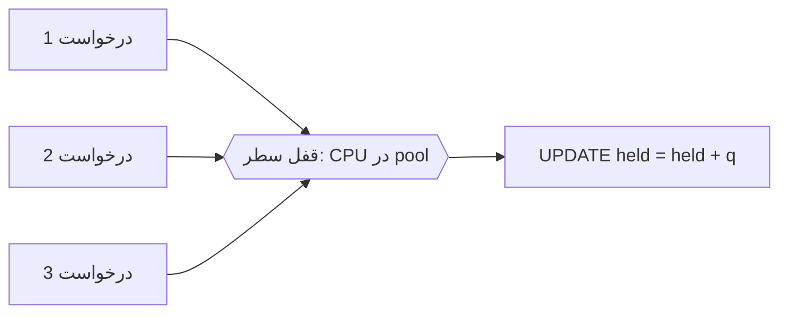

# فرض‌ها و محدودیت‌ها

## چرا این فصل مهم است

متن چالش عمداً ناقص است و تیم به سؤال‌ها پاسخ نمی‌دهد. پس آنچه بازبین در واقع می‌سنجد این است که **من کدام شکاف‌ها را دیدم، چه چیزی را می‌پرسیدم و هر پاسخ را چطور توجیه کردم.**

هر ابهام به یک فرض مکتوب تبدیل شد (`A-1` … `A-20` در PRD). هر کدام همچنین می‌گوید **اگر بازبین چیز دیگری فرض کند، چه چیزی تغییر می‌کند.**

## چارچوب تصمیم‌گیری: سه سطح

برای هر ابهام سه گزینه نوشتم و سپس یکی را انتخاب کردم.

| سطح | معنا |
| --- | --- |
| **1 – ضعیف** | تا وقتی بار و هم‌زمانی کم است کار می‌کند. زیر رقابت (contention) یا خرابی، نادرست است. |
| **2 – میانی** | درست است. روی یک سلول منطقه‌ای (regional cell) تا ده‌ها برابر بار تخمینی کار می‌کند. راه سطح 3 را نمی‌بندد. |
| **3 – سازمانی بالغ** | برای مقیاس بزرگ، مناطق زیاد یا سازمان‌های پیچیده لازم است. هزینهٔ عملیاتی بالایی دارد. |

> **قاعدهٔ من.** جایی که *درستی* در خطر است (بیش‌فروشی، idempotency، audit)، سطح 2 را کامل یا بالاتر از آن برمی‌دارم. جایی که فقط *مقیاس* در خطر است، سطح 2 را برمی‌دارم و **شرط عددی (trigger)** حرکت به سطح 3 را می‌نویسم.

## شش فرضی که به معماری شکل می‌دهند

| # | سؤال | اگر پاسخ متفاوت باشد | تصمیم من |
| --- | --- | --- | --- |
| 1 | حقیقت ظرفیت فیزیکی در اختیار کیست؟ | اگر بیرونی باشد، این یک facade است، نه یک ledger | این سرویس مالک ظرفیت **قابل فروش (sellable)** است. ظرفیت فیزیکی از طریق admin API وارد می‌شود |
| 2 | آیا ساخت سرویس را ارکستره می‌کنیم؟ | مرز سیستم را تغییر می‌دهد و به workflow engine نیاز دارد | **فقط رزرو.** provisioning متعلق به سرویس‌های دیگر است |
| 3 | چه کسی حذف و بازگشت ظرفیت را گزارش می‌کند؟ | بدون آن، حساب‌وکتاب هرگز بسته نمی‌شود | یک API برای **release** به‌علاوهٔ reconciliation دوره‌ای |
| 4 | ظرفیت در چه سطحی معنا دارد؟ | یک شمارندهٔ ساده در برابر bin-packing واقعی | CPU، RAM و دیسک به ازای هر **zone**؛ IP به ازای هر **منطقه**؛ GPU به ازای هر **host** |
| 5 | در قطعی جزئی، رد کنیم یا با ریسک بیش‌فروشی بپذیریم؟ | موضع در CAP | **هرگز بیش‌فروشی نه.** خود سرویس fail closed می‌کند |
| 6 | عددهای واقعی چه هستند؟ | همهٔ آستانه‌ها | یک **سناریوی فرضی** که بعداً با k6 اندازه‌گیری می‌شود |

## فرض‌های کوچک‌تر

| شناسه | فرض |
| --- | --- |
| A-7 | TTL hold به ازای هر محصول است: پیش‌فرض **15 دقیقه**، بازهٔ 2 تا 60، و **یک** بار تمدید |
| A-8 | overcommit یک `allocation_ratio` به ازای هر inventory است که اپراتورها تنظیمش می‌کنند |
| A-9 | سرویس **واحدها را می‌شمارد**؛ انتخاب نمی‌کند کدام IP یا GPU |
| A-10 | درخواست‌ها **همه یا هیچ (all-or-nothing)** هستند؛ پاسخ رد می‌گوید کدام سطر کم بود |
| A-11 | سهمیه‌ها **سخت (hard)** هستند، به ازای (مشتری، resource class، منطقه) |
| A-12 | **holdهای باز از سهمیه کم می‌شوند**، پس درخواست‌های موازی نمی‌توانند قرارداد را دور بزنند |
| A-13 | در v1 poolهای اختصاصی سازمانی نداریم؛ مدل pool برای آن‌ها جا باز گذاشته است |
| A-14 | مشتری‌ها یک **سطح** (`AVAILABLE`، `LIMITED`، `UNAVAILABLE`) به‌علاوهٔ یک fit-check می‌بینند؛ عددهای دقیق برای فراخوان‌های داخلی است |
| A-15 | دسترس‌پذیری 99.95%، p99 برای hold زیر 150 ms |
| A-16 | gateway احراز هویت می‌کند و headerهای هویتی مورد اعتماد را عبور می‌دهد |
| A-17 | رویدادها داخلی‌اند و از طریق outbox منتشر می‌شوند؛ webhook نداریم |
| A-18 | تاریخچه 13 ماه آنلاین می‌ماند و سپس بایگانی می‌شود |
| A-19 | هر درخواست **دقیقاً یک منطقه** را هدف می‌گیرد |
| A-20 | انتظار **اختیاری (opt-in)** است، فقط برای کمبودهای موقت، حداکثر 15 دقیقه |

## مدل بار (عمداً فرضی)

هیچ عدد واقعی در دست نیست، پس یک سناریوی از نظر درونی سازگار ساختم. **همهٔ آستانه‌های ADRها از آن مشتق شده‌اند** و هر جا نتایج k6 با آن مخالف باشند، جایگزینش می‌شوند.

| کمیت | تخمین | مبنا |
| --- | --- | --- |
| مشتری‌های فعال IaaS | حدود 30k (بازهٔ 15k تا 60k) | رشد از حدود 25k مشتری کل در یک گزارش عمومی رخداد |
| VMهای زنده | حدود 100k | حدود 3 VM به ازای هر مشتری |
| درخواست‌های رزرو در روز | حدود 50k | 5% churn روزانهٔ VM ×2 محصول دیگر ×4 اتوماسیون |
| نرخ میانگین | 0.6 / s | 50k ÷ 86,400 |
| **اوج ساعتی** | **حدود 6 / s** | 10× میانگین |
| burst روی یک محصول کمیاب | 200 تا 300 / s به مدت 1 تا 2 دقیقه | عرضهٔ GPU یا یک طوفان retry |
| سطرها در هر درخواست | میانگین 4، حداکثر 16 | CPU، RAM، دیسک، IP |
| holdهای فعال هم‌زمان | حدود 5,400 در اوج | نرخ × TTL پانزده‌دقیقه‌ای |
| خواندن‌های ظرفیت | حدود 100 / s در اوج | 10 تا 20 برابر نوشتن‌ها، قابل cache |
| رشد داده | حدود 18M درخواست، حدود 200M سطر ledger، 60 تا 100 GB در سال | حدود 3 سطر ledger به ازای هر سطر درخواست |

### اهداف طراحی

| هدف | مقدار | در مقایسه با تخمین |
| --- | --- | --- |
| hold پایدار به ازای هر سلول منطقه‌ای | **500 / s** | حدود 80× اوج ساعتی |
| دسترس‌پذیری (hold و confirm) | 99.95% | حدود 22 دقیقه downtime در ماه |
| تأخیر hold | p99 < 150 ms | |
| RPO برای رزروهای تأییدشده | **0** | replication هم‌گام |
| RTO | < 60 s | failover خودکار |
| تأخیر آزادسازی holdهای منقضی‌شده | < 5 s | |

## گلوگاه واقعی: یک hot row

سقف، throughput کل PostgreSQL **نیست**. سقف، **قفل روی یک سطر inventory** است: هر VM که در تهران ساخته می‌شود، همان سطر CPU آن pool را قفل می‌کند.

- زمان قفل با یک round trip و یک commit هم‌گام: حدود **3 تا 5 ms**.
- سقف نظری برای یک سطر: **200 تا 300 hold در ثانیه**. حد کاری امن: **حدود 150 در ثانیه**.
- اوج تخمینی 6 در ثانیه است، پس یک pool به‌تنهایی حدود **25 برابر حاشیه** دارد.
- برای رسیدن به 500 در ثانیه در هر سلول، بار باید روی **دست‌کم 4 pool** پخش شود (تقسیم بر اساس zone یا cluster). این یک تغییر داده است، نه تغییر کد.

> عددهای بالا **تخمین‌های** من هستند. [آزمون بار](#13-load-test) جایی است که این عددها با واقعیت روبه‌رو می‌شوند. روی VM داکر یک لپ‌تاپ، یک hold در ابتدا به‌جای یک round trip، 28 round trip طول می‌کشید و یک سطر خیلی پایین‌تر از 150 در ثانیه از کار افتاد. پس از batch کردن نوشتن‌ها و قفل کردن سطر در آخرین مرحله (9 round trip)، holdهای پذیرفته‌شده روی یک سطر در آن اجراها تا 200 در ثانیه زیر 150 ms در p99 ماندند و بین 200 و 300 در ثانیه شکستند. این‌ها اندازه‌گیری‌های لپ‌تاپ هستند، نه عددهای production.

## عمداً خارج از دامنه گذاشته شد

| ساخته نشد | چرا |
| --- | --- |
| سهمیه‌های سلسله‌مراتبی یا سراسری | نیازی در صورت مسئله نبود؛ به‌عنوان گام رشد 7 نوشته شده است |
| جای‌گذاری با bin-packing | سرویس می‌شمارد؛ schedulerها جای‌گذاری می‌کنند (fragmentation یک ریسک باز و شناخته‌شده است) |
| Webhookها، CDC | رویدادهای داخلی outbox برای v1 کافی است |
| HA واقعی / چندمنطقه‌ای | در ADRها توصیف شده؛ schema از همین حالا `region` را دارد، پس به migration نیاز ندارد |
