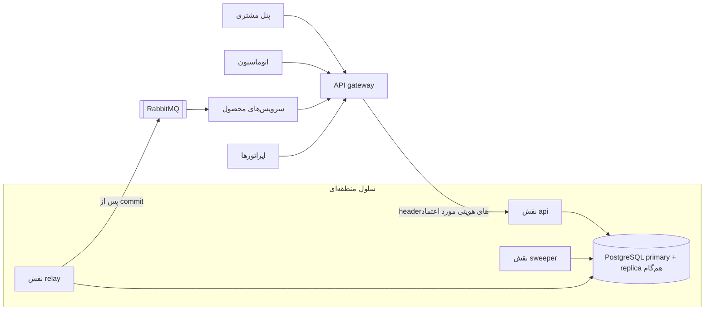
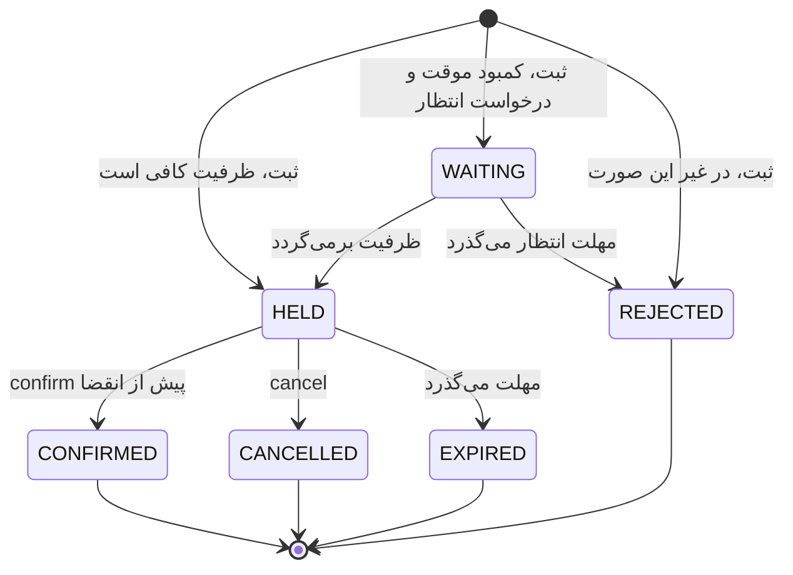

# نمای کلی راه‌حل

## طراحی در شش خط

1. یک **monolith ماژولار** روی ASP.NET Core (.NET 10). تنها وابستگی stateful در مسیر درستی، **PostgreSQL 17** است.
2. یک **ledger فقط‌افزودنی (append-only)** منبع حقیقت است. شمارنده‌ها **درون همان تراکنش** از آن مشتق می‌شوند.
3. تصمیم hold **هم‌گام (synchronous)** است و در **یک تراکنش محلی** گرفته می‌شود. هر درخواست یک ماشین حالت ماندگار با یک lease و انقضای تنبل (lazy expiry) است.
4. واحد استقرار یک **سلول منطقه‌ای (regional cell)** است. هر تراکنش دقیقاً یک منطقه را لمس می‌کند، پس جدا کردن مناطق در آینده به تغییر schema نیاز ندارد.
5. هدف طراحی: **500 hold در ثانیه به ازای هر سلول**، در برابر اوج تخمینی حدود 6 در ثانیه (حدود 80 برابر حاشیه).
6. رویدادها از طریق یک **outbox تراکنشی** خارج می‌شوند. RabbitMQ هرگز در مسیر تصمیم نیست.

## بافت سیستم



- gateway احراز هویت می‌کند و `X-Customer-Id`، `X-Actor-Kind` و `X-Actor-Id` را عبور می‌دهد.
- هر مسیر نوشتن به **یک تراکنش PostgreSQL** ختم می‌شود. قطعی RabbitMQ رویدادها را به تأخیر می‌اندازد؛ هرگز جلوی یک رزرو را نمی‌گیرد.

## سه نقش زمان اجرا، یک image

| نقش | کار | تعداد نمونه |
| --- | --- | --- |
| `api` | endpointهای HTTP، rate limiter، OpenAPI | 3 یا بیشتر، stateless |
| `sweeper` | منقضی کردن holdها، timeout کردن انتظارها، ارتقای منتظرها، پاک کردن کلیدهای idempotency، reconciliation ساعتی | 2 (به لطف `SKIP LOCKED` امن است) |
| `relay` | انتقال سطرهای outbox به RabbitMQ | 2 (`SKIP LOCKED`) |

هیچ state بیرون از پایگاه داده نگه داشته نمی‌شود، پس **هر نمونه را می‌توان هر لحظه kill کرد**.

## زندگی یک رزرو، در یک نگاه



بدترین حالت با مقادیر پیش‌فرض: 15 دقیقه انتظار + 15 دقیقه hold + یک تمدید 15 دقیقه‌ای = **45 دقیقه**. پس از آن هر درخواست در یک حالت نهایی است و ظرفیتش برگشته است.

## سه پاسخ کمبود

کمبود یک خطای واحد نیست. فراخوان باید بداند آیا retry کردن هیچ‌وقت کمکی می‌کند یا نه.

| کد | معنا | retry کمک می‌کند؟ |
| --- | --- | --- |
| `EXCEEDS_REGISTERED_CAPACITY` (422) | بزرگ‌تر از چیزی که هیچ poolی هرگز بتواند فراهم کند | **هرگز** |
| `CAPACITY_SOLD_OUT` (409) | در تئوری جا می‌شود، اما تخصیص‌های زنده آن را پر کرده‌اند | نه در یک بازهٔ زمانی مشخص |
| `CAPACITY_TEMPORARILY_UNAVAILABLE` (409 + `Retry-After`) | فقط به‌خاطر holdهای باز یا یک pool آفلاین کم است | **بله، در طول یک TTL** |

فقط سومی می‌تواند به `WAITING` تبدیل شود، و آن هم فقط وقتی کلاینت `on_shortage = WAIT` بفرستد.

## چه چیزی ساخته شد و چه چیزی فقط طراحی شد

| موضوع | در کد تحویل‌شده | فقط در سند طراحی |
| --- | --- | --- |
| پنج قابلیت مشتری | هر پنج، به‌علاوهٔ `release` و `fit-check` | |
| ledger، شمارنده‌ها، سهمیه‌ها | کامل، با قیدهای `CHECK` | سهمیه‌های سلسله‌مراتبی و سراسری |
| Idempotency | کامل | |
| انقضا | sweeper، انقضای تنبل (effective)، تمدید lease | انقضای مبتنی بر سطل‌های زمانی (time-bucketed) |
| رویدادها | outbox و relay؛ RabbitMQ در یک profile اختیاری | CDC، webhookها |
| بازیابی | فرمان `reconcile` و یک آزمون kill | reconcile در برابر inventory واقعی |
| دادهٔ نمایشی | 3 منطقه، حدود 10 محصول، مشتری‌هایی با سهمیه | |
| HA و چندمنطقه‌ای | `region` در schema و در هر تراکنش | Patroni/CloudNativePG، سلول‌ها، control plane سراسری |
| احراز هویت | headerهای مورد اعتماد برای هویت | gateway و RBAC |
| آزمون بار | اسکریپت‌های k6 و یک اجرای commit‌شده روی لپ‌تاپ | benchmark روی سخت‌افزار production |

> صورت مسئله درستی در مسیر اصلی را خواسته بود. من عمق کار را آنجا گذاشتم و بقیه را مستند کردم.

## اجرا کنید

```bash
make up      # PostgreSQL, RabbitMQ, migrations, api, sweeper, relay, demo data
make demo    # walks through every outcome with curl
make test    # unit, integration (Testcontainers) and architecture tests
make load    # k6 scenarios
make down
```
