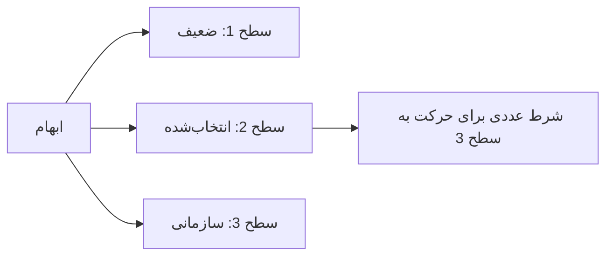

# تصمیم‌ها (ADRها)

**24 سند ثبت تصمیم معماری (Architecture Decision Record)** وجود دارد. هر کدام بافت مسئله، تصمیم، گزینه‌ها در سه سطح بلوغ، دلیل رد بقیه و **شرط قابل‌اندازه‌گیری برای بازنگری در آن** را بیان می‌کند.

## یک ADR را چطور بخوانید

## تصمیم‌های طراحی

| ADR | تصمیم | دلیل کوتاه |
| --- | --- | --- |
| 0001 | **فقط رزرو**، بدون ارکستره کردن ساخت سرویس | مسئله یک ledger است. ارکستراسیون به یک workflow engine و تراکنش‌های توزیع‌شده نیاز دارد |
| 0002 | منابع، **poolها، classها و inventoryهای مبتنی بر شمارنده** هستند | شمارنده‌ها ارزان و دقیق‌اند؛ جای‌گذاری کار scheduler است |
| 0003 | **ledger فقط‌افزودنی** منبع حقیقت است؛ شمارنده‌ها در همان تراکنش به‌روز می‌شوند | پس از یک رخداد باید بتوانید هر عددی را توضیح دهید |
| 0004 | **`UPDATE` اتمی شرطی** با ترتیب ثابت قفل‌گذاری | بدون round trip اضافه یا قفل توزیع‌شده از race جلوگیری می‌کند |
| 0005 | **hold هم‌گام** با یک lease زمان‌دار | یک تصمیم 5 میلی‌ثانیه‌ای به صف نیاز ندارد؛ صف حالت‌های «نامعلوم» اضافه می‌کند |
| 0006 | **کلید idempotency** در همان تراکنش ذخیره می‌شود | یک retry هرگز نباید رزرو دوم بسازد |
| 0007 | **سهمیه‌ها شمارنده‌اند** و در همان تراکنش؛ holdها هم حساب می‌شوند | دو درخواست موازی نمی‌توانند هر دو از بررسی قرارداد عبور کنند |
| 0008 | **سازگاری بر دسترس‌پذیری مقدم است**، fail closed، یک سلول به ازای هر منطقه | بیش‌فروشی بدتر از رد کردن است |
| 0009 | **outbox تراکنشی** ادغام‌شده با تاریخچهٔ رویدادها | یک رویداد وجود دارد اگر و تنها اگر تغییر وضعیت commit شده باشد |
| 0010 | **monolith ماژولار** با سه نقش زمان اجرا | یک build، یک image، بدون شبکه بین ماژول‌ها |
| 0021 | **سه پاسخ کمبود**؛ انتظار اختیاری و محدود است | فراخوان‌ها باید بدانند آیا retry کمک می‌کند |
| 0022 | **دو ماشین حالت**؛ وضعیت مؤثر (effective) هنگام خواندن محاسبه می‌شود | خواننده‌ها همیشه حقیقتِ *همین الان* را می‌بینند |
| 0023 | **Clean architecture**؛ قواعد بین‌aggregateی پشت یک port، با اعمال در SQL | قواعد را آزمون‌پذیر نگه می‌دارد بدون از دست دادن اتمی بودن |
| 0024 | **مدل دادهٔ کم‌حجم**: نه جدول و یک view | هر چیز دیگر یک گام رشد مستندشده است |

## تصمیم‌های فناوری

| ADR | تصمیم | دلیل کوتاه |
| --- | --- | --- |
| 0011 | **C# روی .NET 10** (ASP.NET Core) | LTS فعلی با پشتیبانی تا Nov 2028؛ type قوی برای ماشین‌های حالت |
| 0012 | **PostgreSQL 17**، تنها منبع حقیقت | ACID، قفل سطری، `CHECK`، `SKIP LOCKED`، replication هم‌گام |
| 0013 | **Npgsql + Dapper**، SQL دست‌نویس، migrationهای DbUp | مسیر hold خودِ SQL است؛ یک ORM همان بخشی را پنهان می‌کند که اهمیت دارد |
| 0014 | **REST + OpenAPI** | استاندارد برای پنل‌ها و اتوماسیون؛ gRPC فقط در حد طراحی می‌ماند |
| 0015 | **بدون Redis** در v1 | یک وابستگی کمتر یعنی یک حالت خرابی کمتر |
| 0016 | **RabbitMQ** برای رویدادها | topic exchange ماندگار؛ پشت یک interface قابل جایگزینی |
| 0017 | **بدون workflow engine** | هفت حالت و دو تایمر در یک جدول و یک sweeper جا می‌شوند |
| 0018 | **CloudNativePG** با replication هم‌گام (طراحی) | RPO برابر 0 برای رزروهای تأییدشده |
| 0019 | **OpenTelemetry + Prometheus** | هر آستانهٔ ADR یک metric نام‌دار و یک alert دارد |
| 0020 | **Docker Compose** و آزمون روی **PostgreSQL واقعی** | ارزیاب‌ها با یک فرمان اجرایش می‌کنند؛ mockها نمی‌توانند قفل‌گذاری را ثابت کنند |

## تصمیم‌هایی که بیشترین وزن را دارند

### ADR-0003 و ADR-0004: ledger به‌علاوهٔ به‌روزرسانی شرطی

| گزینه | نتیجه |
| --- | --- |
| خواندن ظرفیت آزاد و سپس نوشتن آن در کد برنامه | رد شد. race بین دو درخواست |
| **`UPDATE` شرطی در یک تراکنش ACID محلی، با ترتیب ثابت قفل‌گذاری** | **انتخاب شد** |
| قفل‌گذاری خوش‌بینانه با یک ستون version | رد شد. روی یک hot row بیشتر تلاش‌ها شکست می‌خورند و طوفان retry راه می‌افتد |
| `SELECT … FOR UPDATE` و سپس `UPDATE` | رد شد. round trip اضافه زمان قفل را دو برابر می‌کند |
| ایزولیشن `SERIALIZABLE` | رد شد. خطاهای serialisation روی hot row |
| قفل توزیع‌شده در Redis | رد شد. fencing ندارد؛ درستی به ساعت‌ها وابسته می‌شد |
| Escrow، batch کردن با یک نویسندهٔ واحد، SQL توزیع‌شده | به تعویق افتاد. در بار تخمینی لازم نیست |

**بازنگری وقتی:** بار پایدار بیش از 150 hold در ثانیه روی یک سطر، یا p99 انتظار قفل بیش از 20 ms → تقسیم poolها. بیش از 300 hold در ثانیه روی poolی که قابل تقسیم نیست → escrow.

### ADR-0005: hold هم‌گام با lease

| گزینه | نتیجه |
| --- | --- |
| بررسی بله/خیر بدون state ماندگار | رد شد. چیزی برای پیگیری نیست، تاریخچه‌ای نیست |
| **تصمیم هم‌گام + ماشین حالت ماندگار + lease** | **انتخاب شد** |
| صف ناهم‌گام با اولویت‌ها و webhookها | رد شد. به یک تصمیم 5 میلی‌ثانیه‌ای حالت‌های «نامعلوم» اضافه می‌کند، دقیقاً همان مشکلی که صورت مسئله مطرح کرده |
| two-phase commit با سرویس‌های provisioning | رد شد. یک coordinator مسدودکننده |
| بدون hold، فقط بررسی | رد شد. این *همان* «دیده شد ولی رفت» امروز است |

**بازنگری وقتی:** یک تصمیم به انسان یا سیستمی دیگر نیاز داشته باشد (تأیید سهمیه، تهیهٔ ظرفیت).

### ADR-0006: idempotency در همان تراکنش

| گزینه | نتیجه |
| --- | --- |
| بدون dedup، یا dedup با hash بدنه | رد شد. retryها تکرار می‌سازند؛ دو درخواست واقعی یکسان یکی می‌شوند |
| **کلید کلاینت در همان تراکنش، به‌علاوهٔ `client_reference`** | **انتخاب شد** |
| ذخیرهٔ کلیدها در Redis | رد شد. یک crash بین Redis و پایگاه داده یک پنجرهٔ خطا باز می‌گذارد |

### ADR-0007: سهمیه‌ها در همان تراکنش

| گزینه | نتیجه |
| --- | --- |
| بررسی در کد برنامه پیش از hold | رد شد. دو درخواست موازی هر دو از بررسی عبور می‌کنند |
| **شمارنده‌های سهمیه در همان تراکنش** | **انتخاب شد** |
| فقط شمردن تخصیص‌های تأییدشده | رد شد. holdهای موازی از قرارداد فراتر می‌روند |
| سرویس جداگانهٔ سهمیه | رد شد. داغ‌ترین مسیر را به یک تراکنش توزیع‌شده تبدیل می‌کند |

**بازنگری وقتی:** یک قرارداد چند منطقه یا چند سازمان را در بر بگیرد.

### ADR-0015 و ADR-0017: آنچه تصمیم گرفتم *اضافه نکنم*

| اضافه نشد | دلیل رد | کی اضافه شود |
| --- | --- | --- |
| Redis | یک cache درون‌پروسه‌ای snapshot دوثانیه‌ای خواندن‌ها را پوشش می‌دهد. هرگز اجازه ندارد در مسیر درستی باشد | بیش از 10 نمونهٔ API، یا محدودیت نرخ سراسری دقیق |
| Workflow engine (Temporal، Camunda) | یک cluster چندسرویسی در مسیر حیاتی برای فقط هفت حالت | وقتی ارکستراسیون ساخت سرویس وارد دامنه شود |

## سندهای کامل را بخوانید

هر ADR کامل، با همهٔ گزینه‌ها و پیامدها، در منوی **Decisions (ADRs)** در سمت چپ است و در گروه‌های *Boundary and model*، *Correctness*، *Request lifecycle*، *Architecture and resilience* و *Technology* دسته‌بندی شده است. فایل‌های منبع در `docs/adr/` هستند.
