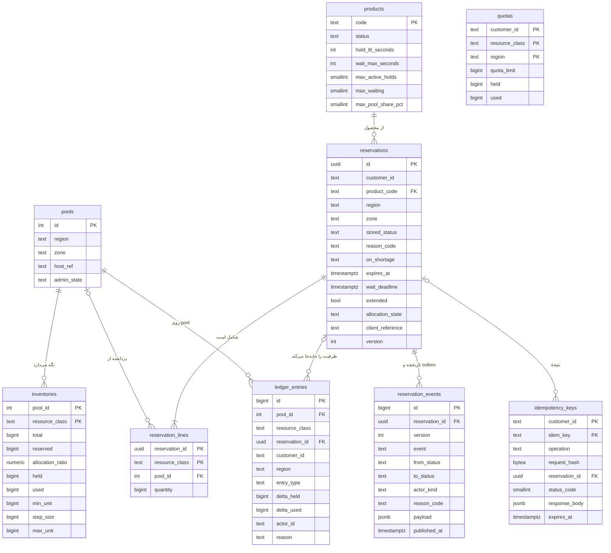
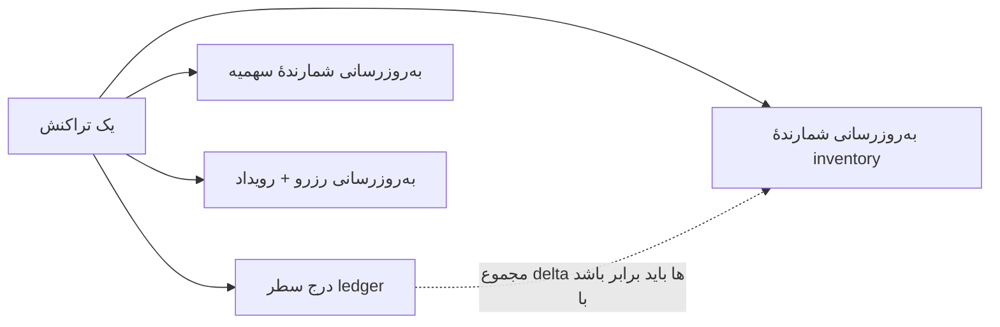

# مدل داده

**نُه جدول و یک view** روی PostgreSQL 17. همهٔ مقادیر عدد صحیح و بر حسب واحد پایهٔ کلاس منبع هستند (millicore، مگابایت، واحد).

با وجود کوچک بودن مدل، سه چیز را نگه داشته‌ام، چون درستی سیستم به آن‌ها وابسته است:

| نگه داشته شده | بدون آن |
| --- | --- |
| **ledger فقط-افزودنی (append-only)** | رفتار سیستم بعد از بازیابی قابل توضیح نیست |
| **کلیدهای idempotency** | retryهای کلاینت رزرو تکراری می‌سازند |
| **شمارنده‌ها با محدودیت‌های `CHECK`** | «فروش بیش از ظرفیت ممنوع» فقط به درست بودن کد وابسته می‌شود |

## ERD



## جدول‌ها به زبان ساده

| جدول | نقش | تعداد سطر در بار تخمینی |
| --- | --- | --- |
| `pools` | یک واحد ظرفیت. منطقه و zone متنی هستند | < 50 |
| `inventories` | دو شمارندهٔ `held` و `used` برای هر (pool، کلاس) | < 100 |
| `products` | کاتالوگ و سیاست در یک سطر (TTL، محدودیت‌ها) | ~30 |
| `quotas` | سقف قرارداد برای هر (مشتری، کلاس، منطقه) | ~30k مشتری × کلاس‌ها |
| `reservations` | ماشین حالت درخواست | ~18M در سال |
| `reservation_lines` | سطرهای منبعِ یک رزرو | ~4 به ازای هر رزرو |
| `reservation_events` | **تاریخچه و outbox در یک جدول** | ~3 به ازای هر رزرو |
| `ledger_entries` | هر تغییر `held` یا `used`. **منبع حقیقت** | ~200M در سال |
| `idempotency_keys` | پاسخ‌های ذخیره‌شده برای retryها (پنجرهٔ 24 ساعته) | ~150k |

> `inventories` کمتر از 100 سطر دارد اما **پرتغییرترین** جدول است. برای این‌که به‌روزرسانی‌ها HOT بمانند از `fillfactor = 50` و تنظیمات تهاجمی autovacuum استفاده می‌کند.

## فرمول ظرفیت قابل فروش

```text
sellable = floor( (total − reserved) × allocation_ratio )
free     = sellable − held − used          (only if the pool is AVAILABLE)
```

- `reserved` حاشیهٔ تکه‌تکه‌شدن (fragmentation) است (10% هر zone).
- `allocation_ratio` همان overcommit است که اپراتورها تنظیمش می‌کنند.

## ledger: چرا منبع حقیقت است

هر تغییر در `held` یا `used` **یک سطر ledger** می‌نویسد و شمارنده‌ها را **در همان تراکنش** به‌روز می‌کند.

| `entry_type` | معنا | `delta_held` | `delta_used` |
| --- | --- | --- | --- |
| `HOLD` | ظرفیت به hold رفت | +q | |
| `COMMIT` | hold به تخصیص تبدیل شد | −q | +q |
| `RETURN` | لغو یا انقضا آن را برمی‌گرداند | −q | |
| `RELEASE` | ظرفیت تخصیص‌یافته آزاد شد | | −q |
| `ADJUST` | اصلاح توسط اپراتور (ادمین) | ± | ± |

یک **تطبیق (reconciliation)** ساعتی شمارنده‌ها را از روی ledger دوباره محاسبه می‌کند و انحراف (drift) را گزارش می‌دهد. هدف `driftRows: 0` است.



## محدودیت‌هایی که از ناوردا (invariant) محافظت می‌کنند

| جدول | محدودیت | چرا |
| --- | --- | --- |
| `inventories` | `CHECK (held >= 0 AND used >= 0 AND held + used <= floor((total − reserved) × allocation_ratio))` | **آخرین خط دفاع در برابر فروش بیش از ظرفیت (oversell)** |
| `quotas` | `CHECK (held >= 0 AND used >= 0)`. خودِ *سقف* یک CHECK **نیست** | تا قرارداد بتواند به کمتر از مصرف فعلی کوچک شود |
| `reservations` | `HELD` ⇒ `expires_at` تهی نیست؛ `WAITING` ⇒ `wait_deadline` تهی نیست؛ `allocation_state` تهی نیست ⇔ `CONFIRMED` | یک سطر نمی‌تواند دربارهٔ وضعیت خودش دروغ بگوید |
| `reservations` | یکتایی جزئی `(customer_id, client_reference)` بین رزروهای باز و تأییدشده | خط دوم idempotency |
| `reservation_lines` | `quantity > 0`؛ PK `(reservation_id, resource_class)` | کلاس تکراری وجود ندارد |
| `idempotency_keys` | PK `(customer_id, idem_key)` | خودِ حذف تکرار (deduplication) |
| `ledger_entries` | نقش برنامه فقط **INSERT** دارد، بدون UPDATE یا DELETE | ledger واقعاً append-only است |
| هر کوئری رزرو | `customer_id` در `WHERE` | یک مشتری نمی‌تواند داده‌های مشتری دیگر را بخواند |

## ایندکس‌های مهم

| ایندکس | استفاده‌کننده |
| --- | --- |
| `reservations (expires_at) WHERE stored_status = 'HELD'` | sweeper، finalizer درون‌خطی، ظرفیت آزاد مؤثر |
| `reservations (region, product_code, created_at) WHERE WAITING` | ارتقای FIFO منتظرها |
| `reservations (wait_deadline) WHERE WAITING` | timeout انتظار |
| `reservations (customer_id, created_at DESC, id)` | تاریخچه با cursor |
| `reservations (customer_id, product_code, updated_at) WHERE EXPIRED` | cooldown |
| `reservation_events (id) WHERE published_at IS NULL` | relay مربوط به outbox |
| `ledger_entries (pool_id, resource_class)` | تطبیق (reconciliation) |

ایندکس‌های جزئی (partial) هر کدام را خیلی کوچک نگه می‌دارند: فقط سطرهایی را دارند که آن job به آن‌ها اهمیت می‌دهد.

## view خواندن

`reservation_effective` ستون‌های `effective_status`، `effective_reason_code` و `settled` را اضافه می‌کند که از وضعیت ذخیره‌شده، مهلت‌ها و `now()` **پایگاه داده** محاسبه می‌شوند. همهٔ خواندن‌های API از این view عبور می‌کنند. بخش [ماشین‌های حالت](#06-state-machines) را ببینید.

## شناسهٔ رزروها

شناسه‌ها **UUIDv7** هستند: بر اساس زمان مرتب‌اند، پس درج‌ها ایندکس را پراکنده نمی‌کنند، و بین مشتری‌ها قابل حدس نیستند.

## مسیر رشد (بدون تغییر API یا ماشین حالت)

| نیاز | تغییر داده | محرک |
| --- | --- | --- |
| دسترس‌پذیری بالا | standby هم‌زمان (synchronous) | اولین روز production |
| حجم تاریخچه | پارتیشن‌های ماهانه روی ledger و رویدادها؛ آرشیو بعد از 13 ماه | ledger > 50M سطر |
| یک cell برای هر منطقه | یک پایگاه داده برای هر منطقه (`region` از قبل کلید تقسیم است) | SLO به ازای هر منطقه، یا منطقهٔ چهارم |
| کاتالوگ مدیریت‌شده توسط ادمین | ستون‌های متنی به جدول‌های مرجع تبدیل می‌شوند | وقتی تعریف‌ها از پیکربندی خارج شوند |
| سهمیه‌های سلسله‌مراتبی یا سراسری | `customers`، `organizations`؛ escrow برای هر منطقه | قراردادهای سطح سازمان یا بین‌منطقه‌ای |
| hot row | تقسیم poolها به ازای هر cluster یا host | > 150 hold در ثانیه روی یک سطر |
| حجم رویدادها | جایگزینی relay با CDC | چند هزار رویداد در ثانیه |
