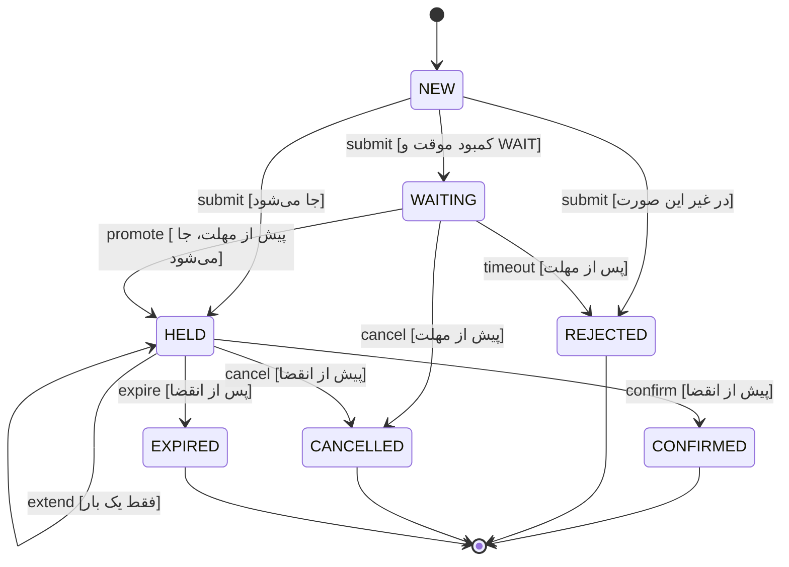
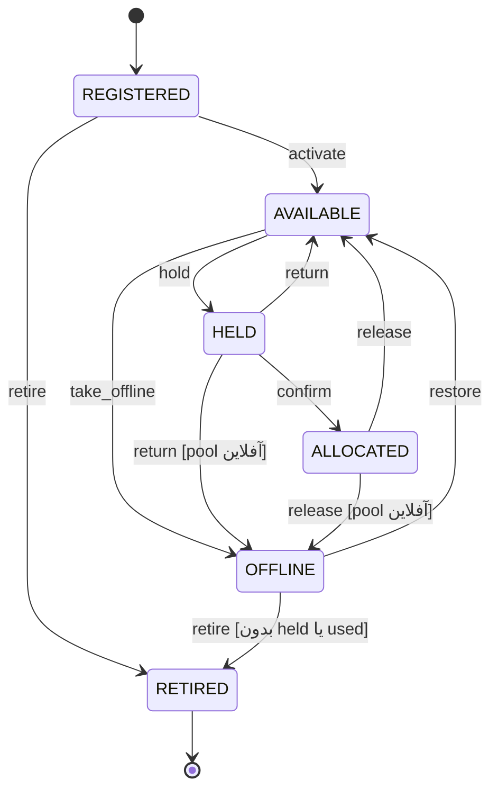
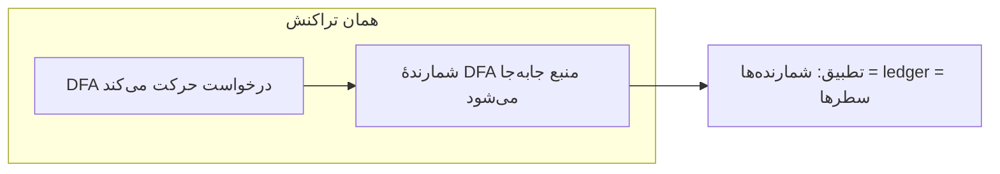
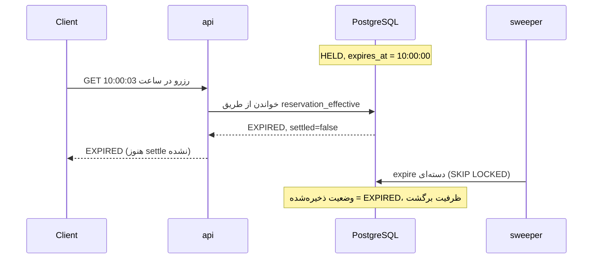

# ماشین‌های حالت

من سیستم را به شکل **دو ماشین حالت متناهی قطعی (DFA)** مدل می‌کنم که در یک تراکنش با هم حرکت می‌کنند.

| ماشین | چه چیزی را توصیف می‌کند |
| --- | --- |
| **DFA درخواست** | عمر یک *رزرو* (درخواست مشتری) |
| **DFA منبع** | عمر یک *واحد ظرفیت* (یک هسته، یک GPU، یک IP) |

> **امتحانش کنید.** روی گذارهای زیر کلیک کنید تا یک رزرو را در طول عمرش جلو ببرید. حرکت‌های غیرمجاز رد می‌شوند، دقیقاً مثل API واقعی (409).

## 1. ماشین حالت درخواست

### حالت‌ها

| حالت | نوع | ذخیره می‌شود | مهلت | ظرفیت نگه می‌دارد |
| --- | --- | --- | --- | --- |
| `NEW` | شروع | خیر (فقط داخل تراکنش submit) | | خیر |
| `WAITING` | میانی | بله | `wait_deadline` | خیر |
| `HELD` | میانی | بله | `expires_at` | بله (`held`) |
| `CONFIRMED` | نهایی | بله | | بله (`used`، تا زمان release) |
| `REJECTED` | نهایی | بله | | خیر |
| `CANCELLED` | نهایی | بله | | خیر |
| `EXPIRED` | نهایی | بله | | خیر |

### نمودار

### جدول گذارها

`now` همیشه **timestamp تراکنش پایگاه داده** است. هر زوجی که در جدول نیامده غیرمجاز است.

| از | رویداد | شرط (guard) | به | عامل | اثر روی ظرفیت |
| --- | --- | --- | --- | --- | --- |
| NEW | submit | همهٔ سطرها و سهمیه‌ها جا می‌شوند | HELD | API | AVAILABLE → HELD |
| NEW | submit | فقط کمبود موقت، `on_shortage = WAIT`، سقف انتظار پر نشده | WAITING | API | هیچ |
| NEW | submit | در غیر این صورت | REJECTED | API | هیچ |
| WAITING | promote | `now < wait_deadline` و جا می‌شود | HELD | Sweeper | AVAILABLE → HELD |
| WAITING | cancel | `now < wait_deadline` | CANCELLED | مشتری، سرویس | هیچ |
| WAITING | timeout | `now ≥ wait_deadline` | REJECTED | Sweeper | هیچ |
| HELD | extend | `now < expires_at` و هنوز تمدید نشده | HELD | مشتری، سرویس | هیچ |
| HELD | confirm | `now < expires_at` | CONFIRMED | مشتری، سرویس | HELD → ALLOCATED |
| HELD | cancel | `now < expires_at` | CANCELLED | مشتری، سرویس | HELD → AVAILABLE |
| HELD | expire | `now ≥ expires_at` | EXPIRED | Sweeper، finalizer درون‌خطی | HELD → AVAILABLE |

### چرا قطعی است

- **شرط‌های مجزا.** برای هر زوج (حالت، رویداد)، شرط‌ها فضای ورودی را افراز می‌کنند. دقیقاً یک سطر اعمال می‌شود.
- **مهلت، زمان را دو نیم می‌کند.** پیش از آن فقط رویدادهای کلاینت مجازند و پس از آن فقط رویداد تایمر. یک رویداد کلاینت و تایمر **هرگز در یک لحظه هر دو مجاز نیستند**.
- **پایان‌پذیری.** هر دو حالت میانی مهلت دارند، پس هر درخواستی به یک حالت نهایی می‌رسد. بدترین حالت پیش‌فرض: 15 + 15 + 15 = **45 دقیقه**.

### هر گذار چه می‌کند (یک تراکنش)

1. سطر رزرو را با **بررسی version** به‌روز می‌کند.
2. اثر روی ظرفیت را اعمال می‌کند و **به ازای هر سطر یک سطر ledger** می‌نویسد.
3. یک سطر `reservation_events` اضافه می‌کند (تاریخچه *و* outbox).
4. اگر فراخوانی کلید idempotency داشته باشد، آن را کامل می‌کند.

### رویدادهای تکراری یا غیرمجاز

| وضعیت | پاسخ |
| --- | --- |
| همان رویداد، همان کلید idempotency | پاسخ ذخیره‌شده دوباره پخش (replay) می‌شود |
| رویداد قبلاً حالت نهایی فعلی را ساخته (confirm روی CONFIRMED)، کلید جدید | `200` با منبع فعلی |
| confirm یا extend روی holdی که عملاً منقضی شده | `409 RESERVATION_EXPIRED` |
| هر حالت غیرمجاز دیگر | `409 INVALID_STATE_TRANSITION`، بدنه شامل وضعیت مؤثر است |

## 2. ماشین حالت منبع

یک *واحد ظرفیت قابل فروش* سطر مخصوص خودش را ندارد. **هر حالت یک شمارنده است** و هر گذار مقداری را بین دو شمارنده جابه‌جا می‌کند.

| حالت | شکل ذخیره |
| --- | --- |
| `REGISTERED` | واحدهای بیکار poolی که `admin_state = REGISTERED` دارد |
| `AVAILABLE` | واحدهای بیکار یک pool در دسترس |
| `HELD` | `inventories.held` |
| `ALLOCATED` | `inventories.used` |
| `OFFLINE` | واحدهای بیکار یک pool آفلاین |
| `RETIRED` | واحدهای بیکار یک pool بازنشسته |

### جابه‌جایی شمارنده‌ها

| رویداد | محرک | تغییر شمارنده |
| --- | --- | --- |
| `hold` | درخواست به HELD رسید | `held += q` |
| `confirm` | درخواست به CONFIRMED رسید | `held −= q; used += q` |
| `return` | درخواست CANCELLED یا EXPIRED شد | `held −= q` |
| `release` | سرویس حذف شد، provisioning شکست خورد، یا reconciler یک orphan پیدا کرد | `used −= q` |
| `activate`، `take_offline`، `restore`، `retire` | ادمین یا health check | فقط `admin_state` مربوط به pool |

### قواعد

- **فقط واحدهای بیکار admin state را تغییر می‌دهند.** آفلاین کردن یک pool به واحدهای held یا allocated دست نمی‌زند؛ آن‌ها چرخه‌شان را تمام می‌کنند و هنگام بازگشت در OFFLINE فرود می‌آیند.
- **روی pool غیر AVAILABLE هیچ holdی گرفته نمی‌شود.** `UPDATE` مربوط به hold شرط `admin_state = 'AVAILABLE'` را لازم دارد.
- **کوچک کردن ظرفیت** به کمتر از `held + used` توسط `CHECK` رد می‌شود. با `force = true` اول pool به OFFLINE می‌رود و تخلیه (drain) می‌شود.
- **release به ازای هر رزرو است**، روی `allocation_state` عمل می‌کند و تکرارش اثری ندارد.

## 3. دو ماشین چطور هماهنگ می‌مانند

- هر گذار درخواست و گذار منبعِ متناظرش **در همان تراکنش** نوشته می‌شوند. حالت‌های ذخیره‌شده هرگز با هم ناسازگار نیستند.
- `hold`، `confirm` و `return` **هیچ نقطهٔ ورود مستقلی ندارند**. آن‌ها خروجی‌های DFA درخواست هستند.
- رویدادهای خودِ DFA منبع `activate`، `take_offline`، `restore`، `retire` و `release` هستند.
- job تطبیق بررسی می‌کند که `inventories.held` برابر مجموع سطرهای HELD باشد، و `used` برابر مجموع سطرهای CONFIRMED با تخصیص ACTIVE.

## 4. حالت مؤثر: خواننده‌ها همیشه حقیقتِ *همین الان* را می‌بینند

holdی که مهلتش گذشته **از قبل منقضی است**، حتی اگر هنوز هیچ پردازه‌ای این را ذخیره نکرده باشد. بنابراین خواندن‌ها وضعیت را محاسبه می‌کنند به‌جای این‌که به وضعیت ذخیره‌شده اعتماد کنند.

| وضعیت ذخیره‌شده | شرط در زمان خواندن | وضعیت مؤثر | `settled` |
| --- | --- | --- | --- |
| `HELD` | `expires_at <= now()` | `EXPIRED` (`HOLD_EXPIRED`) | **false** |
| `WAITING` | `wait_deadline <= now()` | `REJECTED` (`WAIT_TIMEOUT`) | **false** |
| هر چیز دیگر | | وضعیت ذخیره‌شده | true |

چهار قاعده این کار را امن می‌کند:

1. **خواندن‌ها هرگز نمی‌نویسند.**
2. **تنها ساعت، `now()` پایگاه داده است.** ساعت میزبان‌ها هرگز وارد هیچ تصمیمی نمی‌شود.
3. **شرط هر نوشتن، همان شرط وضعیت مؤثر است**، پس یک نوشتن هرگز نمی‌تواند با آن‌چه به خواننده گفته شده تناقض داشته باشد.
4. اگر sweeper متوقف شود، چیزی خراب نمی‌شود. خواندن‌ها همچنان EXPIRED نشان می‌دهند، و holdِ جدیدی که کم بیاورد اول holdهای منقضی را نهایی می‌کند و بعد دوباره تلاش می‌کند. **sweeper متوقف‌شده نمی‌تواند باعث فروش بیش یا کمتر از ظرفیت شود**؛ فقط ذخیرهٔ حالت نهایی را به تأخیر می‌اندازد.

| نویسنده | شرط |
| --- | --- |
| confirm، cancel، extend روی HELD | `stored_status = 'HELD' AND expires_at > now()` |
| expire | `stored_status = 'HELD' AND expires_at <= now()` |
| cancel، promote روی WAITING | `stored_status = 'WAITING' AND wait_deadline > now()` |
| timeout | `stored_status = 'WAITING' AND wait_deadline <= now()` |

اگر confirm و انقضا در یک لحظه برسند، **قفل سطر آن‌ها را سریالی می‌کند** و دومی صفر سطر پیدا می‌کند.
