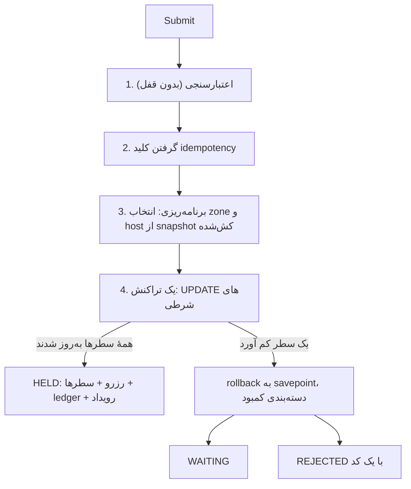
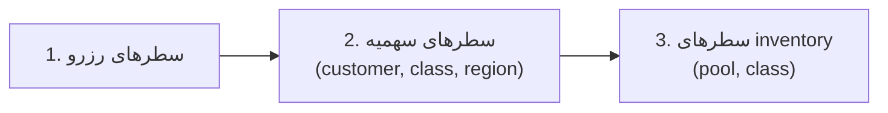
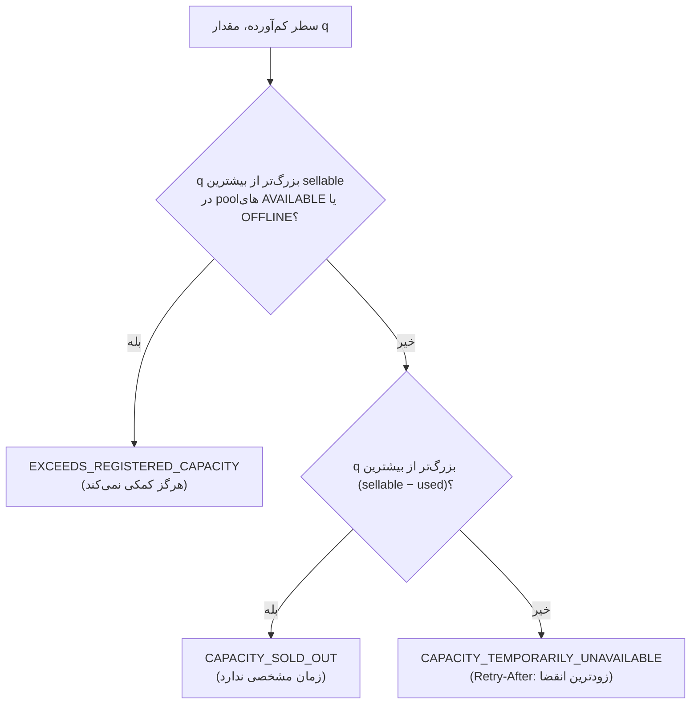
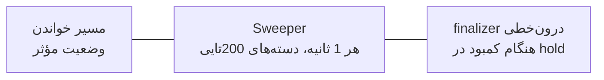
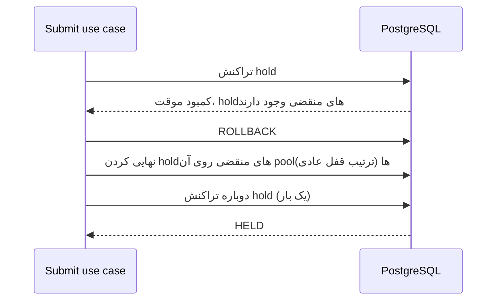
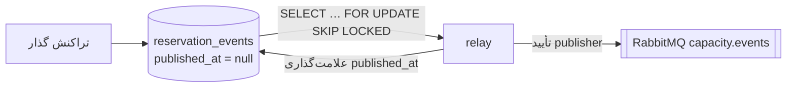

# منطق هسته

این قلب سیستم است: این‌که یک درخواست چطور به یک hold تبدیل می‌شود، بدون این‌که هرگز بیش از ظرفیت فروخته شود.

## ایده در یک تصویر



snapshot کش‌شده **فقط یک راهنمای رتبه‌بندی** است. درستی از UPDATEهای شرطی در گام 4 می‌آید.

## 1. چرا درستی در SQL زندگی می‌کند

دو درخواست در حافظهٔ برنامه هر دو «1 واحد باقی‌مانده» را می‌خوانند و هر دو جلو می‌روند. پس قاعده را به شکل خودِ دستور می‌نویسم:

```sql
UPDATE inventories AS i
SET    held = i.held + @q
FROM   pools AS p
WHERE  i.pool_id = @pool
  AND  i.resource_class = @class
  AND  p.id = i.pool_id
  AND  p.admin_state = 'AVAILABLE'
  AND  i.held + i.used + @q <= floor((i.total - i.reserved) * i.allocation_ratio)
RETURNING i.held;
```

- **یک سطر به‌روز شد** ← سطر جا می‌شود و از قبل hold شده است.
- **صفر سطر** ← کمبود. به چیز دیگری نیاز نیست و هیچ فاصلهٔ خواندن-سپس-نوشتن وجود ندارد.
- همین سقف به صورت `CHECK` جدول هم وجود دارد، پس حتی یک باگ در این دستور هم نمی‌تواند باعث فروش بیش از ظرفیت شود.

## 2. قواعد بر اساس چیزی که لمس می‌کنند تقسیم شده‌اند

| قاعده لمس می‌کند | محل | اعمال‌شده توسط |
| --- | --- | --- |
| **یک رزرو** (گذارهای حالت، مهلت‌ها، تمدید) | Domain (`Reservation`، ماشین حالت) | در C# روی سطری که `FOR UPDATE` قفل شده تصمیم گرفته می‌شود و با بررسی version نوشته می‌شود |
| **شمارنده‌های مشترک** (ظرفیت، سهمیه) | فرمول در Domain (`SellableCapacity`)؛ ناوردا توسط یک port بیان می‌شود | `UPDATE` شرطی و `CHECK` در Infrastructure |

یک آزمون یکپارچگی عملیات تصادفی اجرا می‌کند و بررسی می‌کند که **SQL و مدل domain با هم توافق دارند** (بخش [آزمون](#12-testing) را ببینید).

## 3. تراکنش hold

یک تراکنش `READ COMMITTED`. نوشتن‌ها **در صف قرار می‌گیرند و دسته‌ای ارسال می‌شوند**، و `UPDATE` پررقابتِ inventory **تنها و در آخر**، درست پیش از `COMMIT` می‌رود. یک hold **9 رفت‌وبرگشت (round trip)** طول می‌کشد، چه 1 سطر داشته باشد چه 4 (پیش از این تغییر 28 بود؛ بخش [آزمون بار](#13-load-test) را ببینید).

```text
BEGIN
  claim idempotency key                       → replay / mismatch / continue
  read now(), cooldown, open holds, snapshot   (if every plan is hopeless: store the rejection, skip the attempt)
  SAVEPOINT attempt
    one batch:
        INSERT reservation (HELD, expires_at = now + ttl), lines, event
        UPDATE quotas (…held + used + q <= quota_limit), sorted by class
        pool-share check (scarce products only)
        INSERT ledger_entries (HOLD, +q) per line
        complete the idempotency key with the response
    alone and last:
        UPDATE inventories (…held + used + q <= sellable), sorted by (pool, class)
    if any statement updated zero rows:
        ROLLBACK TO SAVEPOINT   → try next candidate, or classify the shortage
COMMIT
```

**چرا ترتیب مهم است.** سطر داغ inventory از لحظهٔ `UPDATE` تا `COMMIT` قفل می‌ماند. گذاشتنش در آخر این پنجره را به همان `UPDATE` و commit محدود می‌کند، به‌جای 7 رفت‌وبرگشت. هر چیزی که پیش از آن نوشته شده، در صورت شکست همراه savepoint برگردانده می‌شود، پس ترتیب سراسری قفل (رزرو ← سهمیه ← inventory) تغییری نمی‌کند.

**همه یا هیچ:** اگر سطر سوم از چهار سطر کم بیاورد، savepoint همه‌چیزِ آن تلاش را برمی‌گرداند. هیچ چیزی hold باقی نمی‌ماند.

## 4. یک ترتیب سراسری قفل: بدون deadlock

همهٔ نویسنده‌ها قفل‌ها را با یک ترتیب می‌گیرند:



در هر سطح، سطرها **بر اساس کلید مرتب می‌شوند**. hold، confirm، cancel، release و sweeper همه از آن پیروی می‌کنند، پس چرخهٔ انتظار نمی‌تواند شکل بگیرد.

## 5. انتخاب pool

| دامنه | کلاس‌ها | انتخاب |
| --- | --- | --- |
| `ZONE` | VCPU، RAM_MB، DISK_GB | یک pool از یک zone. همهٔ سطرهای zone در یک درخواست از همان zone استفاده می‌کنند |
| `REGION` | IPV4 | pool منطقه |
| `HOST` | GPU | یک host در zone انتخاب‌شده، با روش **best fit** |

1. اگر درخواست zone را مشخص کرده باشد، از همان استفاده می‌شود. در غیر این صورت zoneها بر اساس کوچک‌ترین نسبت `effective_free / requested` رتبه‌بندی می‌شوند، بالاترین اول.
2. برای سطرهای host، تا 3 host با best fit انتخاب می‌شود.
3. اولین کاندید امتحان می‌شود. در صورت کمبود، rollback به savepoint انجام می‌شود و کاندید بعدی امتحان می‌شود. **حداکثر 4 تلاش.**

## 6. نام‌گذاری کمبود

بعد از یک تلاش ناموفق، سیستم poolهای کاندید را می‌خواند (بدون قفل) و هر سطر کم‌آورده را دسته‌بندی می‌کند. رزرو **شدیدترین** کدِ سطرها را می‌گیرد.



`Retry-After` برای حالت موقت، تعداد ثانیه‌ها تا زودترین `expires_at` در میان رزروهای HELD روی poolهای کم‌آورده است که به بازهٔ 1 تا 60 ثانیه محدود می‌شود.

## 7. صف انتظار

| دسته‌بندی نهایی | `on_shortage` | نتیجه |
| --- | --- | --- |
| کمبود موقت | `WAIT` | `WAITING` با `wait_deadline = now + 15 min`؛ **هیچ ظرفیت و سهمیه‌ای نگه نمی‌دارد** |
| هر چیز دیگر | هر مقداری | `REJECTED` با کد |

- حداکثر **4 درخواست در انتظار برای هر مشتری و محصول**.
- وقتی ظرفیت برمی‌گردد، sweeper **به ترتیب FIFO ارتقا می‌دهد**.
- هیچ ظرفیتی برای منتظرها رزرو نمی‌شود: تراکنش هر کس زودتر برسد برنده است. این یک **ریسک پذیرفته‌شده** است (C-9).

## 8. گذارهای بعدی

همه روی یک سطر رزرو که `FOR UPDATE` قفل شده اجرا می‌شوند، سپس سطرهای سهمیه و سپس سطرهای inventory، به ترتیب مرتب‌شده.

| گذار | تغییر سهمیه و inventory | ledger |
| --- | --- | --- |
| confirm | `held −= q; used += q` | `COMMIT` |
| cancel، expire | `held −= q` | `RETURN` |
| release | `used −= q` | `RELEASE` |
| promote | مثل یک hold عادی | `HOLD` |

confirm فقط واحدها را بین دو شمارندهٔ **همان سطر** جابه‌جا می‌کند، پس نیازی به بررسی ظرفیت ندارد. `CHECK (held >= 0 AND used >= 0)` یک اعمال دوباره را می‌گیرد.

## 9. انقضا: سه لایه



| لایه | چه می‌کند |
| --- | --- |
| **وضعیت مؤثر** | خواننده‌ها در همان لحظه‌ای که مهلت می‌گذرد EXPIRED می‌بینند |
| **Sweeper** | EXPIRED را ذخیره می‌کند و ظرفیت را برمی‌گرداند. `LIMIT 200 FOR UPDATE SKIP LOCKED`، پس چند نمونه هم‌زمان امن است. تغییرات شمارنده در هر دسته به ازای (pool، کلاس) جمع زده می‌شوند |
| **finalizer درون‌خطی** | اگر یک hold با کمبود *موقت* روبه‌رو شود و holdهای منقضی‌اما‌settle‌نشده روی آن poolها باشند، آن‌ها را نهایی می‌کند و سپس **یک بار** دوباره تلاش می‌کند |

### تنها مسیر دو-تراکنشی

نهایی کردن holdهای منقضی *داخل* تراکنش hold باعث می‌شد سطرهای رزرو **بعد از** سطرهای inventory قفل شوند و ترتیب قفل بشکند. پس Submit عمل rollback انجام می‌دهد، یک تراکنش کوتاه نهایی‌سازی با ترتیب عادی اجرا می‌کند و سپس hold را از ابتدا دوباره امتحان می‌کند.



## 10. محافظت از hot row

| محافظت | چه می‌کند |
| --- | --- |
| **کش منفی برای تمام‌شدن (sold-out)** | وقتی یک سطر `SOLD_OUT` یا `EXCEEDS_REGISTERED` باشد، `(pool, class) → max(sellable − used)` به مدت **1 ثانیه** در حافظهٔ پردازه کش می‌شود. درخواست‌های بزرگ‌تر از آن `UPDATE` مربوط به inventory را رد می‌کنند و مستقیم دسته‌بندی می‌شوند. کمبود *موقت* هرگز کش نمی‌شود، چون holdها منقضی می‌شوند |
| **بررسی برنامهٔ ناامید** | اگر همهٔ کاندیدها در snapshot از قبل ظرفیت آزاد خیلی کمی نشان دهند، اصلاً هیچ قفلی گرفته نمی‌شود |
| **محدودیت نرخ برای هر مشتری** | بخش [محدودیت‌های نرخ](#09-rate-limits-fairness) را ببینید |
| **Timeoutها** | `statement_timeout = 2 s`، `lock_timeout = 500 ms`، که به صورت **startup options** اتصال تنظیم می‌شوند (با `ConnectionSettingsTests` بررسی می‌شود). lock timeout پاسخ `503` با `Retry-After: 1` برمی‌گرداند؛ کلاینت با همان کلید retry می‌کند |
| **تنظیمات اتصال** | prepared statementهای خودکار، بدون reset هنگام بستن، و سقف pool برابر 80 اتصال برای هر replica |

## 11. رویدادها: outbox تراکنشی

هر گذار یک سطر در `reservation_events` **در همان تراکنش** درج می‌کند. همین یک جدول هم تاریخچهٔ audit است و هم outbox.



- تحویل **حداقل یک بار (at least once)** است. مصرف‌کننده‌ها با `event_id` تکرار را حذف می‌کنند و بر اساس `version` رزرو مرتب می‌کنند.
- اگر RabbitMQ از دسترس خارج باشد، رویدادها در جدول منتظر می‌مانند. **هیچ رزروی هرگز به خاطر broker مسدود نمی‌شود.**

## 12. بازیابی و توضیح‌پذیری

- هیچ وضعیتی در حافظه نیست: هر نمونه را در هر زمانی می‌توان kill کرد.
- retry بعد از گم شدن پاسخ، نتیجهٔ ذخیره‌شده را دوباره پخش می‌کند.
- `reconcile` همهٔ شمارنده‌ها را از روی ledger دوباره محاسبه می‌کند و انحراف را گزارش می‌دهد. بعد از آزمون بار، `driftRows: 0` را گزارش کرد.
