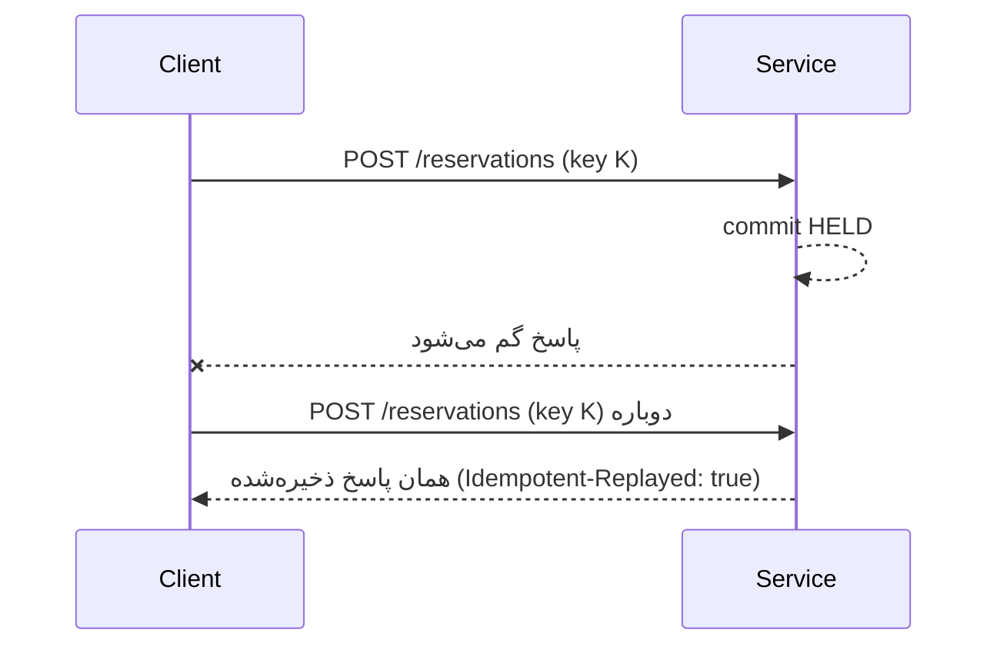
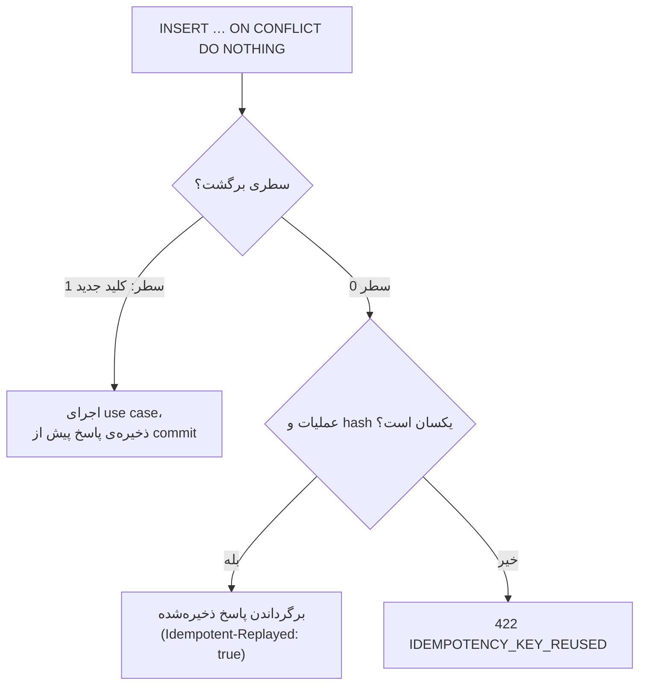
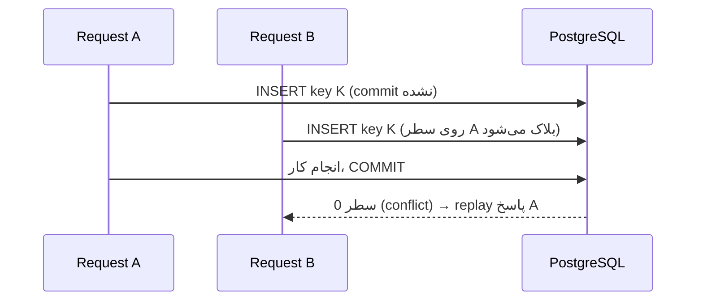

# Idempotency

> **تعهد:** هر فراخوانی که حالت را تغییر می‌دهد، با خیال راحت قابل retry است. یک کلید یکسان همیشه همان نتیجه را برمی‌گرداند و **هرگز رزرو دومی نمی‌سازد.**

## چرا مهم است

کلاینت‌های ماشینی بعد از هر timeout دوباره تلاش می‌کنند. اگر پاسخ *بعد از* commit گم شود، یک سرویس ساده‌لوح برای همان قصد، رزرو دومی می‌سازد و ظرفیت را دو بار نگه می‌دارد.



## کلید

| ویژگی | قاعده |
| --- | --- |
| Header | `Idempotency-Key`، روی submit، confirm، cancel، extend، release و همه‌ی نوشتن‌های ادمین **الزامی** است. نبودش ← `400 IDEMPOTENCY_KEY_REQUIRED` |
| قالب | 1 تا 64 کاراکتر، `[A-Za-z0-9_-]` |
| فضای نام | **به ازای هر مشتری** (فراخوانی‌های ادمین از شناسه‌ی actor استفاده می‌کنند) |
| وابسته به | **عملیات** و یک **اثر انگشت (fingerprint)** از درخواست |
| Fingerprint | SHA-256 روی نام عملیات و بدنه‌ی JSON کانونیک |
| نگهداری | 24 ساعت از اولین استفاده (بیشتر از عمر 45 دقیقه‌ای هر رزرو) |

## الگوریتم

این الگوریتم **درون تراکنش use case و پیش از هر نوشتن دیگری** اجرا می‌شود.

```sql
INSERT INTO idempotency_keys (customer_id, idem_key, operation, request_hash, expires_at)
VALUES (@customer, @key, @operation, @hash, now() + interval '24 hours')
ON CONFLICT (customer_id, idem_key) DO NOTHING
RETURNING 1;
```



| نتیجه‌ی insert | معنی | اقدام |
| --- | --- | --- |
| 1 سطر | کلید جدید | اجرای use case؛ پیش از commit، کد وضعیت و بدنه‌ی پاسخ ذخیره می‌شوند |
| 0 سطر، عملیات و hash یکسان | retry یک فراخوانی کامل‌شده | برگرداندن وضعیت و بدنه‌ی **ذخیره‌شده** |
| 0 سطر، عملیات یا hash متفاوت | کلید برای چیز دیگری دوباره استفاده شده | `422 IDEMPOTENCY_KEY_REUSED` |

## درخواست‌های تکراری هم‌زمان: بدون حالت «در حال انجام»

دو درخواست یکسان در یک لحظه:



- `INSERT` دوم **منتظر سطر commit‌نشده‌ی تراکنش اول می‌ماند**.
- اگر A commit کند، B صفر سطر می‌گیرد و پاسخ ذخیره‌شده‌ی A را replay می‌کند.
- اگر A rollback شود، B سطر را درج می‌کند و اجرا می‌شود.
- هیچ وضعیت «در حال انجام»ی هرگز دیده نمی‌شود و هیچ جدول قفل اضافه‌ای وجود ندارد.

## چه چیزی ذخیره می‌شود و چه چیزی نه

| ذخیره و replay می‌شود | ذخیره نمی‌شود |
| --- | --- |
| نتایج موفق | `401`، `403`، `429` |
| **ردهای قطعی (deterministic)** (`409`، `422`)، چون نتیجه‌ی واقعی همان درخواست‌اند | `503` و هر چیزی که throw و rollback شود |

چون خطاهای ذخیره‌نشده تراکنش را rollback می‌کنند، **کلید آزاد می‌ماند** و retry به‌طور عادی اجرا می‌شود.

## چرا «همان تراکنش» تصمیم کلیدی طراحی است

| جایگزین | مشکل |
| --- | --- |
| کلیدها در Redis | crash بین Redis و پایگاه داده یک پنجره‌ی خطا باز می‌گذارد |
| حذف تکرار با hash بدنه | دو درخواست مشروعِ یکسان به یکی تبدیل می‌شوند |
| بدون حذف تکرار | هر retry یک نسخه‌ی تکراری می‌سازد |

این‌جا کلید و رزرو **با هم commit یا rollback می‌شوند**. هیچ پنجره‌ای وجود ندارد.

## خط دفاعی دوم: `client_reference`

`client_reference` برای هر مشتری در میان رزروهای `WAITING`، `HELD` و `CONFIRMED` یکتاست. کلاینتی که بعد از 24 ساعت (وقتی کلید قدیمی پاک شده) با یک **کلید جدید** ولی **همان reference** دوباره تلاش کند، به جای یک رزرو تکراری، `409 INVALID_STATE_TRANSITION` می‌گیرد که به رزرو موجود اشاره می‌کند.

## گذارها هم به‌طور طبیعی idempotent هستند

| فراخوانی تکراری | نتیجه |
| --- | --- |
| Confirm روی یک رزرو CONFIRMED (کلید جدید) | `200` با منبع فعلی |
| Cancel روی یک رزرو CANCELLED | `200` با منبع فعلی |
| Release دو بار | ظرفیت **فقط یک بار** برمی‌گردد |
| دو confirm موازی | دومی `stored_status != 'HELD'` را می‌بیند، صفر سطر به‌روزرسانی می‌کند و منبع فعلی را برمی‌گرداند |

## در کد

`IdempotencyOperations.ClaimAsync` hash SHA-256 را از عملیات و درخواست سریال‌شده می‌سازد، کلید را از طریق repository ادعا (claim) می‌کند و:

- اگر insert موفق بود، *new* برمی‌گرداند،
- اگر عملیات و hash مطابق بودند (با مقایسه‌ی **constant-time**)، پاسخ ذخیره‌شده را برمی‌گرداند،
- اگر متفاوت بودند، `IdempotencyKeyReusedException` را throw می‌کند.

`SubmitReservationUseCase` اول از همه آن را صدا می‌زند و اگر claim یک replay باشد، خروجی ذخیره‌شده را با پرچم `Replayed = true` برمی‌گرداند (که به شکل header `Idempotent-Replayed: true` نمایان می‌شود).

## پاک‌سازی

sweeper کلیدهایی با `expires_at < now()` را در دسته‌های 1,000 تایی حذف می‌کند. با حدود 50k فراخوانی تغییردهنده در روز، جدول نزدیک به **150k سطر** می‌ماند.

## آزمون‌هایی که این را ثابت می‌کنند

| آزمون | چه چیزی را ثابت می‌کند |
| --- | --- |
| `Same_key_in_parallel_creates_one_reservation` | یک رزرو و پاسخ‌های یکسان تحت هم‌زمانی |
| `Confirm_cancel_and_extend_repeated_with_one_key_apply_once` | همه‌ی عملیات‌ها idempotent هستند |
| `Calls_aborted_mid_flight_and_retried_with_their_keys_leave_no_duplicate_or_partial_reservation` | یک فراخوانی kill‌شده به‌علاوه‌ی retry هرگز رزرو تکراری یا نیمه‌کاره نمی‌سازد |
| `Submit_answers_201_with_location_and_replays_with_the_header` | header و وضعیت replay |
