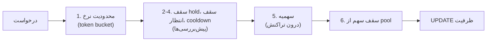

# محدودیت نرخ و انصاف

> **یک hold رایگان است.** بدون محدودیت، ارزان‌ترین راه برای بیرون کشیدن یک محصول کمیاب از بازار است. برای همین سرویس چند لایه کنترل دارد، از ارزان و زودهنگام تا دقیق و دیرهنگام.

## هفت کنترل

| # | کنترل | دامنه | محل اعمال | خطا |
| --- | --- | --- | --- | --- |
| 1 | **محدودیت نرخ (rate limit)** | مشتری × گروه endpoint | rate limiter در ASP.NET Core، **پیش از** هر کار پایگاه داده | `429 RATE_LIMITED` |
| 2 | سقف hold فعال | مشتری × محصول | پیش‌بررسی | `429 HOLD_LIMIT_REACHED` |
| 3 | سقف انتظار | مشتری × محصول | پیش‌بررسی | `429 HOLD_LIMIT_REACHED` |
| 4 | Cooldown | مشتری × محصول | پیش‌بررسی | `429 COOLDOWN_ACTIVE` |
| 5 | **سهمیه** | مشتری × کلاس × منطقه | `UPDATE` شرطی در تراکنش hold | `409 QUOTA_EXCEEDED` |
| 6 | **سقف سهم از pool** | مشتری × pool × کلاس (محصولات کمیاب) | کوئری زیر قفل سطر سهمیه | `409 POOL_SHARE_EXCEEDED` |
| 7 | سقف تمدید | رزرو | guard ماشین حالت درخواست | `409 INVALID_STATE_TRANSITION` |



بررسی‌های ارزان اول می‌آیند. درخواستی که قرار است رد شود، تا حد ممکن قفل کمتری مصرف می‌کند.

## rate limiter چطور کار می‌کند

یک **token bucket به ازای هر مشتری و گروه endpoint** است که از `RateLimiter` داخلی ASP.NET Core استفاده می‌کند. بدون کتابخانه، بدون Redis.

| گروه | نرخ پر شدن | Burst (اندازه‌ی سطل) | استفاده در |
| --- | --- | --- | --- |
| `submit` | 10 / s | 20 | `POST /v1/reservations` |
| `fitcheck` | 5 / s | 10 | `POST /v1/capacity/fit-check` |
| `reads` | 50 / s | 100 | سطوح ظرفیت، get، list |
| `transitions` | 20 / s | 40 | confirm، cancel، extend، release |

**رفتار یک سطل:**

- هر مشتری برای هر گروه یک سطل جدا دارد با کلید `group:customer`. کلید به ترتیب `X-Customer-Id`، سپس `X-Actor-Id`، سپس IP راه دور و در آخر `anonymous` است.
- هر درخواست **یک token** برمی‌دارد. سطل هر ثانیه با نرخ گروه پر می‌شود، تا سقف اندازه‌ی burst.
- وقتی سطل خالی است، درخواست **بلافاصله رد می‌شود** (queue limit برابر 0). هیچ‌وقت منتظر نمی‌ماند.
- ردّ درخواست `429` است، با header `Retry-After` و بدنه‌ی خطای استاندارد.

> **امتحانش کنید.** به یک سطل `submit` (burst 20، نرخ پر شدن 10/s) درخواست بفرستید و خالی و پر شدنش را ببینید.

<div data-widget="token-bucket"></div>

### چرا token bucket

| ویژگی | فایده |
| --- | --- |
| اجازه‌ی **burst** تا اندازه‌ی سطل | یک Terraform apply که 15 فراخوانی را یک‌جا می‌فرستد هم کار می‌کند |
| اعمال نرخ **میانگین** در طول زمان | یک طوفان retry صاف می‌شود |
| حافظه‌ی ثابت، بدون I/O | پیش از دست زدن به پایگاه داده رد می‌شود |

### محدودیت صادقانه

limiter **به ازای هر instance** است. با N instance از API، یک مشتری می‌تواند تا N برابر نرخ پیکربندی‌شده بگیرد. با 3 instance این قابل قبول است. یک limiter مشترک (Redis) گام رشد است **وقتی محدودیت سراسری دقیق لازم باشد** (ADR-0015). در هیچ نسخه‌ای Redis روی مسیر درستی (correctness) قرار نمی‌گیرد.

## سهمیه: محدودیت قرارداد

یک سطر به ازای هر (مشتری، کلاس، منطقه) با `quota_limit`، `held` و `used`.

```sql
UPDATE quotas
SET    held = held + @q
WHERE  customer_id = @customer AND resource_class = @class AND region = @region
  AND  held + used + @q <= quota_limit
RETURNING held;
```

- **holdهای باز حساب می‌شوند** (`held + used + q <= limit`)، پس درخواست‌های موازی نمی‌توانند از قرارداد فرار کنند.
- **سطر غایب با سهمیه‌ی پیش‌فرض کلاس ساخته می‌شود.** هرگز به معنی نامحدود نیست.
- **پایین آوردن سقف به زیر مصرف فعلی مجاز است.** holdهای موجود می‌مانند و holdهای جدید تا پایین آمدن مصرف شکست می‌خورند. برای همین سقف یک شرط در `UPDATE` است، **نه** یک `CHECK`.
- رد شدن به خاطر سهمیه **هرگز به WAITING تبدیل نمی‌شود.** انتظار نمی‌تواند یک قرارداد را درست کند.

## سیاست انصاف به ازای هر محصول

| تنظیم | محصول پیش‌فرض | محصول کمیاب (مثلاً GPU) |
| --- | --- | --- |
| TTL hold | 15 دقیقه | **2 دقیقه** |
| حداکثر انتظار | 15 دقیقه | 5 دقیقه |
| حداکثر hold فعال برای هر مشتری | 20 | **4** |
| حداکثر انتظار برای هر مشتری | 4 | 4 |
| سقف سهم از pool | خاموش (100%) | **25%** |
| Cooldown | 5 انقضا در 1 ساعت ← 10 دقیقه | همان |

## سقف سهم از pool

برای محصولات کمیاب، یک مشتری نمی‌تواند بیش از `max_pool_share_pct` از یک pool را نگه دارد.

```sql
SELECT coalesce(sum(l.quantity), 0)
FROM   reservation_lines l
JOIN   reservations r ON r.id = l.reservation_id
WHERE  r.customer_id = @customer AND l.pool_id = @pool AND l.resource_class = @class
  AND  (r.stored_status = 'HELD'
        OR (r.stored_status = 'CONFIRMED' AND r.allocation_state = 'ACTIVE'));
```

اگر `existing + q > sellable × share%` باشد، رد کن.

**چرا race ندارد:** **سطر سهمیه‌ی مشتری اول قفل می‌شود.** همه‌ی درخواست‌های آن مشتری برای آن کلاس و منطقه روی همان سطر سریال می‌شوند، پس دو درخواست موازی نمی‌توانند هر دو از سقف عبور کنند.

**مثال عملی.** 200 GPU، 2,000 مشتری در دقیقه‌ی اول، TTL دو دقیقه‌ای، حداکثر 4 hold، سقف 25%. در بدترین حالت، احتکار دست‌کم بین 50 مشتری پخش می‌شود، نه یک نفر.

## Cooldown

مشتری‌ای که مدام hold می‌گیرد و می‌گذارد منقضی شوند، در حال احتکار است.

```sql
SELECT count(*) FROM reservations
WHERE customer_id = @customer AND product_code = @product
  AND stored_status = 'EXPIRED' AND updated_at > now() - interval '1 hour';
```

پنج مورد یا بیشتر، که آخرینش در 10 دقیقه‌ی اخیر باشد ← `429 COOLDOWN_ACTIVE`، با `Retry-After` تا 10 دقیقه بعد از آخرین انقضا. این بررسی بدون قفل اجرا می‌شود: یک race در لبه **حداکثر یک** hold اضافه را عبور می‌دهد که نمی‌تواند oversell ایجاد کند.

## لایه‌ها در برابر یک pool داغ

| لایه | جلوی چه چیزی را می‌گیرد |
| --- | --- |
| محدودیت نرخ | یک کلاینت که API را بمباران می‌کند |
| کش منفی sold-out (1 s) | بمباران poolی که از قبل خالی است |
| سقف hold و انتظار، cooldown | احتکار توسط یک مشتری |
| سقف سهم | تصاحب یک pool کمیاب توسط یک مشتری |
| `lock_timeout` 500 ms ← `503` + retry | صف‌شدن بی‌حد روی سطر |

## نکات دیگر درباره‌ی سوءاستفاده

- **سرویس‌های داخلی** از طرف یک مشتری عمل می‌کنند و از سهمیه‌ی همان مشتری کم می‌کنند. سرویسی که برای خودش hold می‌گیرد (مثلاً آزمون‌های ظرفیت) شناسه‌ی مشتری و سهمیه‌ی خودش را دارد.
- **مشتریان تعلیق‌شده** مسئله‌ی سیستم حساب‌ها هستند. gateway صدور هویت را متوقف می‌کند. این سرویس فقط با `cancel-open` پاک‌سازی می‌کند (HELD و WAITING، در دسته‌های 200 تایی). تخصیص‌های confirm‌شده دست نمی‌خورند.

## آزمون‌ها

| آزمون | چه چیزی را ثابت می‌کند |
| --- | --- |
| `Request_rate_is_limited_per_customer_with_a_retry_hint` | سطل با 429 و `Retry-After` رد می‌کند |
| `Quota_counts_open_holds_and_never_means_unlimited` | قواعد سهمیه |
| `Lowering_a_quota_below_usage_keeps_existing_holds_and_blocks_new_ones` | کوچک شدن قراردادها |
| `Hold_limit_share_cap_and_cooldown_apply_to_a_customer_hoarding_a_scarce_product` | سه کنترل ضد احتکار |
| `The_hold_limit_and_the_waiting_limit_apply_per_customer_and_product` | سقف‌های به ازای هر مشتری |
