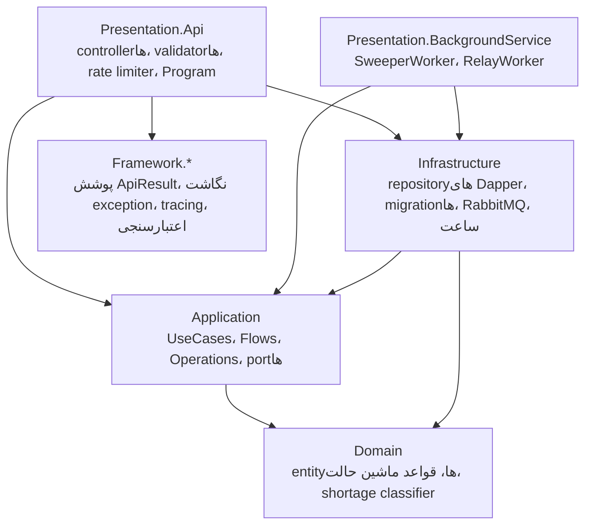
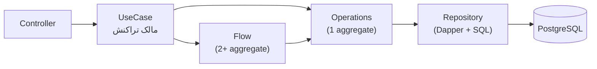

# ساختار کد

## شکل کلی

یک modular monolith با **معماری تمیز (clean architecture)**. solution در `src/Arvan.Capacity.slnx` است و **قاعده‌ی وابستگی با یک آزمون معماری اعمال می‌شود**، نه با حسن نیت.



## نقشه‌ی پوشه‌ها

```text
src/
  Domain/Arvan.Capacity.Domain/                 (43 files, ~1.8k lines)
    Entities/Reservations   Reservation, ReservationLine, ReservationEvent
    Entities/Capacity       Pool, HoldPlanner, ShortageClassifier, InventorySnapshot, CapacityLevels
    Entities/Products       Product, ProductDefinition
    Enums, Exceptions       ReservationStatus, ReasonCode, PoolAdminState, ...
  Application/Arvan.Capacity.Application/       (130 files, ~4.1k lines)
    UseCases/               one folder per business operation (Input, Output, UseCase)
    Flows/                  sequences across two or more aggregates
    Operations/             per-aggregate operations (interface + implementation)
    Repositories/           ports (and Readonly/ for queries)
    Abstractions/           IUseCase, IFlow, ITransactionManager, IClock
  Infrastructure/Arvan.Capacity.Infrastructure/ (24 files, ~2.3k lines)
    Repositories/           Dapper + hand-written SQL (CapacityLedgerRepository, ...)
    Persistence/            TransactionManager, DbClock, migrator, options
    Messaging/              RabbitMqEventPublisher, LoggingEventPublisher
    Migrations/             0001_initial_schema.sql, 0002_...sql (DbUp)
    Seeds/                  0001_demo_catalog.sql
  Presentation/
    Arvan.Capacity.Presentation.Api/            (controllers, validators, mappers, view models)
    Arvan.Capacity.Presentation.BackgroundService/ (sweeper and relay workers)
  Framework/                shared plumbing: ApiResult, error handling, tracing, JSON, validation
tests/
  Arvan.Capacity.Invariants.Tests/              correctness tests on real PostgreSQL
  Arvan.Capacity.ArchitectureTests/             the dependency rules
load/k6/                                        four load scenarios
deploy/                                         observability stack, postgres init
docs/                                           PRD, ADRs, specs, this guide
```

حدود **10.7k خط C#** در `src/`.

## لایه‌ی Application سه‌طبقه

لایه‌ی Application سه طبقه دارد و هر کدام یک وظیفه‌ی روشن.

| طبقه | مالک چه چیزی است | قاعده |
| --- | --- | --- |
| **UseCase** | یک عملیات کسب‌وکاری **و تراکنش آن** | *تنها* جایی که می‌تواند تراکنش را شروع، retry یا commit کند |
| **Flow** | یک توالی روی **دو یا چند aggregate** | درون تراکنش فراخواننده‌اش اجرا می‌شود؛ فقط از طریق Operations به persistence می‌رسد |
| **Operation** | کار روی **یک aggregate** | repositoryها را صدا می‌زند؛ نمی‌داند درون یک تراکنش است |



> **مثال.** `SubmitReservationUseCase` تراکنش را باز می‌کند، کلید idempotency را claim می‌کند، از `CapacityOperations` یک plan می‌خواهد، از `ReservationOperations` می‌خواهد hold کند و در صورت کمبود موقت، `ExpireHeldFlow` را در یک تراکنش کوتاه *جداگانه* صدا می‌زند. `ExpireHeldFlow` با sweeper مشترک است و دقیقاً به همین دلیل یک Flow است.

## Use caseها (یکی برای هر عملیات)

| گروه | Use caseها |
| --- | --- |
| رزروها | Submit، Confirm، Cancel، Extend، Release، Get، List |
| پس‌زمینه | ExpireHolds، TimeOutWaiting، PromoteWaiting، PurgeIdempotencyKeys |
| ظرفیت | GetCapacityLevels، FitCheck |
| رویدادها | RelayEvents |
| ادمین | PutPool، ChangePoolState، PutInventory، PutProduct، PutQuota، AdjustLedger، CancelOpenReservations، GetReconciliation، ReconcileLedger |

## هر قاعده‌ی طراحی کجا زندگی می‌کند

| قاعده | محل |
| --- | --- |
| گذارهای حالت و مهلت‌ها | `Domain/Entities/Reservations/Reservation` |
| فرمول ظرفیت قابل فروش (sellable)، برنامه‌ریزی pool، دسته‌بندی کمبود | `Domain/Entities/Capacity` |
| claim و replay در idempotency | `Application/Operations/.../IdempotencyOperations` |
| کش منفی sold-out | `Application/Operations/.../SoldOutCache` |
| `UPDATE`های شرطی | `Infrastructure/Repositories/CapacityLedgerRepository` (SQL) |
| Rate limiter | `Presentation.Api/Program.cs` (token bucket به ازای هر مشتری و گروه) |
| زمان | `Infrastructure/Persistence/DbClock` (فقط `now()` پایگاه داده) |
| Outbox relay | `RelayEventsUseCase` که `RelayWorker` صدایش می‌زند |
| انقضا | `ExpireHoldsUseCase` و `ExpireHeldFlow` که `SweeperWorker` صدایشان می‌زند |

## آزمون‌های معماری چه چیزی را اعمال می‌کنند

13 آزمون در `ArchitectureTests` اگر کسی قاعده‌ای را بشکند، build را fail می‌کنند:

| قاعده | چرا |
| --- | --- |
| Domain به هیچ چیز جز پایه‌ی framework وابسته نیست | قواعد خالص و آزمون‌پذیر |
| Application فقط به Domain وابسته است: نه Infrastructure، نه Presentation، نه driver | هیچ SQL یا HTTPی به بالا نشت نمی‌کند |
| **Application هرگز ساعت میزبان را نمی‌خواند** | فقط ساعت پایگاه داده تصمیم می‌گیرد |
| فقط UseCaseها می‌توانند از `ITransactionManager` استفاده کنند | هر تراکنش یک مالک دارد |
| Operations و Flowها هرگز به یک UseCase وابسته نیستند | بدون فراخوانی رو به بالا |
| Flowها فقط از طریق Operations به persistence می‌رسند | لایه‌بندی درون Application |
| UseCaseها `*UseCase` نام دارند، `IUseCase` را پیاده می‌کنند و هر کدام دقیقاً یک Input دارند | شکل یکدست |
| پیاده‌سازی‌های repository درون Infrastructure به‌صورت internal می‌مانند | هیچ چیز Operations را دور نمی‌زند |

## نقش‌های زمان اجرا از یک image

`Dockerfile` هم API و هم worker را publish می‌کند. نقش‌ها با command و `Capacity__Roles` انتخاب می‌شوند.

| نقش | Process | چه چیزی اجرا می‌شود |
| --- | --- | --- |
| `api` | `Presentation.Api` | Controllerها، rate limiter، `/health/live`، `/health/ready`، `/metrics`، OpenAPI |
| `sweeper` | `Presentation.BackgroundService` | `SweeperWorker` |
| `relay` | `Presentation.BackgroundService` | `RelayWorker` |
| `migrate` | `Presentation.Api migrate` | migrationهای DbUp را اعمال می‌کند و خارج می‌شود |

سرویس‌های Docker Compose: `postgres` (نسخه‌ی 17، با `pg_stat_statements`)، `migrator`، `api`، `sweeper`، `relay`؛ و profileهای اختیاری `events` (RabbitMQ) و `observability` (OpenTelemetry Collector، Prometheus، Grafana).

## دسترسی به داده

- **Npgsql + Dapper**، با SQL دست‌نویس که مثل کد review می‌شود. مسیر hold دستوراتش را به شکل **یک `NpgsqlBatch`** می‌فرستد.
- migrationهای SQL نسخه‌دار با **DbUp**، که با یک command جداگانه‌ی `migrate` **پیش از** بالا آمدن نقش‌ها اجرا می‌شوند.
- بدون ORM: مهم‌ترین بخش (قفل‌گذاری و به‌روزرسانی‌های شرطی) باید قابل دیدن بماند.

## سطح API

| Method | Path | Actor |
| --- | --- | --- |
| GET | `/v1/capacity` | هر کسی |
| POST | `/v1/capacity/fit-check` | مشتری، سرویس |
| POST | `/v1/reservations` | مشتری، سرویس |
| GET | `/v1/reservations/{id}` · `/v1/reservations` | مشتری، سرویس |
| POST | `/v1/reservations/{id}/confirm` · `cancel` · `extend` | مشتری، سرویس |
| POST | `/v1/reservations/{id}/release` | سرویس، ادمین |
| `/v1/admin/...` | poolها، inventoryها، محصولات، سهمیه‌ها، reconciliation، adjust، cancel-open | ادمین |

سند OpenAPI در `docs/openapi/capacity.v1.json` commit شده و **با یک آزمون بررسی می‌شود**، پس قرارداد نمی‌تواند بی‌صدا منحرف شود.

## جاهایی که کد با specهای نوشته‌شده فرق دارد

specها اول نوشته شدند؛ پیاده‌سازی بعداً از یک framework داخلی (Operation / Flow / UseCase) با **Npgsql و Dapper** پیروی کرد. هر جا با هم فرق داشتند، framework برنده شد:

| specها می‌گویند | کد این کار را می‌کند |
| --- | --- |
| RFC 9457 Problem Details، کدهای `UPPER_SNAKE` | یک **پوشش (envelope) `ApiResult`** با کدهای نقطه‌دار مثل `reservation.expired` |
| Enumها به شکل `VCPU`، `RAM_MB` | نام اعضای enum (`Vcpu`، `RamMb`) |
| صفحه‌بندی cursor | فهرست‌های با شماره‌ی صفحه |
| پروژه‌های آزمون `Domain.Tests`، `Application.Tests`، `IntegrationTests` | `Invariants.Tests` (جدول‌های domain، هم‌زمانی، بازیابی، قرارداد API) و `ArchitectureTests` |
| ردهای ذخیره‌شده | یک `409` یا `422` ذخیره‌شده رزرو را در `data` و دلیل را در `error.code` حمل می‌کند؛ بقیه‌ی خطاها throw می‌شوند، rollback می‌شوند و **ذخیره نمی‌شوند** |

> این را عمداً فهرست می‌کنم. reviewerی که specها را با کد مقایسه می‌کند، باید این تفاوت‌ها را اول این‌جا ببیند، نه به‌طور غافلگیرکننده.
