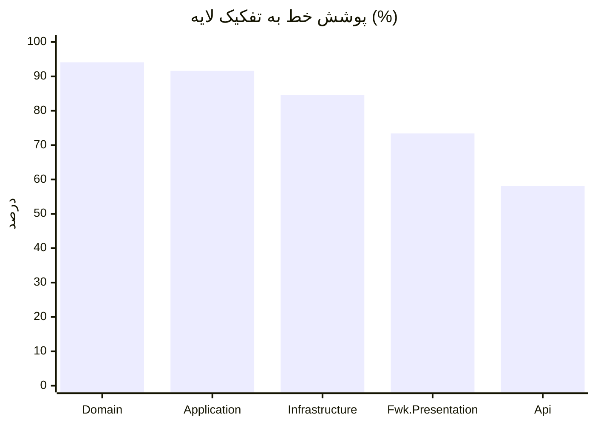
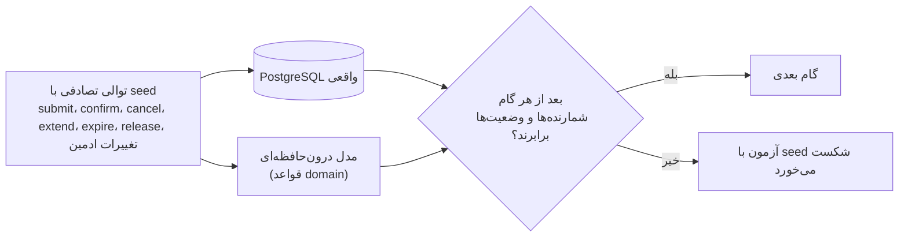

# آزمون و پوشش

> **اصل.** درستی در SQL و تراکنش‌ها زندگی می‌کند، پس آزمون‌های مهم روی یک **PostgreSQL 17 واقعی** (Testcontainers) اجرا می‌شوند. نه mock، نه SQLite.

## اعداد (اندازه‌گیری‌شده در 2026-11-16)

من `dotnet test` را با coverlet روی کل solution روی لپ‌تاپم اجرا کردم. آن اجرا **پیش از** اضافه شدن `ConnectionSettingsTests` بود، پس یک مورد آزمون کمتر از وضعیت فعلی پروژه دارد و اعداد پوشش آن به قبل از تغییرات round-trip برمی‌گردد.

| معیار | نتیجه |
| --- | --- |
| پروژه‌های آزمون | 2 |
| موارد آزمون | **149** (136 درستی + 13 معماری) |
| موفق | **148** |
| ناموفق | **1**، یک آزمون وابسته به زمان‌بندی (پایین‌تر توضیح داده شده) |
| زمان واقعی کل اجرا | حدود 5 دقیقه و 50 ثانیه (containerهای واقعی PostgreSQL را بالا می‌آورد) |
| **پوشش خط** | **81.0%** (3,209 از 3,962 خط) |
| **پوشش شاخه** | **66.7%** (750 از 1,124 شاخه) |

> پوشش از پروژه‌ی آزمون‌های درستی جمع‌آوری می‌شود. آزمون‌های معماری assemblyها را بررسی می‌کنند و کد برنامه را اجرا نمی‌کنند، پس چیزی به پوشش اضافه نمی‌کنند.

### پوشش به تفکیک لایه

| لایه | خط | شاخه | توضیح |
| --- | --- | --- | --- |
| **Domain** (قواعد، ماشین‌های حالت، classifier) | **94.1%** | 84.3% | جایی که قواعد کسب‌وکار هستند |
| **Application** (use caseها، flowها، operationها) | **91.6%** | 77.1% | |
| **Infrastructure** (repositoryهای SQL، ساعت، outbox) | 84.6% | 75.8% | publisher RabbitMQ آزمون نشده (پایین‌تر) |
| Framework.Presentation (envelope، خطاها) | 73.4% | 47.8% | |
| Presentation.Api (controllerها، Program) | 58.1% | 43.4% | شامل کد OpenAPI تولیدشده که هرگز اجرا نمی‌شود |
| Framework.Domain | 100% | 50.0% | typeهای پایه‌ی کوچک |



**خوانش صادقانه.** پوشش جایی بیشترین است که قواعد هستند (Domain، Application) و در پوسته‌ی API کمترین. بخشی از آن کد OpenAPI تولیدشده است که هیچ آزمونی نمی‌تواند به شکل معناداری به آن برسد. دو شکافی که *واقعی‌اند*:

| شکاف | چرا | ریسک |
| --- | --- | --- |
| `RabbitMqEventPublisher` روی **0%** است | آزمون‌ها از publisher لاگ‌کننده استفاده می‌کنند. RabbitMQ فقط در profile اختیاری Compose اجرا می‌شود | کم (درستی را outbox حمل می‌کند، نه broker)، ولی کد آزمون‌نشده است |
| use case `PutPool` و `PoolOperations.PutAsync` به‌سختی پوشش داده شده‌اند | در آزمون‌ها poolها با migration seed می‌شوند؛ مسیر ساخت فقط مخصوص ادمین است | کم |

## برای چه چیزهایی آزمون نوشتم

### لایه‌ها

| پروژه | روی چه چیزی اجرا می‌شود | چه چیزی را ثابت می‌کند |
| --- | --- | --- |
| `Arvan.Capacity.Invariants.Tests` (136 مورد) | **PostgreSQL واقعی** در Testcontainers، و API از طریق `WebApplicationFactory` | هم‌زمانی، invariantها، بازیابی، سازگاری SQL ↔ domain، قرارداد HTTP |
| `Arvan.Capacity.ArchitectureTests` (13 مورد) | Assemblyها | قاعده‌ی وابستگی و قواعد لایه‌بندی |
| `load/k6` (4 اسکریپت) | کل stack در Docker Compose | سقف hot row، burst کمیاب، تخلیه‌ی sweeper |

### آزمون‌های درستی، به تفکیک موضوع

| فایل | موارد | چه چیزی را ثابت می‌کند |
| --- | --- | --- |
| `ConcurrencyTests` | 5 | **1,000 submit موازی روی یک pool با ظرفیت 100 دقیقاً 100 hold می‌سازند.** درخواست‌های چندخطی با ترتیب تصادفی خطوط **هرگز deadlock نمی‌شوند**. confirm، cancel و انقضا در رقابت روی یک hold **دقیقاً یک** نتیجه را اعمال می‌کنند. یک کلید یکسان به‌صورت موازی **یک** رزرو می‌سازد. confirm، cancel و extend که با یک کلید تکرار شوند **یک بار** اعمال می‌شوند |
| `DomainTests` | 12 + 7 theory | فرمول ظرفیت قابل فروش، دسته‌بندی کمبود، قواعد مقدار، رتبه‌بندی zone، best-fit روی host، سطوح ظرفیت، **هر جفت (حالت، رویداد)** در هر دو ماشین حالت، ارتقای انتظار، routing key رویدادها |
| `ReservationStateMachineTests` | 6 + 1 theory | confirm پیش از مهلت تخصیص می‌دهد و idempotent است؛ در لحظه‌ی مهلت یا بعد از آن رد می‌شود؛ **یک رویداد کلاینت و timer هرگز هم‌زمان مجاز نیستند**؛ extend فقط یک بار؛ held بعد از مهلت به شکل expired خوانده می‌شود؛ هر گذار دقیقاً یک رویداد با نسخه‌ی بعدی به جا می‌گذارد |
| `ModelAgreementTests` | theory با seed | **یک توالی تصادفی از عملیات روی پایگاه داده و یک مدل domain درون‌حافظه‌ای اجرا می‌شود. بعد از هر گام، پایگاه داده باید با مدل یکی باشد.** این همان بررسی‌ای است که نشان می‌دهد SQL و C# با هم توافق دارند |
| `RecoveryAndReadTests` | 4 | فراخوانی‌هایی که وسط کار قطع و retry می‌شوند **هیچ رزرو تکراری یا نیمه‌کاره‌ای** به جا نمی‌گذارند. با sweeper متوقف، خواندن‌ها همچنان EXPIRED نشان می‌دهند و holdهای جدید از ظرفیت منقضی‌شده دوباره استفاده می‌کنند. مشتری دیگر برای همه‌ی عملیات‌ها 404 می‌گیرد. Release فقط یک بار است و confirm دیرهنگام رد می‌شود |
| `FairnessWaitingAndAdminTests` | 11 | سهمیه holdهای باز را حساب می‌کند و هرگز به معنی نامحدود نیست. پایین آوردن سهمیه holdها را نگه می‌دارد. سقف hold، سقف سهم و cooldown اعمال می‌شوند. انتظار اختیاری (opt-in) است، به ترتیب ارتقا می‌یابد و در مهلتش رد می‌شود. سطوح ظرفیت holdهای منقضی را آزاد حساب می‌کنند و اعداد را پنهان می‌کنند. Fit-check فقط مشورتی است. وضعیت poolها از ماشین حالت منبع پیروی می‌کند. Reconciliation انحراف را گزارش می‌دهد. `cancel-open` به تخصیص‌های confirm‌شده دست نمی‌زند |
| `RoundTripTests` | 3 | یک hold **برای 1 خط و 4 خط به همان تعداد round trip** نیاز دارد (9 در اجراهای بار، که از 28 پایین آمد)، درون یک بودجه‌ی ثابت. ردّ درخواست روی یک pool پر ارزان است و هرگز hold را امتحان نمی‌کند. confirm، cancel و sweeper در یک batch می‌نویسند |
| `ConnectionSettingsTests` | 1 | اتصال‌های pool‌شده واقعاً timeoutهای statement و lock را دارند. بعد از این اضافه شد که نسخه‌ی اول تنظیمات بی‌صدا هرگز اعمال نشده بود |
| `ApiContractTests` | 11 | کدهای وضعیت (201، 202، 409، 422، 429)، header replay، envelope، محدودیت 16 KB بدنه، خطاهای هویت و کلید، قواعد نوع actor، health و metrics، **تطابق سند OpenAPI با نسخه‌ی commit‌شده** |
| `ArchitectureTests` | 13 | ببینید: [ساختار کد](#10-code-structure) |

## ده سناریوی بحرانی

این‌ها از spec آزمون در PRD آمده‌اند. هر کدام به حالت‌های لبه‌ی [فصل قبل](#11-edge-cases) گره خورده است.

| # | سناریو | حالت‌های لبه | شرط موفقیت | آزمون |
| --- | --- | --- | --- | --- |
| 1 | 1,000 submit موازی، ظرفیت 100 | C-1، C-3، Q-1 | دقیقاً 100 HELD | `Thousand_parallel_submits_on_a_pool_of_hundred_hold_exactly_hundred` |
| 2 | درخواست‌های چندخطی، ترتیب تصادفی خطوط | C-2 | بدون deadlock | `Multi_line_requests_in_random_line_order_never_deadlock` |
| 3 | رقابت confirm، cancel و انقضا | C-4، C-6، C-7، T-2، T-4 | یک حالت نهایی برای هر hold | `Confirm_cancel_and_expiry_racing_on_one_hold_apply_exactly_one_outcome` |
| 4 | کلید یکسان، سریال و موازی | R-1، R-2، R-3، F-2 | یک رزرو، پاسخ‌های یکسان | `Same_key_in_parallel_creates_one_reservation` و آزمون هم‌خانواده‌اش |
| 5 | kill شدن API زیر بار، کلاینت‌ها retry می‌کنند | F-1، F-2 | بدون رزرو تکراری یا نیمه‌کاره | `Calls_aborted_mid_flight_and_retried_with_their_keys_...` |
| 6 | sweeper متوقف در حالی که بار ادامه دارد | T-1، T-7، Q-6 | خواندن‌ها EXPIRED نشان می‌دهند، holdهای جدید موفق‌اند | `With_the_sweeper_stopped_reads_show_expired_...` |
| 7 | مشتری A از شناسه‌های مشتری B استفاده می‌کند | D-4 | همه‌ی پاسخ‌ها 404 | `Another_customer_gets_not_found_for_every_operation` |
| 8 | release تکراری، confirm دیرهنگام | D-5، R-7 | ظرفیت یک بار برمی‌گردد؛ confirm دیرهنگام 409 می‌گیرد | `Release_is_once_only_and_a_late_confirm_is_refused` |
| 9 | یک مشتری در حلقه‌ی hold و رها کردن | A-1، A-2، A-3 | سقف سهم، سقف hold و cooldown اعمال می‌شوند | `Hold_limit_share_cap_and_cooldown_apply_...` |
| 10 | بررسی invariant به‌علاوه‌ی k6 روی یک pool | F-11، C-10 | انحراف 0 | آزمون reconciliation به‌علاوه‌ی [آزمون بار](#13-load-test) |

## invariantهایی که بعد از هر آزمون یکپارچگی بررسی می‌شوند

- `held + used <= sellable` برای هر سطر inventory.
- شمارنده‌ها با جمع‌های ledger برابرند.
- `held` با خطوط رزروهای HELD برابر است؛ `used` با خطوط رزروهای CONFIRMED که تخصیص ACTIVE دارند.
- وضعیت ذخیره‌شده‌ی هر رزرو با ستون‌هایش سازگار است (در غیر این صورت `CHECK` شکست می‌خورد).

## آزمون model-agreement



روی چهار seed (1 تا 4) اجرا می‌شود. شکست، seedش را چاپ می‌کند، پس هر مثال نقضی قابل **replay** است.

## توضیح آزمون ناموفق

| | |
| --- | --- |
| آزمون | `Request_rate_is_limited_per_customer_with_a_retry_hint` |
| نتیجه در اجرای کامل | **ناموفق** (`Assert.NotNull() Failure: Value is null`)، بعد از 34 ثانیه |
| نتیجه در اجرای تنها | **موفق** در 3 ثانیه |

**علت.** آزمون 60 فراخوانی `fit-check` را پشت سر هم می‌فرستد و انتظار دارد token bucket (burst 10، نرخ پر شدن 5 در ثانیه) خالی شود. روی یک ماشین پربار هر فراخوانی حدود نیم ثانیه طول کشید، پس سطل **به همان سرعتی که خالی می‌شد پر هم می‌شد** و هرگز خالی نشد. خود rate limiter درست است؛ **آزمون به سرعت ساعت دیواری وابسته است.**

**اصلاحی که انجام می‌دادم.** limiter را با یک ساعت جعلی (fake clock) پیش ببرم، یا 60 فراخوانی را موازی بفرستم، تا آزمون به سرعت ماشین وابسته نباشد. این‌جا تغییرش ندادم، چون این راهنما پروژه را همان‌طور که هست مستند می‌کند.

## جاهایی که پوشش کم است و معنایش چیست

| حوزه | وضعیت |
| --- | --- |
| قواعد Domain و Application | به‌خوبی پوشش داده شده، با جدول‌های جامع ماشین حالت و یک آزمون model-agreement |
| SQL و هم‌زمانی | روی PostgreSQL واقعی اثبات شده |
| پوسته‌ی HTTP | پوشش متوسط؛ آزمون‌های قرارداد هر گروه endpoint را پوشش می‌دهند |
| انتشار در RabbitMQ | **با هیچ آزمون خودکاری پوشش داده نشده.** فقط در profile `events` در Compose اجرا می‌شود، مثل اجرای بار |
| دسترس‌پذیری بالا (F-3، F-5) | این‌جا **قابل آزمون نیست**؛ به زیرساخت HA نیاز دارد |
| رفتار زیر بار | تا الان فقط یک سناریوی k6 اجرا شده |

## نحوه‌ی اجرا

```bash
make test                                   # everything (Docker required for integration tests)
dotnet test src/Arvan.Capacity.slnx \
  --collect:"XPlat Code Coverage"           # with coverage (the Invariants project carries coverlet)
UPDATE_OPENAPI=1 dotnet test                # regenerate the committed OpenAPI document
```

## تفاوت‌ها با spec آزمون نوشته‌شده

| spec می‌گوید | واقعیت |
| --- | --- |
| `Domain.Tests`، `Application.Tests` (با fakeها) و `IntegrationTests` جدا | یک پروژه‌ی `Invariants.Tests` که جدول‌های خالص domain و آزمون‌های PostgreSQL واقعی را با هم دارد. **هیچ آزمون use case با fake درون‌حافظه‌ای وجود ندارد.** use caseها فقط از طریق پایگاه داده‌ی واقعی اجرا می‌شوند |
| property test با FsCheck | یک آزمون مدل تصادفی **با seed** (`ModelAgreementTests`)، همان ایده، قابل replay با seed |
| CI همه چیز را به‌علاوه‌ی یک OpenAPI diff اجرا می‌کند | OpenAPI diff یک آزمون است؛ هیچ pipeline CI در مخزن وجود ندارد |
