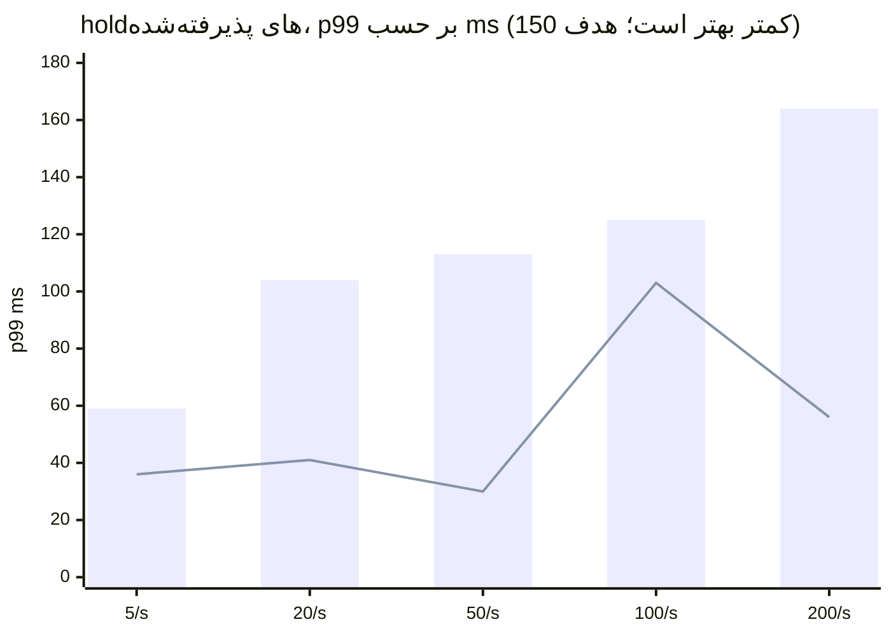
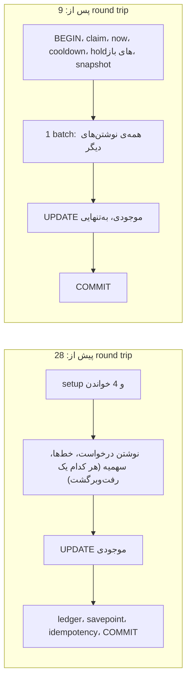

# آزمون بار

> **خلاصه.** روی یک ردیف موجودی داغ (hot row)، در این اجراها **p99 برای holdهای پذیرفته‌شده تا 200 درخواست در ثانیه زیر هدف 150 ms ماند** و جایی بین 200 و 300 در ثانیه شکست. **مسیر رد درخواست دیگر در 200/s فرو نمی‌ریزد**، اما دنباله‌ی تأخیرش در 100/s و 300/s هنوز بالای 150 ms و پرنوسان است. این مشکل **حل نشده** است. درستی در همه‌ی اجراها حفظ شد: هیچ فروش بیش از ظرفیت (oversell) و هیچ انحراف ledger رخ نداد.
>
> **همه‌ی اعداد از یک VM داکر روی لپ‌تاپ با یک replica از API به دست آمده‌اند، نه سخت‌افزار Linux.** آن‌ها را همان چیزی بخوانید که این‌جا اندازه‌گیری شده، نه ظرفیت محیط production.

## دو دور اندازه‌گیری

| دور | چه بود | منبع |
| --- | --- | --- |
| 1. انفجار در کمبود (scarce burst) | 300/s به مدت 2 دقیقه روی یک pool با 200 واحد، **پیش از** هر کاری روی تأخیر | `load/results/2026-11-16-scarce-burst.md` |
| 2. تأخیر hold، گام‌های 1 تا 3 | گام‌های نرخ روی یک ردیف داغ، **پیش و پس از** تغییرات تأخیر | `load/results/2026-11-16-hold-latency-steps-1-3.md` |

تحلیل کامل، همراه با ردگیری round tripها و برنامه، در [گزارش تأخیر hold](../../reports/hold-latency.html) آمده است (`docs/reports/hold-latency.html`؛ بخش 6 نتایج پس از گام‌های 1 تا 3 را دارد).

## چیدمان (دور 2)

| | |
| --- | --- |
| شکل بار | **یک ردیف موجودی داغ**، **یک مشتری تازه برای هر درخواست** (تا فقط ردیف موجودی مشترک باشد)، **15 s برای هر گام نرخ** |
| سخت‌افزار | لپ‌تاپ، VM داکر Docker Desktop (8 هسته). PostgreSQL، k6، workerها و **یک replica از API** همه روی همان VM |
| PostgreSQL | فقط برای اجرای محلی تنظیم شده (`max_connections=300`، `checkpoint_timeout=30min`) |
| روش | هر سری پس از یک اجرای گرم‌کردن (warm-up) که دور ریخته شد اجرا شد. «پس از» برای holdهای پذیرفته‌شده دو اجرا و برای ردها یک اجرا دارد |
| معیار | p99 مدت HTTP، بر حسب ms |

## نتایج: p99 بر حسب ms

| نرخ ارسالی | پذیرفته‌شده، پیش از | پذیرفته‌شده، پس از (2 اجرا) | رد ذخیره‌شده، پیش از | رد ذخیره‌شده، پس از (1 اجرا) |
| --- | --- | --- | --- | --- |
| 5/s | 59 | 32 · 36 | 44 | 40 |
| 20/s | 104 | 34 · 41 | 39 | 28 |
| 50/s | 113 | 30 · 30 | 32 | 38 |
| 100/s | 125 | 20 · 103 | 188 | **278** |
| 200/s | 164 | **53 · 56** | **4,633** | **126** |
| 300/s | اندازه‌گیری نشد | **1,002** (یک اجرا؛ در 400/s: 3.7 s) | اندازه‌گیری نشد | **245** |

هدف: **p99 < 150 ms**.



ستون‌ها **پیش از** هستند؛ خط، **بدترِ دو اجرای «پس از»** است. نقطه‌ی 300/s (1,002 ms) کنار گذاشته شده تا مقیاس نمودار خوانا بماند.

## چطور بخوانیم

| یافته | وضعیت |
| --- | --- |
| holdهای پذیرفته‌شده روی یک ردیف، تا 200/s | در این اجراها **زیر 150 ms در p99** (بدترین: 103 ms در 100/s) |
| holdهای پذیرفته‌شده در 300/s | **بالای هدف**: 1,002 ms. نقطه‌ی شکست بین 200 و 300/s است |
| ردها در 200/s | دیگر فرو نمی‌ریزند: 4,633 → 126 ms |
| ردها در 100/s و 300/s | **هنوز بالای 150 ms** (278 و 245 ms) و پرنوسان. یک اجرا برای گفتن چیزی بیشتر کافی نیست |
| درستی | هیچ oversell و هیچ انحرافی، در همه‌ی اجراها |

> دو اجرای «پس از» در 100/s برای holdهای پذیرفته‌شده (20 ms و 103 ms) نشان می‌دهند یک VM روی لپ‌تاپ چقدر پرنوسان است. من هر دو را گزارش می‌کنم، نه این‌که یکی را انتخاب کنم.

## چه چیزی بین «پیش از» و «پس از» تغییر کرد

یک hold از **28 round trip پایگاه داده به 9 رسید**، و این عدد **برای 1 خط یا 4 خط یکسان است**. رد یک درخواست روی pool پر 10 round trip می‌گیرد. این با متریک خودِ سرویس، `capacity_transaction_round_trips`، اندازه‌گیری شده و در `RoundTripTests` بررسی (assert) می‌شود.

| گام | تغییر |
| --- | --- |
| 1. ابزارگذاری | زمان‌سنجی هر فاز (`capacity_hold_phase_duration_seconds`)، round tripها در هر تراکنش، `pg_stat_statements` |
| 2. دسته‌ای کردن، قفل دیرهنگام | نوشتن‌ها در صف قرار می‌گیرند و به‌صورت دسته (batch) فرستاده می‌شوند: درخواست، خط‌ها، رویداد، سهمیه، ledger و پاسخ idempotency **در یک batch** می‌روند. `UPDATE` پررقابتِ موجودی **تنها و در آخر** می‌رود، سپس `COMMIT` |
| 3. ردهای ارزان | درخواستی که snapshot آن از قبل نشان می‌دهد در هیچ طرحی ظرفیتی نیست، **از تلاش برای hold صرف‌نظر می‌کند** و به‌عنوان ردشده ذخیره می‌شود |
| 4. تنظیمات اتصال | auto-prepare، بدون reset هنگام بستن، سقف برای pool اتصال، و timeoutهای statement و قفل به‌صورت **startup options** |



**چرا مهم است.** ردیف داغ از لحظه‌ی `UPDATE` تا `COMMIT` قفل می‌ماند. پیش‌تر این پنجره 7 round trip به‌علاوه‌ی commit بود؛ اکنون فقط `UPDATE` و commit است. توان عملیاتی هر ردیف تقریباً معکوس طول همین پنجره است.

### دو اشتباه که در مسیر پیدا شد

| اشتباه | اثر | اکنون |
| --- | --- | --- |
| نسخه‌ی اول تنظیمات اتصال **هرگز اعمال نشد** (`ContainsKey` برای همه‌ی keywordهای Npgsql مقدار true برمی‌گرداند) | هیچ timeoutی نبود، بنابراین بار اضافه به‌جای شکست سریع، ده‌ها ثانیه در صف می‌ماند | `ConnectionSettingsTests` timeoutها را روی یک اتصال pool‌شده بررسی می‌کند |
| یک کوئری بازنویسی‌شده‌ی `Retry-After` **همه‌ی رزروهای held را اسکن می‌کرد** | هزینه‌ی اضافه روی مسیر رد | به leaseهایی که ظرف 60 s تمام می‌شوند محدود شد؛ معادل است، چون پاسخ به بازه‌ی 1 تا 60 s محدود (clamp) می‌شود |

## انفجار در کمبودِ قبلی (دور 1، پیش از تغییرات)

| معیار | مقدار |
| --- | --- |
| سناریو | 300 تکرار در ثانیه به مدت 2 دقیقه روی یک pool IPv4 با 200 واحد. **هر تکرار یک `PUT` سهمیه و یک submit انجام می‌داد**، که تعداد درخواست‌ها را دو برابر کرد |
| holdهای پذیرفته‌شده | **200**، دقیقاً برابر ظرفیت pool |
| oversell / انحراف | **0 / 0** (`driftRows: 0`، تسویه‌نشده 0، backlog outbox برابر 0) |
| ردهای ذخیره‌شده | 6,625 مورد `CapacityTemporarilyUnavailable` |
| توان عملیاتی | حدود 58 تکرار در ثانیه (حدود 115 درخواست در ثانیه)؛ k6 تعداد 28,294 تکرار را کنار گذاشت |
| تأخیر | p50 برابر 6.3 s، **p99 برابر 15.3 s** |
| 5xx | 882 از 7,707 submit (11%)، `503` ناشی از lock timeout |

این اجرا **پس از تغییرات تکرار نشده است**. به دلیل `PUT` سهمیه در هر تکرار، مشکل را بزرگ‌تر از واقع نشان می‌دهد، و سری گام‌های دور 2 hold را بهتر جدا می‌کند.

## آنچه اجرا نشده است

| اجرا نشده | چرا مهم است |
| --- | --- |
| سخت‌افزار Linux | Docker Desktop هزینه‌ی شبکه و fsync اضافه می‌کند که یک میزبان Linux ندارد |
| چند replica از API | فقط یک replica اندازه‌گیری شد؛ محدودیت نرخ و pool اتصال برای هر replica جداست |
| replication هم‌گام (synchronous) | به هر commit یک round trip اضافه می‌کند (ADR-0018)؛ باید اندازه‌گیری شود، نه فرض |
| انفجار در کمبودِ 2 دقیقه‌ای، پس از تغییرات | هدف انفجار p99 < 150 ms و 5xx < 0.05% است |
| `expiry-storm.js`، `mixed.js` | نرخ تخلیه‌ی sweeper و SLOهای ترکیبی |

## یک رخداد توضیح‌داده‌نشده

در یک اجرای رد تحت بار اضافه، **یک پروسس سرور PostgreSQL با کد 2 خارج شد** و سرور خودش بازیابی شد. دوباره رخ نداده و توضیحی هم برایش نیست. آن را فهرست می‌کنم تا کسی غافلگیر نشود.

## گام‌های شروع‌نشده‌ی برنامه

| گام | تغییر |
| --- | --- |
| P5 | یک خواندن برای کل تصمیم (claim idempotency، `now()`، cooldown، holdهای باز، snapshot) |
| P6 | hold به‌صورت یک تابع سمت سرور |
| P7 | کنترل پذیرش (admission control): محدودیت درخواست‌های در جریان برای هر pool و `lock_timeout` کوتاه‌تر، تا pool اشباع‌شده فوراً `503` پاسخ دهد |
| P8 | برش pool: شکستن ردیف داغ (یک تغییر داده‌ای؛ گام رشد ADR-0004) |
| P9 | زیرساخت: PgBouncer، WAL سریع، چند replica از API |

این‌که به آن‌ها نیاز هست یا نه، به یک baseline روی سخت‌افزار هدف بستگی دارد.

## این چه چیزی را ثابت می‌کند و چه چیزی را نه

| روی این چیدمان نشان می‌دهد | نشان نمی‌دهد |
| --- | --- |
| holdهای پذیرفته‌شده روی یک ردیف زیر 150 ms در p99 تا 200/s | توان عملیاتی یا تأخیر production |
| کاهش round tripهای هر hold از 28 به 9، مستقل از تعداد خط‌ها | این‌که 500 hold در ثانیه برای هر cell دست‌یافتنی است |
| ردها دیگر در 200/s فرو نمی‌ریزند | این‌که دنباله‌ی تأخیر رد تحت کنترل است (در 100/s و 300/s نیست) |
| هیچ oversell و انحراف صفر تحت همه‌ی بارهای آزموده‌شده | رفتار با replicaها، replication هم‌گام، یا انفجار کامل |

## خودتان اجرا کنید

```bash
make up
make load          # hot-row, scarce-burst, expiry-storm, mixed
```

مشاهده‌پذیری: `make observability` سرویس‌های Prometheus (`:9090`) و Grafana (`:3000`) را اضافه می‌کند. متریک‌های مفید: `capacity_hold_phase_duration_seconds`، `capacity_transaction_round_trips`، `capacity_expiry_lag_seconds`.
