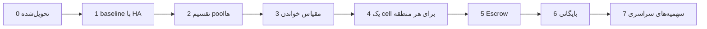

# مصالحه‌ها، محدودیت‌ها و رشد

## برای چه چیزی بهینه کردم

| بهینه کردم برای | به قیمتِ |
| --- | --- |
| **عمق درستی** در مسیر اصلی | تعداد قابلیت‌ها |
| **توضیح‌پذیری** (ledger، تاریخچه، تطبیق) | سرعت خام |
| **رد کردن** وقتی مطمئن نیستم | در دسترس ماندن به هر قیمتی |
| **یک نسخه‌ی اول کوچک** با محرک‌های ارتقای مشخص | یک پلتفرم کامل سازمانی از روز اول |

## مصالحه‌هایی که آگاهانه انجام دادم

| انتخاب | آنچه به دست می‌آورم | هزینه‌اش |
| --- | --- | --- |
| یک PostgreSQL، `UPDATE` شرطی | دقیق، ساده، قابل حسابرسی | یک ردیف داغ (hot row) برای هر pool توان عملیاتی را محدود می‌کند |
| تصمیم هم‌گام (synchronous) | هیچ حالت «نامعلومی» نیست؛ یک پاسخ برای هر فراخوانی | فراخواننده زیر رقابت سنگین منتظر قفل ردیف می‌ماند |
| شکست بسته (fail closed) | هرگز oversell نمی‌شود | یک قطعی کوتاه در زمان failover پاسخ 503 برمی‌گرداند |
| شمارنده، نه هویت واحدها | ارزان و دقیق | چندپارگی (fragmentation) دیده نمی‌شود |
| بدون Redis | یک حالت خرابی کمتر | محدودیت نرخ برای هر instance جداست؛ خواندن‌ها فقط درون پروسس cache می‌شوند |
| بدون workflow engine | هفت حالت در یک جدول جا می‌شوند | ارکستراسیون نیاز به بازنگری دارد |
| انتظار اختیاری (opt-in) و محدود | صادقانه و ساده | هیچ اولویت صف یا انصافی بین منتظرها نیست |
| شمارنده‌های سهمیه در همان تراکنش | هیچ دور زدن موازی‌ای ممکن نیست | سهمیه‌ها برای هر منطقه‌اند، نه سراسری |
| schema کم‌حجم (9 جدول) | بازبینی آسان | منطقه‌ها و zoneها متن‌اند، نه جدول |

## محدودیت‌های شناخته‌شده و ریسک‌های باز

| ریسک | اثر | کاهش ریسک یا برنامه |
| --- | --- | --- |
| **اعداد بار حدس هستند** | اگر اوج 10 برابر تخمین باشد (60/s) چیزی تغییر نمی‌کند. اگر 100 برابر باشد، از روز اول به تقسیم pool نیاز است | تقسیم pool یک تغییر داده‌ای است؛ با k6 اندازه‌گیری می‌شود |
| **یک ردیف داغ بین 200 و 300 درخواست در ثانیه می‌شکند** (VM روی لپ‌تاپ) | holdهای پذیرفته‌شده: p99 برابر 1,002 ms در 300/s. ردها: p99 برابر 278 ms در 100/s و 245 ms در 300/s، پرنوسان | گام‌های P5 تا P9 برنامه (یک خواندن برای تصمیم، hold سمت سرور، کنترل پذیرش، برش pool، زیرساخت)، شروع نشده؛ اول روی سخت‌افزار هدف اندازه‌گیری شود |
| **خروج توضیح‌داده‌نشده‌ی پروسس PostgreSQL** | یک پروسس سرور در یک اجرای رد تحت بار اضافه با کد 2 خارج شد؛ سرور خودش بازیابی شد | تکرار نشده، بررسی نشده. در اجراهای بعدی مراقبش باشید |
| **چندپارگی** | شمارنده‌ها می‌گویند 100 هسته آزاد است؛ شاید هیچ میزبانی 16 هسته‌ی پیوسته نداشته باشد | حاشیه‌ی 10%، آزادسازی هنگام شکست؛ poolهای سطح میزبان در صورت نیاز |
| **بازگشت ظرفیت به این وابسته است که سرویس‌های محصول `release` را صدا بزنند** | یک release فراموش‌شده مثل ظرفیتی به نظر می‌رسد که برای همیشه مصرف شده | interface تطبیق‌دهنده (reconciler) و یک متریک انحراف |
| **سهمیه‌ی سراسری وجود ندارد** | قراردادی که چند منطقه را پوشش دهد اعمال نمی‌شود | پیش از ساختنش، ADR-0007 بازبینی شود |
| **محدودیت نرخ برای هر instance جداست** | N instance اجازه‌ی N برابر نرخ را می‌دهند | محدودکننده‌ی مشترک، وقتی محدودیت دقیق مهم باشد |
| **پوشش بار ناقص است** | اجرا نشده: سخت‌افزار Linux، چند replica از API، replication هم‌گام، انفجار در کمبودِ 2 دقیقه‌ای پس از تغییرات، `expiry-storm.js`، `mixed.js` | اجرایشان کنید و نتایج را commit کنید |

## مسیر رشد

**هیچ گامی چیزی را بازنویسی نمی‌کند.** قرارداد API و schema از گام 0 پایدارند.

| گام | محرک عددی | تغییر | کجا |
| --- | --- | --- | --- |
| 0. تحویل‌شده | ندارد | یک PostgreSQL، یک باینری، Docker Compose | |
| 1. baseline محیط production | اولین روز production | یک replica هم‌گام و یک replica ناهم‌گام، failover خودکار، 3+ instance از API، PgBouncer | فقط استقرار |
| 2. تقسیم poolها | بیش از 150 hold در ثانیه به‌طور پایدار روی یک ردیف، یا p99 انتظار قفل > 20 ms | شکستن یک pool به zoneها یا clusterها | داده و تابع انتخاب pool |
| 3. مقیاس خواندن | بیش از 5,000 خواندن در ثانیه یا بیش از 10 instance از API | read replica؛ Redis برای cache و محدودیت نرخ مشترک | لایه‌ی خواندن |
| 4. یک cell برای هر منطقه | SLO برای هر منطقه، یا منطقه‌ی چهارم | هر منطقه پایگاه داده و استقرار خودش را می‌گیرد؛ مسیریابی در gateway | استقرار و مسیریابی |
| 5. escrow یا batching | بیش از 300 hold در ثانیه روی poolی که دیگر قابل تقسیم نیست | تقسیم ظرفیت یک pool به برش‌های مستقل | repository رزرو |
| 6. بایگانی | ledger > 500 GB | انتقال partitionهای قدیمی به ذخیره‌سازی سرد | job نگهداری |
| 7. سهمیه‌های سراسری | قراردادی که چند منطقه را پوشش دهد | یک control plane سراسری سهم هر cell را escrow می‌کند | سرویس جدید در کنار cellها |

## آنچه بعد از این می‌سازم

1. یک baseline روی سخت‌افزار Linux با چند replica از API و replication هم‌گام می‌گیرم، سپس انفجار در کمبودِ 2 دقیقه‌ای، `expiry-storm.js` و `mixed.js` را دوباره اجرا می‌کنم و مدل بار را با اعداد اندازه‌گیری‌شده به‌روز می‌کنم.
2. درباره‌ی گام‌های P5 تا P9 برنامه بر اساس همان baseline تصمیم می‌گیرم. با کنترل پذیرش (P7) شروع می‌کنم تا دنباله‌ی تأخیر رد محدود شود، و برش pool (P8) را وقتی هشدار ردیف داغ فعال شد.
3. یک target به نام `coverage` به Makefile اضافه می‌کنم و عددش را با هر اجرا منتشر می‌کنم.
4. آزمون محدودیت نرخ را مستقل از سرعت ماشین می‌کنم (ببینید [آزمون](#12-testing)).
5. تخصیص‌ها را با یک موجودی شبیه‌سازی‌شده تطبیق می‌دهم تا ریسک «release فراموش‌شده» پوشش داده شود.

## آنچه از مالکان محصول می‌پرسم

اگر تیم می‌توانست پاسخ دهد، این‌ها بیشترین تغییر را در طراحی ایجاد می‌کردند:

1. منبع حقیقت ظرفیت فیزیکی درون این سرویس است یا بیرون از آن؟ *(مرز)*
2. قراردادها برای هر منطقه‌اند یا سراسری؟ *(مدل سهمیه)*
3. آیا مشتریان سازمانی ظرفیت رزروشده یا اولویت می‌گیرند؟ *(مدل pool، صف‌بندی)*
4. اعداد واقعی اوج و انفجار چیست؟ *(همه‌ی آستانه‌ها)*
5. آیا نمایش دقیق ظرفیت به مشتری قابل قبول است؟ *(نشت اطلاعات)*

## یادداشت پایانی

هدف طراحی هرگز بالاترین توان عملیاتی نبود. هدف سرویسی بود که پاسخش **همیشه درست، همیشه قابل توضیح و همیشه برای retry امن** باشد، با مسیری روشن و اندازه‌گیری‌شده برای روزی که مقیاس از راه برسد.
