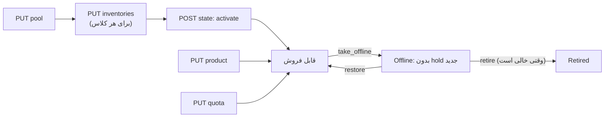

# API ادمین

endpointهایی برای **اپراتورهای ظرفیت** (پنل ادمین). این endpointها کاتالوگ (poolها، موجودی‌ها، محصولات)، سهمیه‌های مشتری، اصلاحات ledger و گزارش تطبیق (reconciliation) را مدیریت می‌کنند. منبع: `AdminController` در `src/Presentation/Arvan.Capacity.Presentation.Api/Controllers/Admin`.

## در یک نگاه

همه‌ی مسیرها زیر `/v1/admin` هستند.

| متد | مسیر | چه کسی | هدف |
| --- | --- | --- | --- |
| `PUT` | `/pools/{id}` | admin | ایجاد یا به‌روزرسانی یک pool (منطقه، zone، میزبان) |
| `POST` | `/pools/{id}/state` | admin؛ **service** برای `take_offline` / `restore` | جابه‌جا کردن pool در ماشین حالتش |
| `PUT` | `/pools/{poolId}/inventories/{resourceClass}` | admin | تنظیم ظرفیت یک pool برای یک کلاس منبع |
| `PUT` | `/products/{code}` | admin | ایجاد یا به‌روزرسانی یک محصول و policy آن |
| `PUT` | `/quotas/{customerId}/{resourceClass}/{region}` | admin | تنظیم سقف قرارداد یک مشتری |
| `POST` | `/customers/{customerId}/cancel-open` | admin | لغو holdها و انتظارهای یک مشتری معلق‌شده |
| `POST` | `/ledger/adjustments` | admin | اصلاح یک شمارنده با یک ردیف ledger از نوع `ADJUST` |
| `GET` | `/reconciliation` | admin | گزارش انحراف: شمارنده‌ها در برابر ledger در برابر رزروها |
| `GET` | `/v1/capacity?detail=true` | admin، service | اعداد هر pool (ببینید [API مشتری](#api-customer)) |



## قواعد مشترک

| قاعده | |
| --- | --- |
| هویت | `X-Actor-Kind: Admin` و `X-Actor-Id` در هر فراخوانی. نیازی به `X-Customer-Id` نیست |
| idempotency | `Idempotency-Key` روی **هر نوشتن** الزامی است؛ فضای نام کلید، شناسه‌ی actor است |
| پوشش پاسخ (envelope) | همان envelope `ApiResult` که در [API مشتری](#api-customer) هست |
| actor نادرست | `403 actor.not_allowed` |
| ممیزی (audit) | هر تغییر همراه با actor ثبت می‌شود؛ تغییرات شمارنده‌ها ردیف ledger هم می‌نویسند |
| محدودیت نرخ | روی مسیرهای ادمین وجود ندارد (اپراتورها مورد اعتماد و کم‌شمارند) |

```http
PUT /v1/admin/pools/12/inventories/Vcpu
X-Actor-Kind: Admin
X-Actor-Id: ops-sara
Idempotency-Key: inv-12-vcpu-2026-11-16
Content-Type: application/json
```

---

## Poolها

### `PUT /v1/admin/pools/{id}` — ایجاد یا به‌روزرسانی یک pool

```csharp
[HttpPut("pools/{id:int}")]
Task<ActionResult<PoolResponse>> PutPool(int id, PutPoolRequest request, CancellationToken ct);

public sealed record PutPoolRequest(string Region, string? Zone, string? HostRef);
public sealed record PoolResponse(int Id, string Region, string? Zone, string? HostRef, PoolAdminState AdminState);
```

```json
{ "region": "ir-thr", "zone": "ir-thr-1", "hostRef": null }
```

یک pool جدید با حالت `Registered` شروع می‌شود: وجود دارد اما تا فعال نشود **چیزی نمی‌فروشد**. منطقه‌ی خالی، یا میزبان بدون zone، با `400 pool.invalid` رد می‌شود. برای poolهای zone (CPU، RAM، دیسک) از `zone` استفاده کنید، برای poolهای منطقه (IPv4) zone نگذارید، و برای poolهای میزبان (GPU) از `hostRef` استفاده کنید.

### `POST /v1/admin/pools/{id}/state` — تغییر حالت pool

```csharp
[HttpPost("pools/{id:int}/state")]
Task<ActionResult<PoolStateResponse>> ChangePoolState(int id, ChangePoolStateRequest request, CancellationToken ct);

public sealed record ChangePoolStateRequest(string Event);   // activate | take_offline | restore | retire
public sealed record PoolStateResponse(int Id, PoolAdminState AdminState);
```

```json
{ "event": "take_offline" }
```

| رویداد | مجاز از | اثر | چه کسی |
| --- | --- | --- | --- |
| `activate` | `Registered` | pool قابل فروش می‌شود | admin |
| `take_offline` | `Available` | hold جدیدی پذیرفته نمی‌شود؛ holdها و تخصیص‌های موجود به‌طور عادی تمام می‌شوند | admin، **service** (بررسی‌کننده‌ی سلامت) |
| `restore` | `Offline` | دوباره قابل فروش | admin، **service** |
| `retire` | `Registered`؛ یا `Offline` با `held = 0` و `used = 0` | نهایی | admin |

هر ترکیب دیگری → `409 pool.invalid_state_transition`. pool ناشناخته → `404 pool.not_found`.

---

## موجودی‌ها

### `PUT /v1/admin/pools/{poolId}/inventories/{resourceClass}` — تنظیم ظرفیت

```csharp
[HttpPut("pools/{poolId:int}/inventories/{resourceClass}")]
Task<ActionResult<InventoryChangeResponse>> PutInventory(
    int poolId, ResourceClass resourceClass, PutInventoryRequest request, CancellationToken ct);

public sealed record PutInventoryRequest(
    long Total,               // physical units, in the class's base unit
    long Reserved,            // fragmentation margin, 0..Total
    decimal AllocationRatio,  // overcommit, >= 1
    long MinUnit, long StepSize, long MaxUnit,   // allowed request sizes
    bool Force);              // see below

public sealed record InventoryChangeResponse(bool Applied, bool PoolTakenOffline, long Held, long Used);
```

```json
{ "total": 512000, "reserved": 51200, "allocationRatio": 4.0,
  "minUnit": 500, "stepSize": 500, "maxUnit": 64000, "force": false }
```

ظرفیت **قابل فروش (sellable)** برابر `floor((total − reserved) × allocationRatio)` می‌شود. اگر این مقدار **کمتر از** `held + used` باشد:

| `force` | نتیجه |
| --- | --- |
| `false` | `409 inventory.below_usage`، همراه با `held` و `used` فعلی |
| `true` | تغییر اعمال **نمی‌شود**. pool **offline** می‌شود تا hold جدیدی روی آن ننشیند، و پاسخ می‌گوید `applied: false, poolTakenOffline: true`. وقتی مصرف تخلیه شد، به‌روزرسانی را تکرار کنید |

شکل نامعتبر (ratio کمتر از 1، reserved بیشتر از total، واحدهای نادرست) → `400 inventory.configuration_invalid`.

---

## محصولات

### `PUT /v1/admin/products/{code}` — کاتالوگ و policy

```csharp
[HttpPut("products/{code}")]
Task<ActionResult<ProductResponse>> PutProduct(string code, PutProductRequest request, CancellationToken ct);

public sealed record PutProductRequest(
    ProductStatus Status,                         // Active | Retired
    IReadOnlyList<ResourceClass> ResourceClasses, // lines this product may request
    int HoldTtlSeconds,                           // 120..3600, default 900
    int WaitMaxSeconds,                           // 0..900, default 900
    int MaxActiveHolds,                           // per customer, > 0
    int MaxWaiting,                               // per customer, >= 0
    int MaxPoolSharePct);                         // 1..100; 100 = off, 25 for scarce products
```

```json
{
  "status": "Active",
  "resourceClasses": ["Vcpu", "RamMb", "DiskGb", "Gpu"],
  "holdTtlSeconds": 120,
  "waitMaxSeconds": 300,
  "maxActiveHolds": 4,
  "maxWaiting": 4,
  "maxPoolSharePct": 25
}
```

- `Retired` جلوی submitهای **جدید** را می‌گیرد (`product.not_available`). holdهای موجود همچنان می‌توانند confirm یا cancel شوند یا منقضی شوند.
- تغییرات policy (TTL، سقف‌ها) فقط روی رزروهای **جدید** اعمال می‌شوند. مقدارهای `expiresAt` موجود هرگز جابه‌جا نمی‌شوند.
- مقدارهای خارج از بازه → `400 product.definition_invalid`.

---

## سهمیه‌ها

### `PUT /v1/admin/quotas/{customerId}/{resourceClass}/{region}` — سقف قرارداد

```csharp
[HttpPut("quotas/{customerId}/{resourceClass}/{region}")]
Task<ActionResult<QuotaResponse>> PutQuota(
    string customerId, ResourceClass resourceClass, string region, PutQuotaRequest request, CancellationToken ct);

public sealed record PutQuotaRequest(long Limit);
public sealed record QuotaResponse(string CustomerId, ResourceClass ResourceClass, string Region, long Limit);
```

```json
{ "limit": 64000 }
```

پایین آوردن سقف به **زیر** مصرف فعلی مجاز است: holdها و تخصیص‌های موجود می‌مانند و holdهای جدید تا وقتی مصرف کم شود با `quota.exceeded` شکست می‌خورند. مشتری‌ای که ردیفی ندارد سهمیه‌ی پیش‌فرض کلاس را می‌گیرد، هرگز نامحدود.

---

## مشتریان

### `POST /v1/admin/customers/{customerId}/cancel-open` — پاک‌سازی یک مشتری معلق‌شده

```csharp
[HttpPost("customers/{customerId}/cancel-open")]
Task<ActionResult<CancelOpenResponse>> CancelOpen(string customerId, CancellationToken ct);

public sealed record CancelOpenResponse(int Cancelled);
```

رزروهای `Held` و `Waiting` مشتری را در دسته‌های 200 تایی لغو می‌کند و ظرفیت held را برمی‌گرداند. **به تخصیص‌های confirmشده دست نمی‌زند**: سرنوشت آن‌ها با billing است. متوقف کردن درخواست‌های جدید کار gateway است.

---

## Ledger و تطبیق

### `POST /v1/admin/ledger/adjustments` — اصلاح یک شمارنده

```csharp
[HttpPost("ledger/adjustments")]
Task<IActionResult> AdjustLedger(AdjustLedgerRequest request, CancellationToken ct);

public sealed record AdjustLedgerRequest(
    int? PoolId,              // set for an inventory counter …
    string? CustomerId,       // … or CustomerId + Region for a quota counter
    string? Region,
    ResourceClass ResourceClass,
    long DeltaHeld, long DeltaUsed,
    string Reason);           // required, kept in the ledger
```

```json
{ "poolId": 12, "customerId": null, "region": null, "resourceClass": "Vcpu",
  "deltaHeld": -2000, "deltaUsed": 0, "reason": "INC-481: hold lost by a manual edit" }
```

این **تنها** راه تغییر یک شمارنده خارج از گذارهای رزرو است. یک ردیف ledger از نوع `ADJUST` می‌نویسد و delta را زیر همان محدودیت‌های `CHECK` اعمال می‌کند، بنابراین نمی‌تواند شمارنده را منفی یا بیش از ظرفیت کند. نقش پایگاه داده‌ی برنامه نمی‌تواند شمارنده‌ها یا ledger را مستقیماً `UPDATE` کند.

### `GET /v1/admin/reconciliation` — گزارش انحراف

```csharp
[HttpGet("reconciliation")]
Task<ActionResult<ReconciliationResponse>> GetReconciliation([FromQuery] bool refresh, CancellationToken ct);

public sealed record ReconciliationResponse(
    DateTimeOffset GeneratedAt,
    int DriftRows,                          // must be 0
    IReadOnlyList<DriftRowResponse> Drift,  // (Check, Key, Counter, Expected, Actual)
    long UnsettledHolds, long UnsettledWaiting,
    long OutboxBacklog, long OutboxOldestAgeSeconds);
```

```json
{
  "generatedAt": "2026-11-16T11:00:00Z",
  "driftRows": 0,
  "drift": [],
  "unsettledHolds": 0,
  "unsettledWaiting": 0,
  "outboxBacklog": 0,
  "outboxOldestAgeSeconds": 0
}
```

| بررسی | مقایسه |
| --- | --- |
| ledger در برابر شمارنده‌ها | `inventories.held/used` و `quotas.held/used` در برابر مجموع deltaهای ledger |
| رزروها در برابر شمارنده‌ها | `held` در برابر خط‌های رزروهای Held؛ `used` در برابر خط‌های رزروهای Confirmed + Active |
| backlog تسویه‌نشده | Held گذشته از `expiresAt`، Waiting گذشته از `waitDeadline` |
| backlog outbox | رویدادهای منتشرنشده و سن قدیمی‌ترینشان |

sweeper این گزارش را **هر ساعت** محاسبه می‌کند؛ `refresh=true` آن را همین حالا محاسبه می‌کند. انحراف هرگز خودکار اصلاح نمی‌شود: یک اپراتور تصمیم می‌گیرد و سپس از اصلاح ledger استفاده می‌کند.

---

## کدهای خطا (سمت ادمین)

| HTTP | `error.code` | معنا |
| --- | --- | --- |
| 400 | `idempotency.key_required`، `validation_failed` | کلید جاافتاده، body نادرست |
| 400 | `pool.invalid`، `inventory.configuration_invalid`، `product.definition_invalid` | مقدارهای خارج از بازه |
| 401 | `identity.missing` | headerهای actor جاافتاده |
| 403 | `actor.not_allowed` | ادمین نیست (یا service خارج از `take_offline` / `restore`) |
| 404 | `pool.not_found` | pool ناشناخته |
| 409 | `pool.invalid_state_transition` | رویداد برای حالت pool مجاز نیست |
| 409 | `inventory.below_usage` | ظرفیت قابل فروش جدید کمتر از `held + used`، بدون `force` |
| 422 | `idempotency.key_reused` | همان کلید، درخواست متفاوت |
