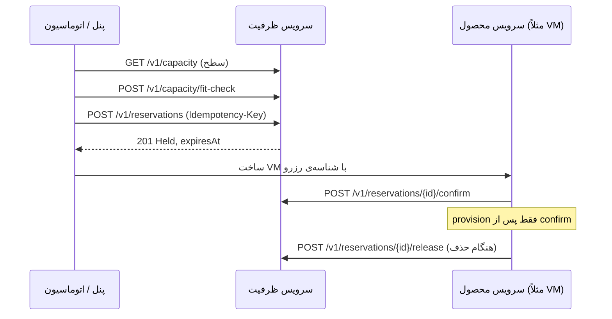

# API مشتری

این‌ها endpointهایی هستند که **پنل مشتری**، اتوماسیون مشتری (Terraform، اسکریپت‌ها) و **سرویس‌های داخلی محصول** صدا می‌زنند. همه‌چیز این‌جا از controllerهای `src/Presentation/Arvan.Capacity.Presentation.Api` آمده است. قرارداد ماشین‌خوان `docs/openapi/capacity.v1.json` است و یک آزمون بررسی می‌کند که با کد مطابقت داشته باشد.

## در یک نگاه

| متد | مسیر | چه کسی | هدف | گروه نرخ |
| --- | --- | --- | --- | --- |
| `GET` | `/v1/capacity` | هر actor | **سطح** ظرفیت برای هر محصول و منطقه | `reads` |
| `POST` | `/v1/capacity/fit-check` | customer، service | آیا این درخواست **همین حالا** جا می‌شود؟ (مشورتی) | `fitcheck` |
| `POST` | `/v1/reservations` | customer، service | **ثبت** یک رزرو (hold) | `submit` |
| `GET` | `/v1/reservations/{id}` | customer، service | خواندن یک رزرو (وضعیت مؤثر) | `reads` |
| `GET` | `/v1/reservations` | customer، service | تاریخچه، جدیدترین اول، با فیلتر و صفحه‌بندی | `reads` |
| `POST` | `/v1/reservations/{id}/confirm` | customer، service | confirm یک hold پیش از انقضا | `transitions` |
| `POST` | `/v1/reservations/{id}/cancel` | customer، service | لغو یک hold یا یک انتظار | `transitions` |
| `POST` | `/v1/reservations/{id}/extend` | customer، service | تمدید یک hold، یک بار | `transitions` |
| `POST` | `/v1/reservations/{id}/release` | **service، admin** | آزاد کردن ظرفیت تخصیص‌یافته پس از حذف یا شکست provisioning | `transitions` |



## قواعد مشترک

### Headerها

| Header | الزامی روی | مقدارها |
| --- | --- | --- |
| `X-Customer-Id` | هر فراخوانی رزرو و fit-check | شناسه‌ی مشتری که gateway احراز هویت کرده |
| `X-Actor-Kind` | هر فراخوانی | `Customer`، `Service`، `Admin` (بدون حساسیت به بزرگی و کوچکی حروف) |
| `X-Actor-Id` | هر فراخوانی | شناسه‌ی کاربر، سرویس یا اپراتور |
| `Idempotency-Key` | هر `POST` که حالت را تغییر می‌دهد | 1 تا 64 کاراکتر، `[A-Za-z0-9_-]` |

- هویت جاافتاده یا بدشکل → `401 identity.missing`. کلید جاافتاده یا بدشکل → `400 idempotency.key_required`.
- actor از نوع `Service` **از طرف** `X-Customer-Id` عمل می‌کند و holdهایش از سهمیه‌ی همان مشتری کم می‌شوند.
- پاسخ replayشده header `Idempotent-Replayed: true` را دارد (ببینید [Idempotency](#08-idempotency)).

### پوشش پاسخ (envelope)

هر پاسخ، موفق یا ناموفق، از همان envelope `ApiResult` استفاده می‌کند.

```json
{
  "isSuccess": true,
  "data": { },
  "error": null,
  "traceId": "4bf92f3577b34da6a3ce929d0e0e4736"
}
```

```json
{
  "isSuccess": false,
  "data": null,
  "error": {
    "code": "validation_failed",
    "message": "…",
    "details": [ { "field": "lines[0].quantity", "code": "GreaterThanValidator", "message": "…" } ]
  },
  "traceId": "4bf92f3577b34da6a3ce929d0e0e4736"
}
```

- نام propertyها **camelCase** است. enumها با **نام عضوشان** منتقل می‌شوند: `Held`، `Vcpu`، `RamMb`، `Wait`.
- `details` فقط برای خطاهای اعتبارسنجی ظاهر می‌شود.
- **رد ذخیره‌شده** (کمبود ظرفیت یا سهمیه) حالت خاصی است: وضعیت `409`/`422` است، `error.code` دلیل را می‌گوید، **و `data` همچنان رزرو ذخیره‌شده را در خود دارد**، تا کلاینت شناسه‌ی آن را داشته باشد.

### Enumها

| نوع | مقدارها |
| --- | --- |
| `ResourceClass` | `Vcpu` (millicore)، `RamMb` (MB)، `DiskGb` (GB)، `Ipv4` (واحد)، `Gpu` (واحد) |
| `ReservationStatus` | `Waiting`، `Held`، `Confirmed`، `Rejected`، `Cancelled`، `Expired` |
| `ShortagePolicy` | `Reject` (پیش‌فرض)، `Wait` |
| `ReasonCode` | `HoldExpired`، `CancelledByClient`، `WaitTimeout`، `QuotaExceeded`، `PoolShareExceeded`، `CapacityTemporarilyUnavailable`، `CapacitySoldOut`، `ExceedsRegisteredCapacity` |
| `CapacityLevel` | `Available`، `Limited`، `Unavailable` |
| `AllocationState` | `Active`، `Released` (فقط روی `Confirmed`) |
| `ReleaseReason` | `ServiceDeleted`، `ProvisioningFailed`، `Reconciled` |

داده‌ی نمایشی: منطقه‌های `ir-thr`، `ir-tbz`، `ir-ahv`، هر کدام با zoneهای `-1` و `-2`؛ محصولات شامل `vm-standard`، `vm-gpu`، `public-ip` هستند.

### شیء رزرو

توسط submit، get، list و هر گذار برگردانده می‌شود.

```csharp
public sealed record ReservationResponse(
    Guid Id,
    ReservationStatus Status,          // the EFFECTIVE status at the moment of reading
    bool Settled,                      // false: past its deadline, final state not yet stored
    ReasonCode? ReasonCode,
    string Product,
    string Region,
    string? Zone,
    IReadOnlyList<ReservationLineResponse> Lines,   // (ResourceClass, Quantity)
    DateTimeOffset? ExpiresAt,         // set while Held
    DateTimeOffset? WaitDeadline,      // set while Waiting
    bool Extended,
    AllocationState? AllocationState,  // set only when Confirmed
    string? ClientReference,
    int Version,                       // +1 on every transition
    DateTimeOffset CreatedAt,
    DateTimeOffset UpdatedAt);
```

---

## ظرفیت

### `GET /v1/capacity` — سطوح ظرفیت

```csharp
[HttpGet] [EnableRateLimiting("reads")]
Task<ActionResult<CapacityLevelsResponse>> GetLevels(
    [FromQuery] string? region, [FromQuery] string? product, [FromQuery] bool detail, CancellationToken ct);
```

```http
GET /v1/capacity?region=ir-thr&product=vm-standard
X-Actor-Kind: Customer
X-Actor-Id: user-42
```

```json
{
  "isSuccess": true,
  "data": {
    "items": [ { "product": "vm-standard", "region": "ir-thr", "level": "Available" } ],
    "asOf": "2026-11-16T10:00:00Z",
    "stale": false,
    "pools": null
  },
  "error": null,
  "traceId": "…"
}
```

| قاعده | |
| --- | --- |
| سطح | بدترین سطح در میان کلاس‌های منبع محصول. `Unavailable` وقتی ظرفیت آزاد مؤثر همه‌جا 0 باشد؛ `Limited` وقتی کمتر از 10% ظرفیت قابل فروش باشد؛ در غیر این صورت `Available` |
| holdهای منقضی‌شده | **آزاد** حساب می‌شوند (ظرفیت آزاد مؤثر) |
| `detail=true` | مقدارهای `sellable`، `held`، `used`، `free` را برای هر pool اضافه می‌کند. **فقط `Service` و `Admin`**؛ مشتری `403` می‌گیرد |
| `stale` | وقتی پایگاه داده در دسترس نیست و پاسخ از cache داده می‌شود، `true` است |

### `POST /v1/capacity/fit-check` — همین حالا جا می‌شود؟

```csharp
[HttpPost("fit-check")] [EnableRateLimiting("fitcheck")]
Task<ActionResult<FitCheckResponse>> FitCheck(FitCheckRequest request, CancellationToken ct);

public sealed record FitCheckRequest(string Product, string Region, string? Zone, IReadOnlyList<FitCheckLineRequest> Lines);
public sealed record FitCheckResponse(bool Fits, ReasonCode? Code, IReadOnlyList<FitCheckLineResponse> Lines);
```

```json
{ "product": "vm-standard", "region": "ir-thr", "zone": null,
  "lines": [ { "resourceClass": "Vcpu", "quantity": 4000 } ] }
```

```json
{ "fits": false, "code": "QuotaExceeded",
  "lines": [ { "resourceClass": "Vcpu", "code": "QuotaExceeded" } ] }
```

> **فقط مشورتی.** سهمیه‌ی فراخواننده را در نظر می‌گیرد اما هرگز نمی‌گوید چقدر آزاد است، و فقط یک hold ظرفیت را تضمین می‌کند. محدودیت نرخ دارد (5/s) تا نشود از آن برای کاوش موجودی دقیق استفاده کرد.

---

## رزروها

### `POST /v1/reservations` — ثبت

```csharp
[HttpPost] [EnableRateLimiting("submit")]
Task<ActionResult<ReservationResponse>> Submit(SubmitReservationRequest request, CancellationToken ct);

public sealed record SubmitReservationRequest(
    string Product, string Region, string? Zone,
    IReadOnlyList<SubmitReservationLineRequest> Lines,   // 1–16 lines, each class once
    ShortagePolicy? OnShortage,                          // Reject (default) or Wait
    string? ClientReference);                            // unique among open + confirmed
```

```http
POST /v1/reservations
X-Customer-Id: cust-001
X-Actor-Kind: Customer
X-Actor-Id: user-42
Idempotency-Key: order-123-submit
Content-Type: application/json
```

```json
{
  "product": "vm-standard",
  "region": "ir-thr",
  "zone": "ir-thr-1",
  "lines": [
    { "resourceClass": "Vcpu",   "quantity": 4000 },
    { "resourceClass": "RamMb",  "quantity": 8192 },
    { "resourceClass": "DiskGb", "quantity": 80 },
    { "resourceClass": "Ipv4",   "quantity": 1 }
  ],
  "onShortage": "Reject",
  "clientReference": "order-123"
}
```

```json
{
  "isSuccess": true,
  "data": {
    "id": "01936c4e-8f0a-7b3e-9a51-2c4d5e6f7a80",
    "status": "Held",
    "settled": true,
    "reasonCode": null,
    "product": "vm-standard",
    "region": "ir-thr",
    "zone": "ir-thr-1",
    "lines": [ { "resourceClass": "Vcpu", "quantity": 4000 }, "…" ],
    "expiresAt": "2026-11-16T10:15:00Z",
    "waitDeadline": null,
    "extended": false,
    "allocationState": null,
    "clientReference": "order-123",
    "version": 1,
    "createdAt": "2026-11-16T10:00:00Z",
    "updatedAt": "2026-11-16T10:00:00Z"
  },
  "error": null,
  "traceId": "…"
}
```

**نتیجه‌ها**

| وضعیت | چه زمانی | `error.code` | ذخیره می‌شود؟ |
| --- | --- | --- | --- |
| `201 Created` + `Location` | همه‌ی خط‌ها hold شدند | | بله |
| `202 Accepted` + `Location` | کمبود موقت و `onShortage: Wait` → `Waiting` | | بله |
| `409` | کمبود فقط به خاطر holdهای باز یا یک pool آفلاین است (+ `Retry-After`) | `capacity.temporarily_unavailable` | بله، `data` = رزرو ردشده |
| `409` | تخصیص‌های زنده آن را پر کرده‌اند | `capacity.sold_out` | بله |
| `409` | سقف قرارداد، با احتساب holdهای باز | `quota.exceeded` | بله |
| `409` | بیش از سهم مشتری از یک pool کمیاب | `capacity.pool_share_exceeded` | بله |
| `422` | بزرگ‌تر از آن‌که هیچ poolی هرگز بتواند فراهم کند | `capacity.exceeds_registered` | بله |
| `400` | شکل body (با `details` فیلدها)، zone نادرست، مقدار نادرست، خط‌های نادرست | `validation_failed`، `reservation.zone_invalid`، `capacity.quantity_not_allowed`، `reservation.lines_invalid` | خیر |
| `422` | محصول ناشناخته یا بازنشسته، یا کلاسی که محصول اجازه نمی‌دهد | `product.not_available` | خیر |
| `409` | `clientReference` قبلاً توسط یک رزرو باز یا confirmشده استفاده شده | `reservation.client_reference_taken` | خیر |
| `429` | سقف hold یا انتظار، cooldown، یا محدودیت نرخ (+ `Retry-After`) | `reservation.hold_limit_reached`، `reservation.cooldown_active`، `rate.limited` | خیر |
| `503` | lock timeout روی یک ردیف داغ (+ `Retry-After: 1`) | `service.unavailable` | خیر، با **همان کلید** retry کنید |

### `GET /v1/reservations/{id}` — خواندن یک رزرو

```csharp
[HttpGet("{id:guid}")] [EnableRateLimiting("reads")]
Task<ActionResult<ReservationResponse>> Get(Guid id, CancellationToken ct);
```

- وضعیت **مؤثر** را برمی‌گرداند: رزرو `Held` که از `expiresAt` گذشته، تا وقتی sweeper آن را ذخیره کند، به‌صورت `Expired` با `settled: false` خوانده می‌شود.
- شناسه‌ی مشتری دیگر → `404` (وجود رزرو هرگز فاش نمی‌شود).

### `GET /v1/reservations` — تاریخچه

```csharp
[HttpGet] [EnableRateLimiting("reads")]
Task<ActionResult<PagedData<ReservationResponse>>> List([FromQuery] ListReservationsRequest request, CancellationToken ct);

public sealed record ListReservationsRequest {
    ReservationStatus[]? Status;   // filter on the effective status
    string? Product; string? Region;
    int PageNumber = 1; int PageSize = 20;
}
```

```http
GET /v1/reservations?status=Held&status=Waiting&region=ir-thr&pageNumber=1&pageSize=20
```

```json
{
  "isSuccess": true,
  "data": {
    "items": [ { "id": "…", "status": "Held", "…": "…" } ],
    "pagination": { "pageNumber": 1, "pageSize": 20, "totalCount": 3,
                    "totalPages": 1, "hasNextPage": false, "hasPreviousPage": false }
  },
  "error": null,
  "traceId": "…"
}
```

جدیدترین اول. فقط رزروهای خودِ فراخواننده.

### `POST /v1/reservations/{id}/confirm`

```csharp
[HttpPost("{id:guid}/confirm")] [EnableRateLimiting("transitions")]
Task<ActionResult<ReservationResponse>> Confirm(Guid id, CancellationToken ct);
```

| وضعیت | چه زمانی |
| --- | --- |
| `200` | `Held` → `Confirmed`، `allocationState: Active`. اگر **از قبل** `Confirmed` باشد هم `200` همراه با منبع فعلی |
| `409 reservation.expired` | `now >= expiresAt`. سرویس محصول **نباید provision کند** |
| `409 reservation.invalid_state_transition` | هر حالت دیگر |
| `404` | رزرو متعلق به فراخواننده نیست |

### `POST /v1/reservations/{id}/cancel`

```csharp
[HttpPost("{id:guid}/cancel")] [EnableRateLimiting("transitions")]
Task<ActionResult<ReservationResponse>> Cancel(Guid id, CancellationToken ct);
```

`Held` یا `Waiting` → `Cancelled`؛ ظرفیت held **بلافاصله** برمی‌گردد. cancel روی `Cancelled` پاسخ `200` همراه با منبع فعلی می‌دهد؛ cancel روی `Confirmed` خطای `409 reservation.invalid_state_transition` است (به‌جایش از release استفاده کنید).

### `POST /v1/reservations/{id}/extend`

```csharp
[HttpPost("{id:guid}/extend")] [EnableRateLimiting("transitions")]
Task<ActionResult<ReservationResponse>> Extend(Guid id, CancellationToken ct);
```

TTL محصول را **یک بار** به `expiresAt` اضافه می‌کند، با سقف `created + 2 × ttl + wait_max`. تمدید دوم → `409`. تمدید یک hold منقضی‌شده → `409 reservation.expired`.

### `POST /v1/reservations/{id}/release` — فقط سرویس‌های محصول

```csharp
[HttpPost("{id:guid}/release")] [EnableRateLimiting("transitions")]
Task<ActionResult<ReservationResponse>> Release(Guid id, ReleaseReservationRequest request, CancellationToken ct);

public sealed record ReleaseReservationRequest(ReleaseReason Reason);  // ServiceDeleted | ProvisioningFailed | Reconciled
```

```json
{ "reason": "ServiceDeleted" }
```

| وضعیت | چه زمانی |
| --- | --- |
| `200` | `Confirmed` + `Active` → `allocationState: Released`؛ `used` کم می‌شود. تکرار آن همان نتیجه را برمی‌گرداند؛ ظرفیت **یک بار** برمی‌گردد |
| `403 actor.not_allowed` | با `X-Actor-Kind: Customer` فراخوانی شده |
| `409` | رزرو `Confirmed` نیست |

---

## کدهای خطا (سمت مشتری)

| HTTP | `error.code` | معنا |
| --- | --- | --- |
| 400 | `idempotency.key_required` | `Idempotency-Key` جاافتاده یا بدشکل |
| 400 | `validation_failed` | شکل body؛ `details` هر فیلد را فهرست می‌کند |
| 400 | `reservation.lines_invalid`، `reservation.zone_invalid`، `capacity.quantity_not_allowed`، `reservation.client_reference_invalid` | اعتبارسنجی دامنه |
| 401 | `identity.missing` | headerهای هویت جاافتاده یا بدشکل |
| 403 | `actor.not_allowed` | این نوع actor اجازه‌ی این کار را ندارد |
| 404 | `reservation.not_found` | شناسه‌ی ناشناخته، یا متعلق به مشتری دیگر |
| 409 | `reservation.invalid_state_transition` | رویداد در حالت مؤثر فعلی مجاز نیست |
| 409 | `reservation.expired` | confirm یا extend پس از `expiresAt` |
| 409 | `reservation.already_extended` | تمدید دوم |
| 409 | `reservation.client_reference_taken` | reference در حال استفاده است |
| 409 | `capacity.temporarily_unavailable`، `capacity.sold_out`، `capacity.pool_share_exceeded`، `quota.exceeded` | ردهای ذخیره‌شده |
| 422 | `capacity.exceeds_registered` | رد ذخیره‌شده: هرگز جا نمی‌شود |
| 422 | `idempotency.key_reused` | همان کلید، درخواست متفاوت |
| 422 | `product.not_available` | محصول ناشناخته یا بازنشسته، یا کلاسی که اجازه نمی‌دهد |
| 429 | `rate.limited`، `reservation.hold_limit_reached`، `reservation.cooldown_active` | آهسته‌تر (`Retry-After`) |
| 503 | `service.unavailable` | lock timeout یا failover؛ با همان کلید retry کنید (`Retry-After`) |

## محدودیت‌های نرخ

| گروه | نرخ پرشدن | burst | endpointها |
| --- | --- | --- | --- |
| `submit` | 10 / s | 20 | submit |
| `fitcheck` | 5 / s | 10 | fit-check |
| `reads` | 50 / s | 100 | capacity، get، list |
| `transitions` | 20 / s | 40 | confirm، cancel، extend، release |

برای هر مشتری، برای هر instance از API. جزئیات در [محدودیت نرخ و انصاف](#09-rate-limits-fairness).
