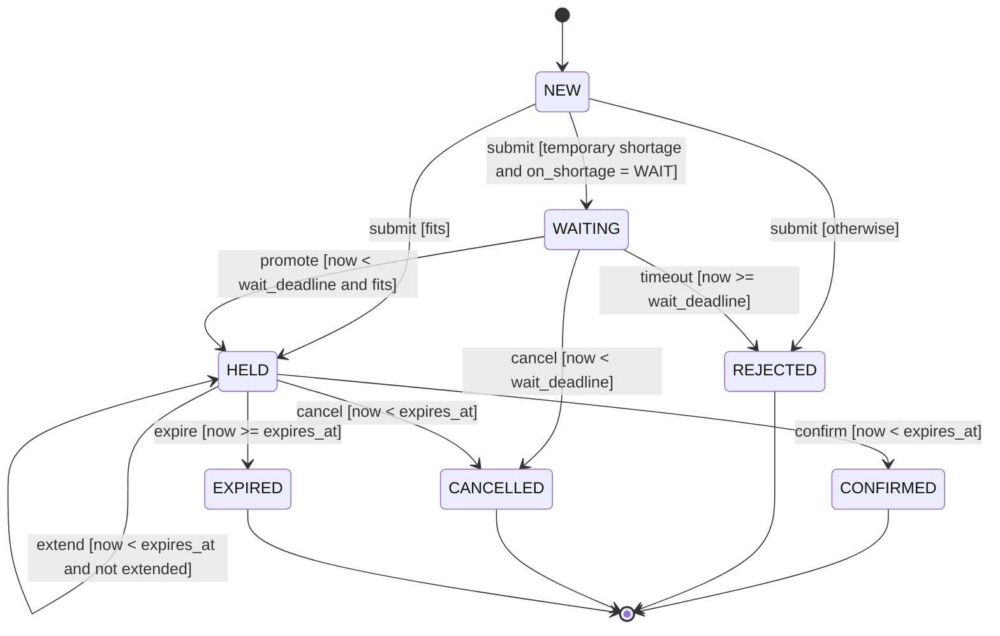

# Spec 02 — Request State Machine

A deterministic finite automaton over reservation states. Related: [ADR-0022](../adr/0022-two-state-machines-effective-state.md), [ADR-0005](../adr/0005-synchronous-hold-with-lease.md), [spec 03](03-resource-state-machine.md).

## 1. States

| State | Kind | Stored | Deadline | Holds capacity |
| --- | --- | --- | --- | --- |
| `NEW` | Start | No | — | No |
| `WAITING` | Intermediate | Yes | `wait_deadline` | No |
| `HELD` | Intermediate | Yes | `expires_at` | Yes (`held`) |
| `CONFIRMED` | Final | Yes | — | Yes (`used`, until release) |
| `REJECTED` | Final | Yes | — | No |
| `CANCELLED` | Final | Yes | — | No |
| `EXPIRED` | Final | Yes | — | No |

`NEW` exists only inside the submit transaction. `CONFIRMED` is final for the request; the life of the allocated capacity, including release, belongs to the [resource state machine](03-resource-state-machine.md) and is tracked by `allocation_state`.

## 2. Diagram

## 3. Transition table

`now` is the database transaction timestamp. Every row not in this table is illegal.

| From | Event | Guard | To | Actor | Capacity effect | Reason code |
| --- | --- | --- | --- | --- | --- | --- |
| NEW | submit | All lines and quotas fit | HELD | API | AVAILABLE → HELD per line | — |
| NEW | submit | Shortage is `CAPACITY_TEMPORARILY_UNAVAILABLE` only, `on_shortage = WAIT`, waiting limit not reached | WAITING | API | None | — |
| NEW | submit | Otherwise | REJECTED | API | None | Shortage, quota or fairness code |
| WAITING | promote | `now < wait_deadline` and all lines fit | HELD | Sweeper | AVAILABLE → HELD per line | — |
| WAITING | cancel | `now < wait_deadline` | CANCELLED | Customer, service | None | `CANCELLED_BY_CLIENT` |
| WAITING | timeout | `now >= wait_deadline` | REJECTED | Sweeper, inline finalizer | None | `WAIT_TIMEOUT` |
| HELD | extend | `now < expires_at` and `extended = false` | HELD | Customer, service | None | — |
| HELD | confirm | `now < expires_at` | CONFIRMED | Customer, service | HELD → ALLOCATED per line | — |
| HELD | cancel | `now < expires_at` | CANCELLED | Customer, service | HELD → AVAILABLE (or OFFLINE) | `CANCELLED_BY_CLIENT` |
| HELD | expire | `now >= expires_at` | EXPIRED | Sweeper, inline finalizer | HELD → AVAILABLE (or OFFLINE) | `HOLD_EXPIRED` |

## 4. Determinism

- **Disjoint guards.** For each (state, event) pair the guards partition the input space; exactly one row applies.
- **Deadline split.** Each intermediate state's deadline splits time in two. Before it, only client events (`confirm`, `cancel`, `extend`) and `promote` are legal. After it, only the timer event (`expire`, `timeout`). A client event and the timer can never both be legal at the same instant.
- **Termination.** Both intermediate states have deadlines, so every request reaches a final state. Worst case with default policy: 15 minutes waiting, 15 minutes held, one 15-minute extension — 45 minutes.

## 5. Effects of every transition

Each transition is one transaction that:

1. Updates the reservation row with a version check (`version = version + 1`).
2. Applies the capacity effect through `ICapacityLedger` and writes one `ledger_entries` row per line ([spec 04](04-capacity-allocation.md)).
3. Appends one `reservation_events` row with `from_status`, `to_status`, `event`, actor and reason ([spec 08](08-events.md)).
4. Completes the idempotency key, when the call carried one ([spec 06](06-idempotency.md)).

## 6. Extension

`expires_at = expires_at + hold_ttl_seconds`, capped at `created_at + 2 × hold_ttl_seconds + wait_max_seconds`. `extended = true`. A second extend → `409 INVALID_STATE_TRANSITION`.

## 7. Repeated and illegal events

| Situation | Response |
| --- | --- |
| Same event repeated with the same idempotency key | Stored response replayed |
| Event that already produced the current final state (confirm on CONFIRMED, cancel on CANCELLED) with a new key | `200` with the current resource |
| Confirm or extend on effective `EXPIRED` | `409 RESERVATION_EXPIRED` |
| Any other illegal pair | `409 INVALID_STATE_TRANSITION`, body includes the effective status |

## 8. Implementation

- `RequestStateMachine` in the domain holds the table above as data. `Reservation` methods consult it.
- A domain test enumerates every (state, event) pair and checks it against the table: legal pairs produce the listed target, every other pair returns `INVALID_STATE_TRANSITION`.
- The use case locks the reservation row (`FOR UPDATE`) before calling the domain, so the decision and the write cannot interleave with another transition ([architecture §8.1](../architecture/backend-architecture.md#81-rules-on-one-aggregate-domain-on-a-locked-row)).
