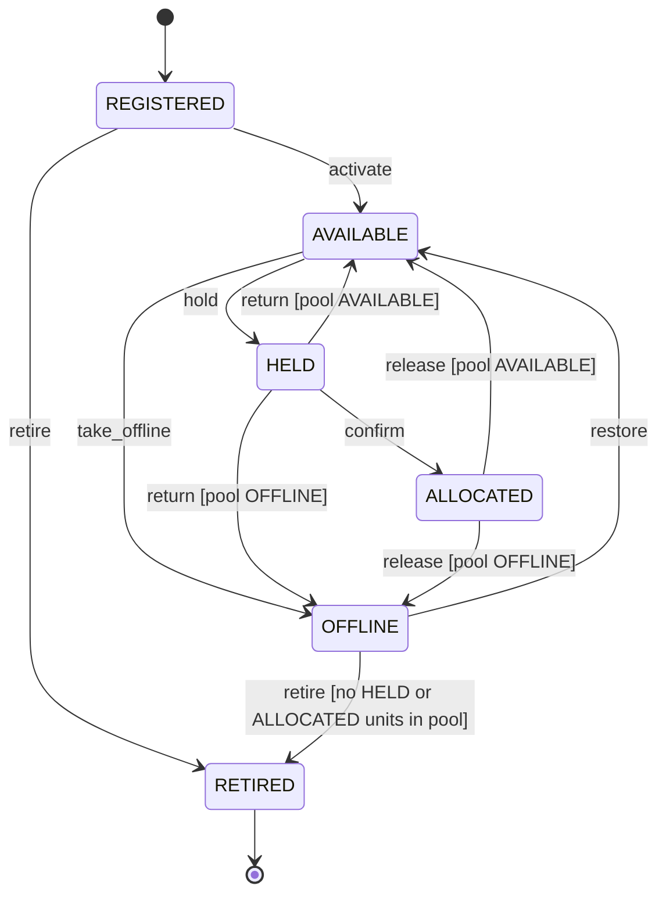

# Spec 03 — Resource State Machine

A deterministic finite automaton over one **sellable capacity unit**: one millicore of vCPU, one megabyte of RAM, one gigabyte of disk, one IPv4 address, one GPU. Units have no rows of their own; each state is a counter, and a transition moves a quantity between two counters in one transaction. Related: [ADR-0022](../adr/0022-two-state-machines-effective-state.md), [ADR-0002](../adr/0002-resource-model.md), [ADR-0003](../adr/0003-ledger-and-counters.md).

## 1. States

| State | Kind | Stored as |
| --- | --- | --- |
| `REGISTERED` | Start | Idle units of a pool whose `admin_state = REGISTERED` |
| `AVAILABLE` | Intermediate | Idle units of a pool whose `admin_state = AVAILABLE` |
| `HELD` | Intermediate | `inventories.held` |
| `ALLOCATED` | Intermediate | `inventories.used` |
| `OFFLINE` | Intermediate | Idle units of a pool whose `admin_state = OFFLINE` |
| `RETIRED` | Final | Idle units of a pool whose `admin_state = RETIRED` |

Idle units of a pool = `sellable − held − used`, where `sellable = floor((total − reserved) × allocation_ratio)`. Idle units are in exactly one of REGISTERED, AVAILABLE, OFFLINE or RETIRED, decided by the pool's admin state.

## 2. Diagram

## 3. Transition table

| From | Event | Guard | To | Trigger | Counter change |
| --- | --- | --- | --- | --- | --- |
| REGISTERED | activate | Admin confirmed the capacity | AVAILABLE | Admin | Pool `admin_state` |
| REGISTERED | retire | — | RETIRED | Admin | Pool `admin_state` |
| AVAILABLE | hold | A request reached HELD | HELD | Request DFA | `held += q` |
| AVAILABLE | take_offline | Pool went offline | OFFLINE | Admin or health check | Pool `admin_state` |
| HELD | confirm | Request reached CONFIRMED | ALLOCATED | Request DFA | `held −= q; used += q` |
| HELD | return | Request reached CANCELLED or EXPIRED; pool AVAILABLE | AVAILABLE | Request DFA | `held −= q` |
| HELD | return | Same; pool OFFLINE | OFFLINE | Request DFA | `held −= q` |
| ALLOCATED | release | Service deleted, provisioning failed, or reconciler found an orphan; pool AVAILABLE | AVAILABLE | Product service, reconciler | `used −= q` |
| ALLOCATED | release | Same; pool OFFLINE | OFFLINE | Product service, reconciler | `used −= q` |
| OFFLINE | restore | Pool is healthy again | AVAILABLE | Admin or health check | Pool `admin_state` |
| OFFLINE | retire | `held = 0 and used = 0` for every class in the pool | RETIRED | Admin | Pool `admin_state` |

`hold`, `confirm` and `return` have no independent entry point; they are outputs of the request DFA. The resource DFA's own events are `activate`, `take_offline`, `restore`, `retire` and `release`.

## 4. Rules

- **Only idle units change admin state.** Taking a pool offline does not touch held or allocated units; they finish their own cycle and land in OFFLINE when returned or released.
- **No hold on a non-AVAILABLE pool.** The hold `UPDATE` requires the pool's `admin_state = AVAILABLE` ([spec 04 §4](04-capacity-allocation.md#4-hold-transaction)).
- **Shrinking capacity.** Lowering `total`, raising `reserved` or lowering `allocation_ratio` so that `sellable < held + used` is rejected by the `CHECK` constraint. With `force = true` the admin API instead sets the pool OFFLINE, applies the change once `held + used` fits, and reports progress ([spec 09](09-admin-api.md)).
- **Release is per reservation, not per unit.** It acts on the reservation's `allocation_state`; repeating it has no effect ([D-5](../edge-cases/edge-cases.md#7-data-model-and-access)).

## 5. Synchronisation with the request DFA

- Every request transition and its resource transition are written in the same transaction; stored states of the two machines never disagree.
- Invariants checked by the reconciliation job ([spec 09](09-admin-api.md#6-reconciliation-report)):
  - `inventories.held` = sum of line quantities of reservations stored as `HELD` on that pool and class.
  - `inventories.used` = sum of line quantities of `CONFIRMED` reservations with `allocation_state = ACTIVE` on that pool and class.
  - Each counter = sum of the matching `ledger_entries` deltas.

## 6. Effective state on read

A unit counted in `held` for a reservation whose `expires_at` has passed is effectively AVAILABLE (or OFFLINE) before the sweeper stores the return. Capacity reads count it as free; the hold path finalizes it before retrying ([spec 05](05-expiry-and-effective-state.md)).
